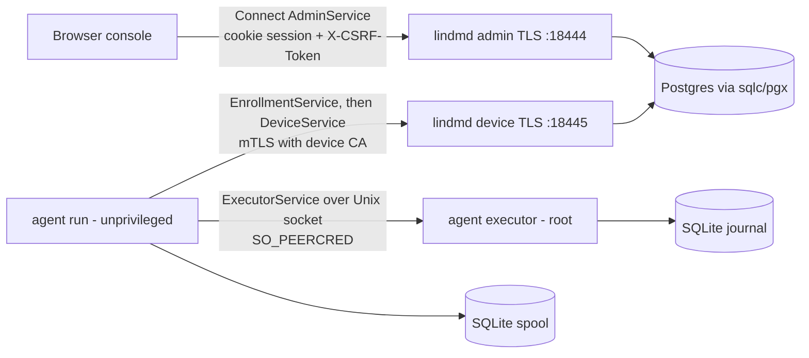

# Repository Guidelines

## Project Overview

lindm is a self-hosted, single-tenant Linux device management (MDM) system. It is desktop-first but also manages servers, and it supports both connected and air-gapped sites. It is not production-ready. It has three parts:

- **`lindmd`**: a Go control-plane server using Postgres, OIDC through Keycloak, and Connect RPC.
- **`lindm-agent`**: a Linux-only agent split into a root executor and an unprivileged network process.
- **Web console**: a React app built by Vite and embedded into `lindmd`.

The documents in `docs/*.md` are the delivery contract. `docs/engineering.md` is binding: read §1–5 before making non-trivial changes.

Any change touching distribution-specific behavior must update the matching
`docs/platforms/` page in the same change, including implementation quirks, native
prerequisites and qualification limits; link new qualification claims to evidence
in `docs/verification.md`.

## Architecture & Data Flow

The codebase is a modular Go monolith in a single module named `lindm`. Postgres is both the authoritative store and the work queue.



- `cmd/*` packages only compose and start things. The composition root is `internal/server/server.go`. It sets up the pgxpool, calls `db.Check`, and builds the identity, executionauthority and device services. It also creates two muxes, admin and device, with TLS 1.3, a 256-slot in-flight guard and a 30s request timeout.
- Domains: `internal/identity` (OIDC PKCE admin sessions), `internal/device` (composes the Admin/Enrollment/Device handlers from `device/{core,dispatch,secrets,inventory,directory,assistance}`), `internal/executionauthority` (quorum-signed trust store) and `internal/policy` (service profiles). Each domain owns its own sqlc package: `identitydb`, `devicedb`, `authoritydb`, `profiledb`.
- On the agent, the root executor holds the identity keys, trust and journal. The unprivileged process does only transport.
- Migrations run only through `lindmd migrate`, which takes an advisory lock. `serve` never runs DDL; `db.Check` requires that exactly the expected set of migrations has been applied.
- Protobuf is the only schema for both APIs and config. Config files are strict protobuf JSON (unknown fields are rejected), loaded by `internal/config` (`Document.Resolve()` → `Resources`).

## Key Directories

| Path                                                               | Purpose                                                                                                                                                                                                       |
| ------------------------------------------------------------------ | ------------------------------------------------------------------------------------------------------------------------------------------------------------------------------------------------------------- |
| `cmd/lindmd`                                                       | Server CLI: `serve`, `migrate`, `bootstrap-owner`, `check-config` (all take `-config FILE`)                                                                                                                   |
| `cmd/lindm-agent`                                                  | Agent CLI: `executor` (root), `run` (network)                                                                                                                                                                 |
| `cmd/dev`                                                          | Landing tool: `land`, `gate-commit`, `status`, `protect`, `worktree add\|list\|audit\|prune`. Imports no product code (test-enforced), so it works while the shared tree is broken; run it from your worktree |
| `cmd/devenv`                                                       | Dev environment: `init`, `up`, `check`, `trust`, `test-integration [-code DIR]`, `down`, `reset -confirm-delete`, `signoff`, `pre-push`, `generate-docs`, `gc`. State lives in `.cache/dev`                   |
| `cmd/lab`                                                          | VM/native lab: `packages`, `auth`, `profiles`, `native`, `vm`, `images`, `guest`, `matrix` (platform × cell ledger, `lab/matrix.json`)                                                                        |
| `internal/agent/*`                                                 | `executor`, `journal`, `spool`, `localrpc`, `serviceprovider` (systemd), `inventory`, `enrollment`                                                                                                            |
| `internal/{trust,pki}`                                             | Trust and certificate handling                                                                                                                                                                                |
| `internal/{vmlab,devlab}`                                          | Lab and dev-fixture logic                                                                                                                                                                                     |
| `internal/testdb`                                                  | Disposable Postgres schemas for integration tests                                                                                                                                                             |
| `internal/packaging/assets`                                        | Real packaging assets. Top-level `packaging/` holds only empty directories                                                                                                                                    |
| `api/lindm/<domain>/v1`                                            | `.proto` sources. Shared validation rules are in `api/lindm/validation/v1`                                                                                                                                    |
| `db/migrations`, `db/queries/<domain>`                             | goose SQL migrations (`000NN_name.sql`) and sqlc queries                                                                                                                                                      |
| `gen/`, `web/gen/`, `internal/**/*db/`, `web/src/routeTree.gen.ts` | **Generated and committed. Never hand-edit**                                                                                                                                                                  |
| `web/src`                                                          | Console: `app/`, `routes/` (thin), `features/<domain>/`, `components/{ui,layout}`, `lib/`, `styles/`                                                                                                          |
| `deploy/dev/compose.yml`                                           | Postgres 18.6 on `:15432` and Keycloak 26.7 on `:18443`. Driven only via `cmd/devenv`                                                                                                                         |
| `lab/images/*.json`                                                | Pinned, signed cloud-image manifests                                                                                                                                                                          |

## Development Commands

```sh
make bootstrap        # pinned tools into .tools/bin, npm ci --ignore-scripts, git hooks
make generate         # buf generate + sqlc generate (CI fails if the output differs from what is committed); fails by design in the read-only shared checkout, so run it in your worktree
make fmt              # format everything
make lint             # prettier, markdownlint, eslint, tsc, buf lint/format, golangci-lint
make test             # builds web assets, then go test -race -timeout 45m ./cmd/... ./db/... ./gen/... ./internal/... ./web/...
make check            # default target: lint + test + audit (npm audit + govulncheck)
make test-integration # dev-up, then go run ./cmd/devenv test-integration (real Postgres)
make signoff          # local CI: clean worktree of the pushed HEAD runs check + test-integration (shared fixture), then gh signoff create --commit SHA unit integration
go run ./cmd/dev worktree add NAME [-base REV]   # private worktree in ../lindm.worktrees/NAME; prints the path
go run ./cmd/dev worktree list | prune -dry-run   # status; prune clean merged unused trees (-archive-dirty archives the rest first)
go run ./cmd/devenv gc [-dry-run]   # reclaim disk (old build cache, finished matrix inputs, landed worktrees, stale lab runs, unreferenced lab images, invalid dev databases); dev land runs it under 200 GiB free
make build            # artifacts/bin/{lindmd,lindm-agent,lab}
make dev-up && go run ./cmd/lindmd serve -config .cache/dev/server.json   # console at https://localhost:18444
make dev-down
npm run build:web | typecheck:web | lint:web
go test -race ./internal/agent/inventory ./internal/trust   # focused run
```

Only one checkout can run the dev lab at a time, because it uses fixed ports.

## Code Conventions & Common Patterns

**Go**: follow the Google Go style guide. Lint config: golangci v2 standard linters plus `bodyclose` and `sqlclosecheck`, with errcheck also checking type assertions. Formatting: goimports with local prefix `lindm`.

- Every package has a doc comment that states its boundaries and non-goals.
- Dependency injection is constructor-only, e.g. `New(ctx, pool, Config) (*Service, error)`. Constructors validate every dependency and return errors such as `errors.New("device: ...")`. Use concrete types; add interfaces only at real consumer or test boundaries, and assert compliance with `var _ X = (*T)(nil)`. No globals or hidden state.
- Test seams are injected through options and a `clock func() time.Time`.
- Errors:
  - Wrap with `fmt.Errorf("verb noun: %w", err)`.
  - In deferred Close, use a named return combined with `errors.Join`.
  - Sentinel errors carry snake_case reasons, e.g. `errors.New("recovery_hold")`.
  - RPC errors use `rpcError(code, reason)`, which sets `Lindm-Reason` metadata.
  - No panics for routine failures. No ignored errors, and no blanket `nolint`.
- Context:
  - `main` uses `signal.NotifyContext`.
  - Use explicit `context.WithTimeout` on startup, RPC calls and probes.
  - Every goroutine has a bounded lifetime (a cancel func plus a done channel).
- Bound everything: message sizes, in-flight slots, page and batch sizes, subprocess output. Stream data rather than loading it all.
- Logging uses `log/slog` with key/value pairs (JSON handler in `lindmd`).
- Keep layers separate: transport/auth, domain, SQL, reconciliation and OS providers. Business authorization must not live only in middleware.
- Validation uses only `buf.validate`/CEL in the protos. No parallel Go structs and no handwritten field bounds.
- Database URLs require `sslmode=verify-full`, and `PG*` environment variables are rejected.
- Linux-only code uses the `_linux.go` suffix or `//go:build linux`.
- Generated packages get import aliases: `adminv1`, `devicev1connect`, etc.
- Banned: ORMs and generic repository layers, workflow DSLs, homegrown crypto/PKI, plugin SDKs, and `x/crypto/openpgp`.

**TypeScript/React**:

- **Console design:** [docs/design.md](docs/design.md) is binding for console changes,
  including AI-generated UI. The owner accepted it as the console design standard
  on 2026-10-12. Read it before changing screens or shared components.
  Every console landing note must report its **Required design review** checklist:
  decision, evidence, restraint, safety, craft and human editing, with pass / needs
  owner decision / not applicable (reason) for each. Include before/after light/dark
  desktop/mobile screenshots, `make ui-review` evidence and unresolved owner
  annotations as tasks. Automated green is not owner design approval.
- Stack: React 19, TanStack Router (file-based) and Query, Connect-ES, shadcn and Tailwind 4. The alias `@/` maps to `web/src`. Prettier uses `printWidth` 100.
- ESLint enforces import boundaries:
  - `components/`, `lib/` and `hooks/` must not import `features/`, `app/` or `routes/`.
  - Features never import each other; they are combined only in `routes/`.
- Use the single `adminClient` (`lib/rpc.ts`), which has a CSRF interceptor. Use only generated API types.
- Queries:
  - Each feature defines factories named `xxxQueryOptions(lifetime, ...)`.
  - `queryKey` includes `lifetime.generation`.
  - Pass the abort signal as `AbortSignal.any([signal, lifetime.signal])`.
- On an Unauthenticated error, `app/query.ts` clears the cache and the CSRF token, then navigates to `/`.
- Normalize errors with `toRpcFailure` (`lib/errors.ts`). Its `ambiguous` flag means: retry with the same request ID.
- Never retry mutations. Secrets (e.g. enrollment) never go into the cache, storage or URLs.

## Important Files

- `docs/engineering.md`: binding standards.
- `docs/architecture.md`, `docs/agent-enrollment.md`, `docs/verification.md`, `docs/implementation-plan.md`.
- `internal/server/server.go`, `cmd/lindmd/main.go`, `cmd/lindm-agent/`.
- `Makefile`, `buf.yaml`, `buf.gen.yaml`, `sqlc.yaml`, `.golangci.yml`, `eslint.config.mjs`, `.lintstagedrc.mjs`.
- `db/migrate.go`, `web/embed.go` (`go:embed all:dist`), `.github/workflows/check.yml`.

## Runtime/Tooling Preferences

- Go 1.26.9 (`GOTOOLCHAIN` is pinned in the Makefile). Node 24.21.0 (`.node-version`) with **npm**, exact dependency versions and ESM.
- Use the tools in `.tools/bin` (golangci-lint, buf, sqlc, …) instead of system copies.
- Hooks: pre-commit runs lint-staged; pre-push (`make pre-push`) runs `make check` in a clean worktree of each pushed SHA, skipping SHAs that already have a green `signoff/unit`. Enable them with `npm run hooks:install`.
- To change the API or SQL: edit the `.proto` files or `db/queries`/`db/migrations`, run `make generate`, and commit the generated output. `dev land` treats buf/sqlc output (the `out` directories of `buf.gen.yaml` and `sqlc.yaml`: `gen/`, `web/gen/`, `internal/**/*db/`) as derived: it applies your change without it and reruns `make generate-code` in the shared checkout under the landing lock, so two proto/SQL landings compose instead of conflicting on each other's generated files. Your worktree's own generated output never lands, so hand edits there are lost (they were already banned).
- Never commit `.cache/dev` (it holds secrets).
- Private lindm worktrees: create them only with `go run ./cmd/dev worktree add NAME`; they live in `~/dev/minor/lindm.worktrees/NAME` and get their own `node_modules` (a hardlinked copy when the lockfile matches main, otherwise `npm ci --prefer-offline`). Never symlink `node_modules` into the shared checkout; `go run ./cmd/dev worktree own-node-modules` migrates old symlinked trees. Clean up with `go run ./cmd/dev worktree prune` (it never removes a tree in use or unmerged work without `-archive-dirty`, which archives to `~/.cache/lindm-worktree-archive`). `~/dev/minor/clones` is only for third-party source clones.

## Testing & QA

- Go tests use only the stdlib `testing` package (no testify or go-cmp). Tests are white-box, in the same package, with shared helpers in `fixture_test.go`.
- Integration tests:
  - Files are named `*_integration_test.go` and tagged `//go:build integration`.
  - Each test gets a fresh schema via `pool, conn := testdb.Open(t)`.
  - Without `LINDM_TEST_DATABASE_URL_FILE` (an owner-only DSN file; never put the DSN in argv or the environment) they fail rather than skip. Run them with `make test-integration`.
- Root, namespace or capability tests in `internal/agent` call `t.Skip` when not running as root or on EPERM. Some re-exec the test binary, gated by env vars (e.g. `LINDM_SNAPSHOT_REEXEC`).
- The web code has no unit tests. It is gated by eslint (`--max-warnings=0`), `tsc` and prettier.
- There is no coverage percentage target. Rules:
  - Every bug fix needs a deterministic regression test when practical.
  - Tests check consumer-visible behavior, boundaries, authority and durability. Never test source text, mock echoes or tooling glue.
  - Poll with deadlines instead of sleeping.
  - Do not mock OS package transactions or OIDC in tests that claim to cover them.
- Rules from `docs/verification.md`: a skipped test is not a pass, and VM results do not count as physical validation.
- Landing in the shared checkout: work and gate in a private worktree, rebase it onto `main`, then land **only** with `go run ./cmd/dev land -from ~/dev/minor/lindm.worktrees/NAME -m "descriptive message" [-paths a,b]`. Never copy files into the shared tree by hand. `land` takes the exclusive lock `.git/lindm-landing.lock`. It refuses unless the shared checkout is on `main`, clean and contains its freshly fetched upstream (local gate-commits ahead of it are pushed with the landing). It applies the worktree's whole change against `main` (commits, edits, renames, deletions, untracked files); on conflict nothing is applied, so rebase and retry. It runs the quick gate in the shared tree on the touched files, then commits exactly those files with your message and pushes to `main`'s upstream. Any failure rolls everything back. While it runs, `.git/lindm-landing.current` records the owner, worktree, message and files, so applied files in the shared tree are not stray edits; `go run ./cmd/dev status` (and `worktree audit`) print it with the lock holders. The quick gate:
  - first, the main checkout's `node_modules` is checked with `npm ls` and, when it doesn't match `package-lock.json` or the landing changes `package.json`/`package-lock.json`, reinstalled by a staged `npm ci` that is swapped in atomically
  - then `make generate-code` (buf + sqlc) regenerates the derived directories from `main` plus your change (generated files your worktree deleted are removed first, since sqlc never deletes stale output); every regenerated file is gated and committed with the landing, and a rollback restores the derived directories too
  - generated document regions and the matrix ledger are derived too: your change is applied with every `generate-docs` block (lab matrix table, platform tables) emptied on both sides, `lab/ledger.json` is merged record by record (your added entries appended to `main`'s, your removed ones removed), and `go run ./cmd/devenv generate-docs` refills the blocks; so concurrent ledger landings never conflict on table widths. Any other file the gate changes fails the landing
  - `go build ./...`
  - `.tools/bin/golangci-lint run` on every touched package, for both default and `integration` build tags, and `golangci-lint fmt --diff`
  - `buf format --diff` and `buf lint` if protos changed
  - prettier and markdownlint on touched Markdown/web files
  - a new `db/migrations/NNNNN_*.sql` must be numbered above every migration on `main`; otherwise the landing is refused with the number to rename it to
  - `go run ./cmd/devenv generate-docs -check`, always
  - race tests of the touched packages and of every module package whose build or tests import them, directly or transitively; each test binary gets `-timeout 45m` (the integration lock budget) rather than go test's 10m default, which loaded hosts exceed
  - `make check-web` (`lab acceptance -web-only -engines chromium`: the real browser journey against a freshly built server and console) when the landing touches `web/src` or `web/acceptance`; release acceptance still covers Chromium, WebKit and Firefox
- `go run ./cmd/dev gate-commit -m MSG` is the post-hoc full gate: under the same lock it runs `make check` and commits any remaining change only if green. The parent runs it periodically and reverts or routes anything that breaks `make check`. `go run ./cmd/dev worktree audit` is likewise the parent's periodic job only: landers don't run or broadcast it. It lists only stranded work; PARTIAL/UNLANDED trees that a live owner is working in are hidden unless `-all`.
- The shared checkout's tracked files are read-only (`a-w`) outside landings: an edit or write that a relative path or a tool's default cwd sends there fails at once with EACCES. Redo it with the absolute path of your private worktree; never `chmod` the shared tree. `land` and `gate-commit` restore `u+w` under the lock and protect again however they end (commit, refusal, rollback, failure or interrupt). `go run ./cmd/dev protect` is idempotent and does nothing while a landing holds the lock; the `post-merge` and `post-checkout` hooks run `.githooks/protect` (plain shell, builds nothing) in the main checkout after git rewrites files (a `git pull` recreates them writable), and `dev status` runs it and names any tracked files it found writable. Directories and untracked files stay writable, so `make check`, `acceptance-build`, `check-web`, `signoff` and `pre-push` work there (they write only untracked outputs such as `artifacts/` and `web/dist/`, or use clean worktrees); `make generate` fails there by design. When `land` refuses a dirty shared checkout it lists each file with its mtime and the private worktree whose copy holds the same change (identical file or the same hunks), naming the agent that wrote into the shared tree.
- A change that leaves `make check` red is not landed.
