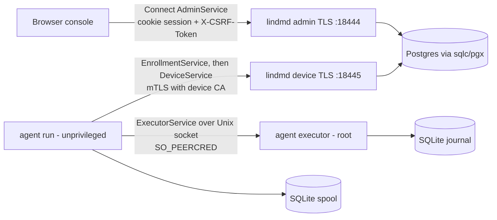

# Repository Guidelines

## Project Overview

lindm is a self-hosted, single-tenant Linux device management (MDM) system. It is desktop-first but also manages servers, and it supports both connected and air-gapped sites. It is not production-ready. It has three parts:

- **`lindmd`**: a Go control-plane server using Postgres, OIDC through Keycloak, and Connect RPC.
- **`lindm-agent`**: a Linux-only agent split into a root executor and an unprivileged network process.
- **Web console**: a React app built by Vite and embedded into `lindmd`.

The documents in `docs/*.md` are the delivery contract. `docs/engineering.md` is binding: read §1–5 before making non-trivial changes.

## Architecture & Data Flow

The codebase is a modular Go monolith in a single module named `lindm`. Postgres is both the authoritative store and the work queue.



- `cmd/*` packages only compose and start things. The composition root is `internal/server/server.go`. It sets up the pgxpool, calls `db.Check`, and builds the identity, executionauthority and device services. It also creates two muxes, admin and device, with TLS 1.3, a 256-slot in-flight guard and a 30s request timeout.
- Domains: `internal/identity` (OIDC PKCE admin sessions), `internal/device` (Admin/Enrollment/Device handlers), `internal/executionauthority` (quorum-signed trust store) and `internal/policy` (service profiles). Each domain owns its own sqlc package: `identitydb`, `devicedb`, `authoritydb`, `profiledb`.
- On the agent, the root executor holds the identity keys, trust and journal. The unprivileged process does only transport.
- Migrations run only through `lindmd migrate`, which takes an advisory lock. `serve` never runs DDL; `db.Check` requires that exactly the expected set of migrations has been applied.
- Protobuf is the only schema for both APIs and config. Config files are strict protobuf JSON (unknown fields are rejected), loaded by `internal/config` (`Document.Resolve()` → `Resources`).

## Key Directories

| Path                                                               | Purpose                                                                                                                            |
| ------------------------------------------------------------------ | ---------------------------------------------------------------------------------------------------------------------------------- |
| `cmd/lindmd`                                                       | Server CLI: `serve`, `migrate`, `bootstrap-owner`, `check-config` (all take `-config FILE`)                                        |
| `cmd/lindm-agent`                                                  | Agent CLI: `executor` (root), `run` (network)                                                                                      |
| `cmd/dev`                                                          | Dev fixture tool: `init`, `up`, `check`, `trust`, `test-integration`, `down`, `reset -confirm-delete`. State lives in `.cache/dev` |
| `cmd/lab`                                                          | VM/native lab: `packages`, `auth`, `profiles`, `native`, `vm`, `images`, `guest`                                                   |
| `internal/agent/*`                                                 | `executor`, `journal`, `spool`, `localrpc`, `serviceprovider` (systemd), `inventory`, `enrollment`                                 |
| `internal/{trust,pki}`                                             | Trust and certificate handling                                                                                                     |
| `internal/{vmlab,devlab}`                                          | Lab and dev-fixture logic                                                                                                          |
| `internal/testdb`                                                  | Disposable Postgres schemas for integration tests                                                                                  |
| `internal/packaging/assets`                                        | Real packaging assets. Top-level `packaging/` holds only empty directories                                                         |
| `api/lindm/<domain>/v1`                                            | `.proto` sources. Shared validation rules are in `api/lindm/validation/v1`                                                         |
| `db/migrations`, `db/queries/<domain>`                             | goose SQL migrations (`000NN_name.sql`) and sqlc queries                                                                           |
| `gen/`, `web/gen/`, `internal/**/*db/`, `web/src/routeTree.gen.ts` | **Generated and committed. Never hand-edit**                                                                                       |
| `web/src`                                                          | Console: `app/`, `routes/` (thin), `features/<domain>/`, `components/{ui,layout}`, `lib/`, `styles/`                               |
| `deploy/dev/compose.yml`                                           | Postgres 18.6 on `:15432` and Keycloak 26.7 on `:18443`. Driven only via `cmd/dev`                                                 |
| `lab/images/*.json`                                                | Pinned, signed cloud-image manifests                                                                                               |

## Development Commands

```sh
make bootstrap        # pinned tools into .tools/bin, npm ci --ignore-scripts, git hooks
make generate         # buf generate + sqlc generate (CI fails if the output differs from what is committed)
make fmt              # format everything
make lint             # prettier, markdownlint, eslint, tsc, buf lint/format, golangci-lint
make test             # builds web assets, then go test -race ./cmd/... ./db/... ./gen/... ./internal/... ./web/...
make check            # default target and pre-push hook: lint + test + audit (npm audit + govulncheck)
make test-integration # dev-up, then go run ./cmd/dev test-integration (real Postgres)
make build            # artifacts/bin/{lindmd,lindm-agent,lab}
make dev-up && go run ./cmd/lindmd serve -config .cache/dev/server.json   # console at https://localhost:18444
make dev-down
npm run build:web | typecheck:web | lint:web
go test -race ./internal/agent/inventory ./internal/trust   # focused run
```

Only one checkout can run the dev lab at a time, because it uses fixed ports.

## Code Conventions & Common Patterns

**Go**: follow the Google Go style guide. Lint config: golangci v2 standard linters plus `bodyclose` and `sqlclosecheck`, with errcheck also checking type assertions. Formatting: goimports with local prefix `lindm`.

- Every package has a doc comment that states its boundaries and non-goals.
- Dependency injection is constructor-only, e.g. `New(ctx, pool, Config) (*Service, error)`. Constructors validate every dependency and return errors such as `errors.New("device: ...")`. Use concrete types; add interfaces only at real consumer or test boundaries, and assert compliance with `var _ X = (*T)(nil)`. No globals or hidden state.
- Test seams are injected through options and a `clock func() time.Time`.
- Errors:
  - Wrap with `fmt.Errorf("verb noun: %w", err)`.
  - In deferred Close, use a named return combined with `errors.Join`.
  - Sentinel errors carry snake_case reasons, e.g. `errors.New("recovery_hold")`.
  - RPC errors use `rpcError(code, reason)`, which sets `Lindm-Reason` metadata.
  - No panics for routine failures. No ignored errors, and no blanket `nolint`.
- Context:
  - `main` uses `signal.NotifyContext`.
  - Use explicit `context.WithTimeout` on startup, RPC calls and probes.
  - Every goroutine has a bounded lifetime (a cancel func plus a done channel).
- Bound everything: message sizes, in-flight slots, page and batch sizes, subprocess output. Stream data rather than loading it all.
- Logging uses `log/slog` with key/value pairs (JSON handler in `lindmd`).
- Keep layers separate: transport/auth, domain, SQL, reconciliation and OS providers. Business authorization must not live only in middleware.
- Validation uses only `buf.validate`/CEL in the protos. No parallel Go structs and no handwritten field bounds.
- Database URLs require `sslmode=verify-full`, and `PG*` environment variables are rejected.
- Linux-only code uses the `_linux.go` suffix or `//go:build linux`.
- Generated packages get import aliases: `adminv1`, `devicev1connect`, etc.
- Banned: ORMs and generic repository layers, workflow DSLs, homegrown crypto/PKI, plugin SDKs, and `x/crypto/openpgp`.

**TypeScript/React**:

- Stack: React 19, TanStack Router (file-based) and Query, Connect-ES, shadcn and Tailwind 4. The alias `@/` maps to `web/src`. Prettier uses `printWidth` 100.
- ESLint enforces import boundaries:
  - `components/`, `lib/` and `hooks/` must not import `features/`, `app/` or `routes/`.
  - Features never import each other; they are combined only in `routes/`.
- Use the single `adminClient` (`lib/rpc.ts`), which has a CSRF interceptor. Use only generated API types.
- Queries:
  - Each feature defines factories named `xxxQueryOptions(lifetime, ...)`.
  - `queryKey` includes `lifetime.generation`.
  - Pass the abort signal as `AbortSignal.any([signal, lifetime.signal])`.
- On an Unauthenticated error, `app/query.ts` clears the cache and the CSRF token, then navigates to `/`.
- Normalize errors with `toRpcFailure` (`lib/errors.ts`). Its `ambiguous` flag means: retry with the same request ID.
- Never retry mutations. Secrets (e.g. enrollment) never go into the cache, storage or URLs.

## Important Files

- `docs/engineering.md`: binding standards.
- `docs/architecture.md`, `docs/agent-enrollment.md`, `docs/verification.md`, `docs/implementation-plan.md`.
- `internal/server/server.go`, `cmd/lindmd/main.go`, `cmd/lindm-agent/`.
- `Makefile`, `buf.yaml`, `buf.gen.yaml`, `sqlc.yaml`, `.golangci.yml`, `eslint.config.mjs`, `.lintstagedrc.mjs`.
- `db/migrate.go`, `web/embed.go` (`go:embed all:dist`), `.github/workflows/check.yml`.

## Runtime/Tooling Preferences

- Go 1.26.9 (`GOTOOLCHAIN` is pinned in the Makefile). Node 24.21.0 (`.node-version`) with **npm**, exact dependency versions and ESM.
- Use the tools in `.tools/bin` (golangci-lint, buf, sqlc, …) instead of system copies.
- Hooks: pre-commit runs lint-staged and pre-push runs `make check`. Enable them with `npm run hooks:install`.
- To change the API or SQL: edit the `.proto` files or `db/queries`/`db/migrations`, run `make generate`, and commit the generated output.
- Never commit `.cache/dev` (it holds secrets). Research clones go in `~/dev/minor/clones`, not in the repo.

## Testing & QA

- Go tests use only the stdlib `testing` package (no testify or go-cmp). Tests are white-box, in the same package, with shared helpers in `fixture_test.go`.
- Integration tests:
  - Files are named `*_integration_test.go` and tagged `//go:build integration`.
  - Each test gets a fresh schema via `pool, conn := testdb.Open(t)`.
  - Without `LINDM_TEST_DATABASE_URL` they fail rather than skip. Run them with `make test-integration`.
- Root, namespace or capability tests in `internal/agent` call `t.Skip` when not running as root or on EPERM. Some re-exec the test binary, gated by env vars (e.g. `LINDM_SNAPSHOT_REEXEC`).
- The web code has no unit tests. It is gated by eslint (`--max-warnings=0`), `tsc` and prettier.
- There is no coverage percentage target. Rules:
  - Every bug fix needs a deterministic regression test when practical.
  - Tests check consumer-visible behavior, boundaries, authority and durability. Never test source text, mock echoes or tooling glue.
  - Poll with deadlines instead of sleeping.
  - Do not mock OS package transactions or OIDC in tests that claim to cover them.
- Rules from `docs/verification.md`: a skipped test is not a pass, and VM results do not count as physical validation.
