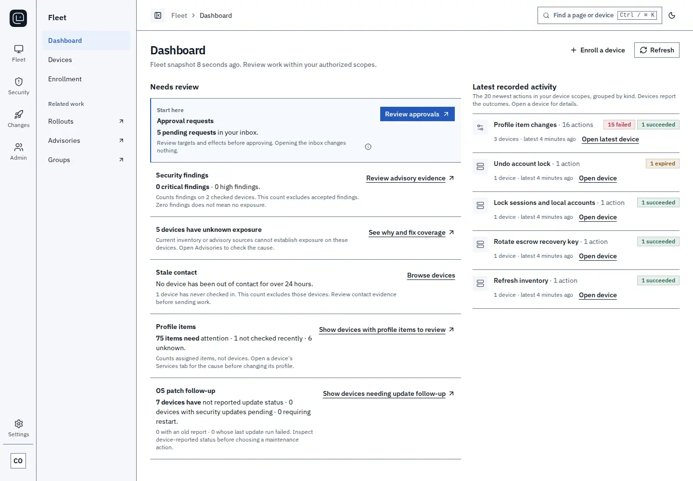
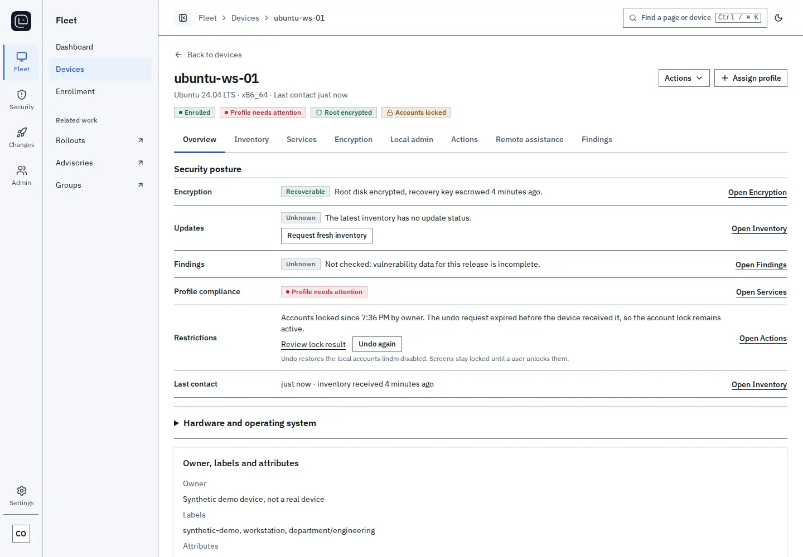
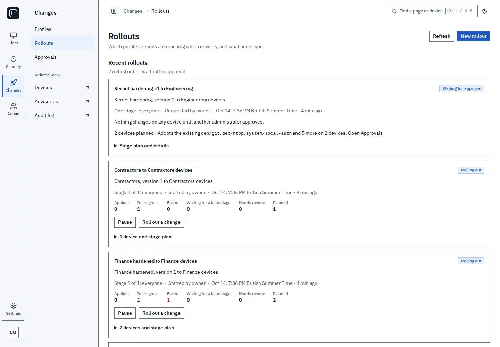
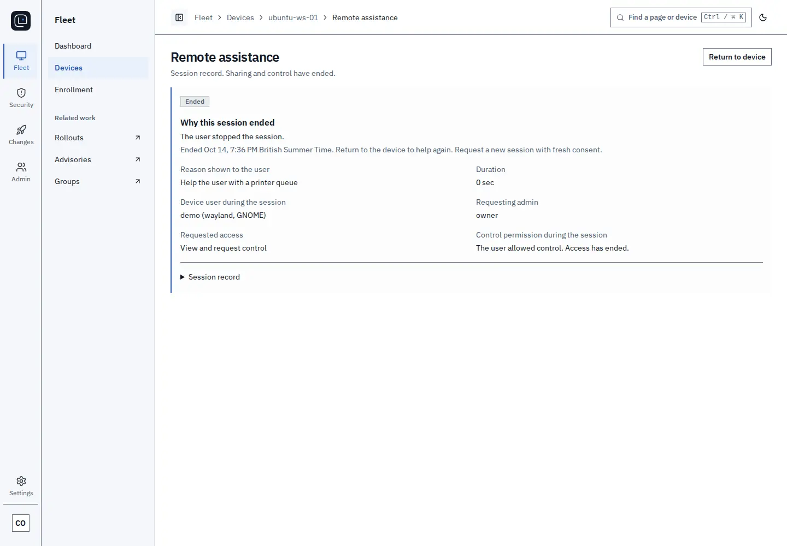

<!-- markdownlint-disable MD041 -->
<!-- The solid brand icon precedes the real Markdown H1. -->


# lindm

[](LICENSE)
[](https://github.com/radkawar/lindm/actions/workflows/check.yml)

lindm is a self-hosted MDM for Linux fleets.
It uses each distribution's native package and system tools. You run the server yourself.

<picture>
  <source media="(prefers-color-scheme: dark)" srcset="docs/images/console-dashboard-dark.webp">
  
</picture>

Screenshots use demo data.

## What it does

- One-line or installer-file enrollment, with agents served by your own server.
- TPM-backed disk encryption with escrowed recovery keys.
- Remote lock, wipe and recovery wipe for lost devices.
- Profiles with staged rollouts and two-person approval.
- Vulnerability findings from vendor advisory feeds.
- OS update windows.
- Browser-based remote assistance with user consent.
- A signed audit log and exports.
- An MCP server for AI assistants.

| Device page                                                                                                                                                                                                                                                     | Rollouts                                                                                                                                                                                                                           | Remote assistance                                                                                                                                                                                                                                   |
| --------------------------------------------------------------------------------------------------------------------------------------------------------------------------------------------------------------------------------------------------------------- | ---------------------------------------------------------------------------------------------------------------------------------------------------------------------------------------------------------------------------------- | --------------------------------------------------------------------------------------------------------------------------------------------------------------------------------------------------------------------------------------------------- |
| <picture><source media="(prefers-color-scheme: dark)" srcset="docs/images/console-device-dark.webp"></picture> | <picture><source media="(prefers-color-scheme: dark)" srcset="docs/images/console-rollouts-dark.webp"></picture> | <picture><source media="(prefers-color-scheme: dark)" srcset="docs/images/console-assistance-dark.webp"></picture> |

## Distributions

| Distribution                                      | Releases                |
| ------------------------------------------------- | ----------------------- |
| [Ubuntu](docs/platforms/ubuntu.md)                | 22.04, 24.04, 26.04 LTS |
| [Debian](docs/platforms/debian.md)                | 12, 13                  |
| [Fedora](docs/platforms/fedora.md)                | 43, 44                  |
| [RHEL](docs/platforms/rhel.md)                    | 9, 10                   |
| [Rocky Linux](docs/platforms/alma-rocky.md)       | 9, 10                   |
| [AlmaLinux](docs/platforms/alma-rocky.md)         | 9, 10                   |
| [Linux Mint](docs/platforms/mint.md)              | 22.3                    |
| [Pop!_OS](docs/platforms/popos.md)                | 24.04 LTS               |
| [Arch Linux](docs/platforms/arch.md)              | Rolling                 |
| [Omarchy](docs/platforms/omarchy.md)              | 4.0.4                   |
| [openSUSE Tumbleweed](docs/platforms/opensuse.md) | Rolling                 |

## Install

Build a release with your own signing keys, then install the bundle on your server.
Installation from a prepared bundle is the five-minute part.
The build takes longer, depending on your machine and network.
See the [installation guide](docs/install.md) for prerequisites and server setup.

1. Install the pinned tools from [CONTRIBUTING](CONTRIBUTING.md), then clone and build:

   ```sh
   git clone https://github.com/radkawar/lindm.git
   cd lindm
   make bootstrap
   make release-keys
   make release
   ```

   Keep the release keys and their encryption passphrase on the signing workstation.
   Read [self-built releases and signing keys](docs/self-built-releases.md) for key custody and public trust files.

2. Copy the verified `artifacts/release/` bundle and public trust files to the server.
   From the bundle directory, run:

   ```sh
   sudo ./install.sh --release-key-file "$TRUSTED_RELEASE_PUBLIC_KEY" \
     --release-key-id "$RELEASE_KEY_ID" --backup-recipient-file "$BACKUP_RECIPIENT_FILE"
   ```

   Supply the stable HTTPS origin when prompted.

3. Trust the deployment CA in your browser, then open the setup URL printed by the installer.
   Read the one-use setup code as root from `/var/lib/lindmd-operations/setup/code`.
   Enter the code, create the owner account and register a user-verifying passkey.

4. In **Settings**, confirm that the agent repository is **Ready**.
   Select **Enroll**, choose the device's operating system and copy the install-and-enroll command.
   Run it on a second device. The console shows the device as **Enrolled**.

## How it works

`lindmd` is a Go server with PostgreSQL as its store and work queue.
It serves the React console and Connect RPC on separate administration and device TLS listeners.
The device agent separates an unprivileged network process from a root executor through a protected Unix socket.
The executor checks signed authority and owns device identity, trust and durable execution state.
See [architecture](docs/architecture.md) for the security boundaries.

## Contribute

See [CONTRIBUTING](CONTRIBUTING.md) for development and DCO sign-off, and the [roadmap](ROADMAP.md) for planned work.
Report vulnerabilities privately through [SECURITY](SECURITY.md).
The [code of conduct](CODE_OF_CONDUCT.md) applies to project discussions.

[Documentation](docs/platforms/README.md) · [Enrollment](docs/agent-enrollment.md) · [Operations](docs/security-and-operations.md) · [Test matrix](docs/verification.md#tier-capability-matrix)

lindm's original code is licensed under [Apache-2.0](LICENSE).
Third-party code and data retain their own licenses. See [NOTICE](NOTICE).
