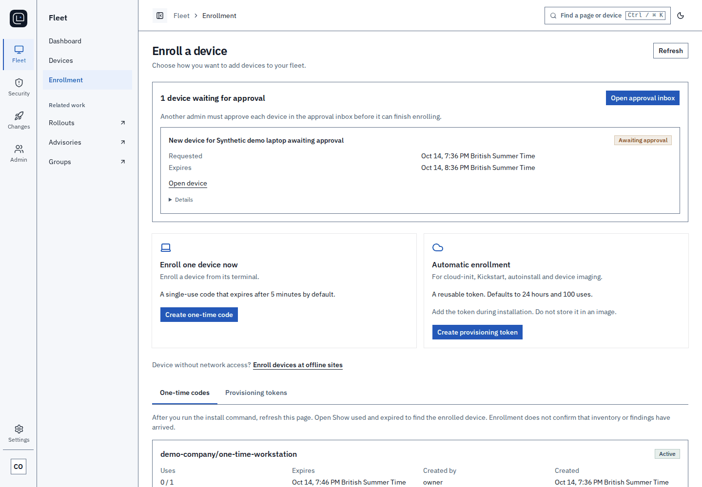
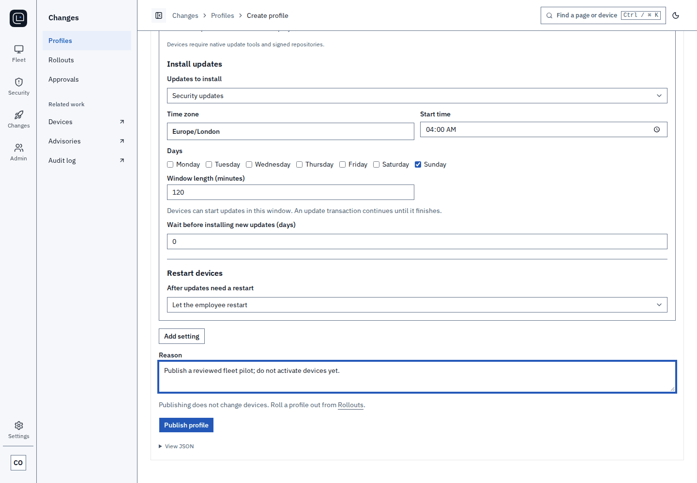
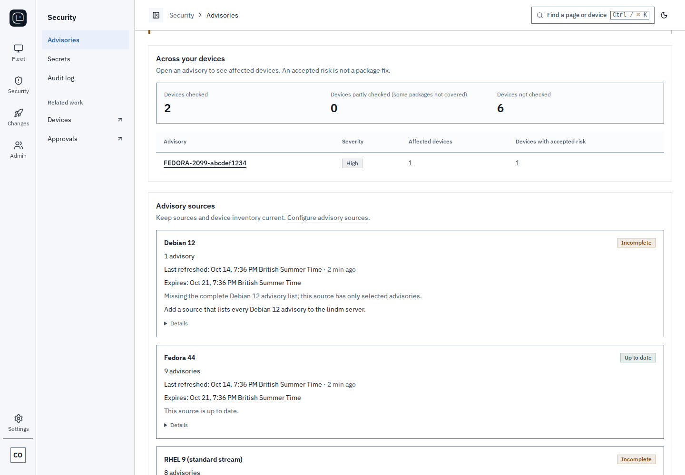
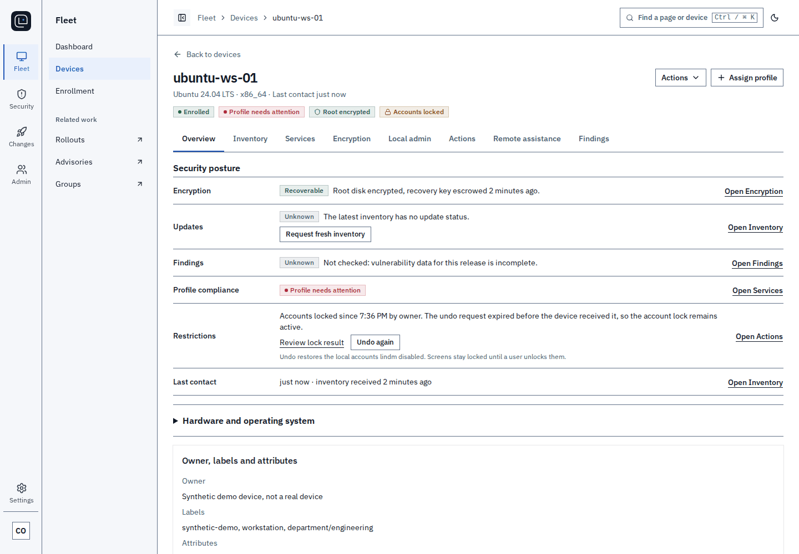
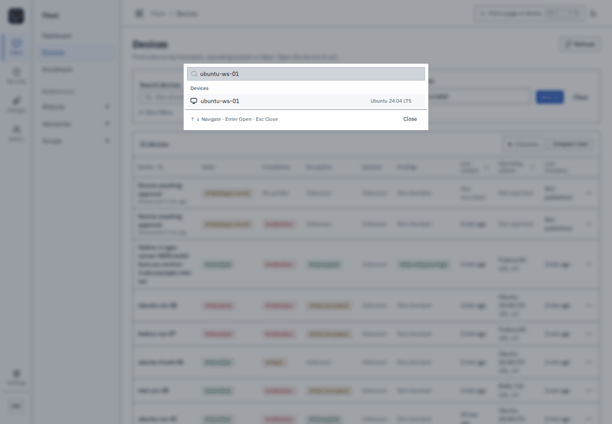
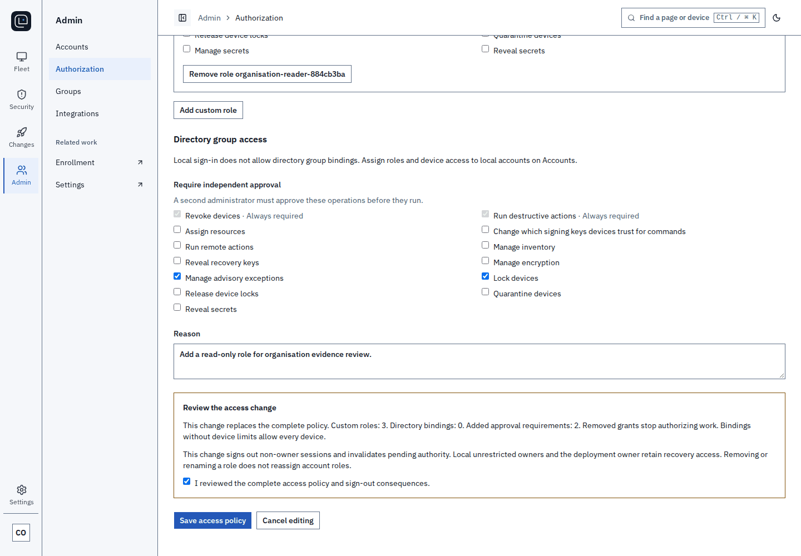

<!-- markdownlint-disable MD041 -->
<!-- The solid brand icon precedes the real Markdown H1. -->


# lindm

[](LICENSE)
[](https://github.com/radkawar/lindm/actions/workflows/check.yml)

lindm is a self-hosted MDM for Linux fleets.
It uses each distribution's native package and system tools. You run the server yourself.

<picture>
  <source media="(prefers-color-scheme: dark)" srcset="docs/images/console-dashboard-dark.webp">
  
</picture>

Screenshots and animations use synthetic demo data.

## What it does

- One-line or installer-file enrollment, with agents served by your own server.
- TPM-backed disk encryption with escrowed recovery keys.
- Remote lock, wipe and recovery wipe for lost devices.
- Profiles with staged rollouts and two-person approval.
- Vulnerability findings from vendor advisory feeds.
- OS update windows.
- Browser-based remote assistance with user consent.
- A signed audit log and exports.
- An MCP server for AI assistants.

### Enroll devices

Choose a distribution, create a one-time code or a bounded provisioning token, and copy the install command.
The device page shows enrollment, inventory and security findings separately.

<picture>
  <source media="(prefers-color-scheme: dark)" srcset="docs/images/flow-enrollment-dark.gif">
  
</picture>

### Configure a fleet

Publish a profile, review the affected devices and roll it out in stages.
Review the pilot's results before advancing to the fleet.

<picture>
  <source media="(prefers-color-scheme: dark)" srcset="docs/images/flow-policy-dark.gif">
  
</picture>

### Review vulnerabilities

Follow an advisory to its affected devices and review the finding before requesting a patch or accepting a risk.

<picture>
  <source media="(prefers-color-scheme: dark)" srcset="docs/images/flow-vulnerability-dark.gif">
  
</picture>

<details>
<summary>Lost devices, remote assistance and administration</summary>

### Respond to a lost device

Find the device, review a lock or wipe request and record the reason.
Destructive actions require independent approval.

<picture>
  <source media="(prefers-color-scheme: dark)" srcset="docs/images/flow-lost-device-dark.gif">
  
</picture>

### Ask to help

Choose the access, tools and time limit before asking the user for consent.
This demo shows the request and consent states, not a live shared desktop.

<picture>
  <source media="(prefers-color-scheme: dark)" srcset="docs/images/flow-assist-dark.gif">
  
</picture>

### Manage access

Create administrator accounts, define roles and review changes in the audit log.

<picture>
  <source media="(prefers-color-scheme: dark)" srcset="docs/images/flow-admin-dark.gif">
  
</picture>

</details>

## Distributions

<!-- BEGIN GENERATED readme-support -->

x86_64: ✓ supported · ✗ not supported · not yet tested. Footnotes name feature limits.

| Distribution / release                                      | Enrolment      | Profiles                     | Encryption / TPM | Lock & wipe     | OS updates      | Findings        | Assistance      |
| ----------------------------------------------------------- | -------------- | ---------------------------- | ---------------- | --------------- | --------------- | --------------- | --------------- |
| [Ubuntu 22.04 LTS](docs/platforms/ubuntu.md)                | ✓              | ✓ [^support-1]               | ✓                | ✓               | ✓               | ✓ [^support-2]  | ✓ [^support-3]  |
| [Ubuntu 24.04 LTS](docs/platforms/ubuntu.md)                | ✓              | ✓ [^support-4]               | ✓                | ✓               | ✓               | ✓ [^support-2]  | ✓               |
| [Ubuntu 26.04 LTS](docs/platforms/ubuntu.md)                | ✓              | ✓                            | ✓                | ✓               | ✓               | ✓ [^support-2]  | ✓ [^support-3]  |
| [Debian 12](docs/platforms/debian.md)                       | ✓              | ✓                            | ✓                | ✓               | ✗ [^support-5]  | ✓ [^support-2]  | ✓ [^support-3]  |
| [Debian 13](docs/platforms/debian.md)                       | ✓              | ✓                            | ✓                | ✓               | ✗ [^support-5]  | ✓ [^support-2]  | ✓ [^support-3]  |
| [Fedora 43](docs/platforms/fedora.md)                       | ✓              | ✓ [^support-6] [^support-7]  | ✓                | ✓               | ✓               | ✓ [^support-2]  | ✓ [^support-3]  |
| [Fedora 44](docs/platforms/fedora.md)                       | ✓              | ✓                            | ✓                | ✓               | ✓               | ✓ [^support-2]  | ✓               |
| [RHEL 9](docs/platforms/rhel.md)                            | ✓              | ✓                            | ✓                | ✓               | ✓               | ✓ [^support-2]  | ✓ [^support-3]  |
| [RHEL 10](docs/platforms/rhel.md)                           | ✓              | ✓                            | ✓                | ✓               | ✓               | ✓ [^support-2]  | ✓ [^support-3]  |
| [Rocky Linux 9](docs/platforms/alma-rocky.md)               | ✓              | ✓                            | ✓                | ✓               | ✓               | ✓ [^support-2]  | ✓ [^support-3]  |
| [Rocky Linux 10](docs/platforms/alma-rocky.md)              | ✓              | ✓                            | ✓                | ✓               | ✓               | ✓ [^support-2]  | ✓ [^support-3]  |
| [AlmaLinux 9](docs/platforms/alma-rocky.md)                 | ✓              | ✓                            | ✓                | ✓               | ✓               | ✓ [^support-2]  | ✓ [^support-3]  |
| [AlmaLinux 10](docs/platforms/alma-rocky.md)                | ✓              | ✓                            | ✓                | ✓               | ✓               | ✓ [^support-2]  | ✓ [^support-3]  |
| [Linux Mint 22.3](docs/platforms/mint.md)                   | ✓              | ✓                            | ✓                | ✓ [^support-8]  | ✗ [^support-9]  | ✓ [^support-10] | ✗ [^support-11] |
| [Pop!\_OS 24.04 LTS](docs/platforms/popos.md)               | ✓              | ✓                            | ✓                | ✓ [^support-8]  | ✗ [^support-9]  | ✓ [^support-10] | ✗ [^support-12] |
| [Arch Linux](docs/platforms/arch.md) (rolling)              | ✓              | ✓                            | ✓                | ✓               | ✓               | ✓ [^support-2]  | ✓ [^support-3]  |
| [Omarchy 4.0.4](docs/platforms/omarchy.md)                  | not yet tested | ✓ [^support-7] [^support-13] | ✓ [^support-14]  | ✓ [^support-15] | ✗ [^support-16] | ✗ [^support-17] | ✗ [^support-18] |
| [openSUSE Tumbleweed](docs/platforms/opensuse.md) (rolling) | ✓              | ✓                            | ✓                | ✓               | ✓               | ✓ [^support-2]  | ✓ [^support-3]  |

arm64 builds are available for [Ubuntu 22.04 LTS](docs/platforms/ubuntu.md), [Ubuntu 24.04 LTS](docs/platforms/ubuntu.md), [Ubuntu 26.04 LTS](docs/platforms/ubuntu.md), [Debian 12](docs/platforms/debian.md), [Debian 13](docs/platforms/debian.md), [Fedora 43](docs/platforms/fedora.md), [Fedora 44](docs/platforms/fedora.md), [RHEL 9](docs/platforms/rhel.md), [RHEL 10](docs/platforms/rhel.md), [Rocky Linux 9](docs/platforms/alma-rocky.md), [Rocky Linux 10](docs/platforms/alma-rocky.md), [AlmaLinux 9](docs/platforms/alma-rocky.md), [AlmaLinux 10](docs/platforms/alma-rocky.md), [openSUSE Tumbleweed](docs/platforms/opensuse.md) (rolling); their distribution pages list the tested features.

Encryption and wipe require an encrypted installation. TPM2 unlock needs a compatible TPM and boot setup. Wipe erases encryption keys, not physical drives. Assistance requires a compatible desktop and user consent.

[^support-1]: Systemd unit definitions require a newer systemd.

[^support-2]: Findings cover packages included in the available vendor feeds.

[^support-3]: Extra assistance tools depend on the installed desktop; see the distribution page.

[^support-4]: Firewall settings were not included in these profile tests.

[^support-5]: Security-origin selection is not implemented for this update runner.

[^support-6]: Package profiles require a newer DNF.

[^support-7]: Password-policy profiles are unavailable with this PAM stack.

[^support-8]: Account locks and wipe work; the desktop does not report its screen-lock state.

[^support-9]: Automatic OS updates are not supported on this release.

[^support-10]: Findings cover upstream base packages only.

[^support-11]: The desktop has no screen-sharing or remote-control portal.

[^support-12]: The desktop cannot show the required consent buttons.

[^support-13]: Firewall profiles require firewalld rather than the installed ufw.

[^support-14]: TPM2 unattended unlock is unavailable with this boot setup.

[^support-15]: Account locks and wipe work; screen locking is unavailable.

[^support-16]: System upgrades must use the distribution's own updater.

[^support-17]: No vendor advisory feed covers this distribution.

[^support-18]: The desktop does not report screen-lock state for safe sharing.

<!-- END GENERATED readme-support -->

## Install

Build a release with your own signing keys, then install the bundle on your server.
Installation from a prepared bundle is the five-minute part.
The build takes longer, depending on your machine and network.
See the [installation guide](docs/install.md) for prerequisites and server setup.

1. Install the pinned tools from [CONTRIBUTING](CONTRIBUTING.md), then clone and build:

   ```sh
   git clone https://github.com/radkawar/lindm.git
   cd lindm
   make bootstrap
   make release-keys
   make release
   ```

   Keep the release keys and their encryption passphrase on the signing workstation.
   Read [self-built releases and signing keys](docs/self-built-releases.md) for key custody and public trust files.

2. Copy the verified `artifacts/release/` bundle and public trust files to the server.
   From the bundle directory, run:

   ```sh
   sudo ./install.sh --release-key-file "$TRUSTED_RELEASE_PUBLIC_KEY" \
     --release-key-id "$RELEASE_KEY_ID" --backup-recipient-file "$BACKUP_RECIPIENT_FILE"
   ```

   Supply the stable HTTPS origin when prompted.

3. Trust the deployment CA in your browser, then open the setup URL printed by the installer.
   Read the one-use setup code as root from `/var/lib/lindmd-operations/setup/code`.
   Enter the code, create the owner account and register a user-verifying passkey.

4. In **Settings**, confirm that the agent repository is **Ready**.
   Select **Enroll**, choose the device's operating system and copy the install-and-enroll command.
   Run it on a second device. The console shows the device as **Enrolled**.

## How it works

`lindmd` is a Go server with PostgreSQL as its store and work queue.
It serves the React console and Connect RPC on separate administration and device TLS listeners.
The device agent separates an unprivileged network process from a root executor through a protected Unix socket.
The executor checks signed authority and owns device identity, trust and durable execution state.
See [architecture](docs/architecture.md) for the security boundaries.

## Contribute

See [CONTRIBUTING](CONTRIBUTING.md) for development and DCO sign-off, and the [roadmap](ROADMAP.md) for planned work.
Report vulnerabilities privately through [SECURITY](SECURITY.md).
The [code of conduct](CODE_OF_CONDUCT.md) applies to project discussions.

[Documentation](docs/platforms/README.md) · [Enrollment](docs/agent-enrollment.md) · [Operations](docs/security-and-operations.md) · [Platform details](docs/platforms/README.md#support-status-matrix)

lindm's original code is licensed under [Apache-2.0](LICENSE).
Third-party code and data retain their own licenses. See [NOTICE](NOTICE).
