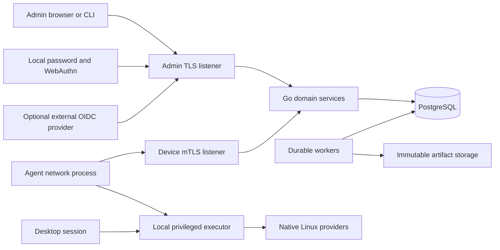
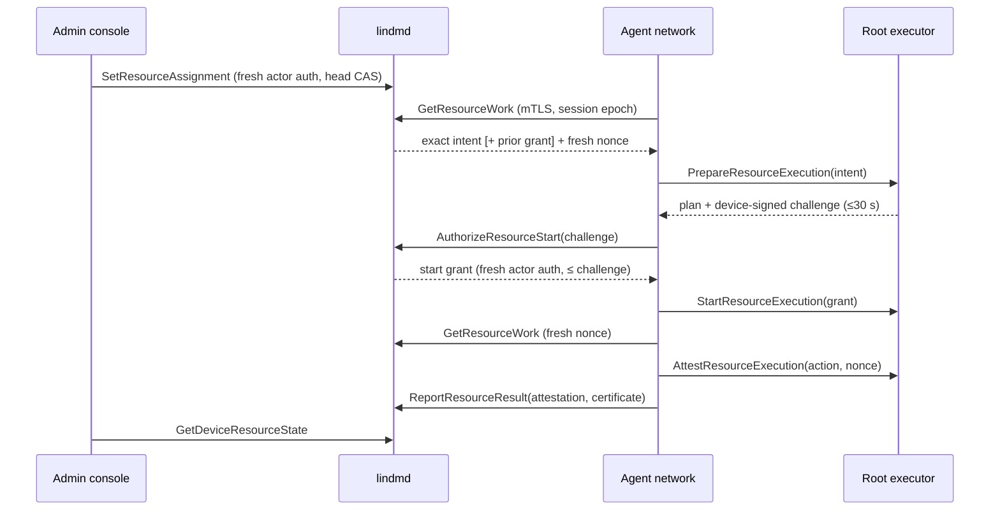

# Architecture and protocol contract

Status: implementation contract, not a claim that every component exists. The
[release allocation](product-specification.md#3-release-requirements-and-allocation)
requires the entire P01–P21 contract and every named platform for commercial launch.
Build-order gates do not defer capabilities or separate native platform models out
of launch. Actual implementation and qualification are recorded in the
[evidence ledger](implementation-plan.md). Security/operations requirements apply
to every capability and deployment that uses them.

## 1. Selected architecture

Use a modular Go monolith, not microservices. The same server executable runs API,
worker, or combined roles. PostgreSQL is the authoritative database and durable work
queue; do not introduce Redis, Kafka, Kubernetes, or a workflow engine as baseline
installation prerequisites. Object/file storage holds immutable artifacts, not job
truth. The frontend is a TypeScript web application embedded in the server release.

| Component              | Responsibility                                                                                                 | Boundary                                                                                              |
| ---------------------- | -------------------------------------------------------------------------------------------------------------- | ----------------------------------------------------------------------------------------------------- |
| `lindmd`               | Admin and device RPC, SSO/session handling, reconciliation, durable workers, embedded console                  | Unprivileged process; one organization/database/trust domain per deployment                           |
| `lindm-agent`          | Outbound device transport, observation spool and reconciliation scheduling                                     | Separate executable from server; no inbound device TCP listener; cannot modify executor state         |
| Agent executor process | Typed privileged operations, authoritative execution journal/trust, plan verification and sensitive local keys | Same agent executable in executor mode, root-owned Unix socket with peer credentials and narrow RPC   |
| Agent session process  | Desktop notices, consent, self-service, recovery interaction                                                   | Same executable in session mode, unprivileged per-user context; never accepts raw privileged commands |
| `lindmctl`             | Automation, diagnostics and operator workflows over the same API                                               | No alternate authorization path or direct production database mutation                                |
| PostgreSQL             | Identity, desired state, jobs, audit/outbox, inventory and leases                                              | pgx with sqlc-generated queries, SQL migrations; no ORM                                               |
| Artifact store         | Packages, signed updates, exports and support attachments                                                      | Local filesystem on single host; S3-compatible storage for replicated topology                        |

Logical listeners may share port 443 on different names using L4 passthrough. Device
client certificates are verified at the application TLS boundary. Never trust a
client-supplied `X-Client-Cert` header. A supported TLS-terminating enterprise gateway
requires a separately authenticated, explicitly configured identity-forwarding
contract and tests; it is not the default topology. HTTP CONNECT passthrough proxies
are supported without weakening device authentication. Public bootstrap RPC is
separate from the mTLS-required device service.

Native server delivery and OCI use the same embedded-console executable and strict
protobuf configuration. Native runtime and explicit migration units have separate
unprivileged identities; OCI mounts the migration credential only into its explicit
migration service. Neither package lifecycle hooks nor `serve` run DDL or bootstrap
an owner. Configuration/key ownership is checked at resource loading, in addition
to systemd/container sandboxing. PostgreSQL is external to the application package;
purge retains operator configuration, keys and database. See the
[installation and recovery runbooks](security-and-operations.md#native-single-host-installation).

## 2. API and compatibility

Choose Protocol Buffers with Connect-Go over `net/http`: generated Go clients for
agents/CLI and generated TypeScript clients for the console. Admin unary RPC may use
Connect JSON; device RPC uses binary protobuf over TLS/mTLS. gRPC compatibility is
useful, but clients do not require permanent bidirectional streams or a gRPC proxy.
SSO callbacks, SCIM, health/metrics and artifact transfer remain appropriate HTTP
interfaces; do not force external standards into proprietary RPC envelopes.

- Packages: `lindm.admin.v1`, `lindm.device.v1`, and `lindm.enrollment.v1`.
  Local executor RPC is a separate, non-network API.
- Never reuse protobuf field numbers or change field meanings. Reserve removed tags
  and names; run Buf lint and breaking-change checks against the released baseline.
- Separate API major, policy schema version, provider capability version, local state
  schema, and agent release. An additive API is not evidence of executable capability.
- Every mutation has an idempotency key scoped to principal and method. Persist its
  request digest and non-secret result with the domain transaction. Reuse with a
  different request returns conflict. Retention covers the maximum retry window.
  Secret issuance is deliberately different: grants/service tokens are returned only
  on their original creation response, stored only as hashes, and excluded from
  response caches/audit/outbox. A retry returns the credential ID and
  `secret_delivery_unknown`, never a new or recoverable bearer value. The authorized
  caller revokes that ID and issues a replacement with a new idempotency key after a
  lost response. Recovery reveals also bypass response caching and are independently
  authorized/audited on every attempt. No retry store may retain plaintext secrets.
- Updates carry expected resource versions; lost-update conflicts are explicit.
  List RPCs use bounded page sizes, stable keyset cursors and allowlisted filters.
- Use canonical RPC errors plus machine-readable reason/retry classification.
  Include request/operation IDs, never secrets or unbounded command output.
- All endpoints have request/decompression/body/output limits, deadlines, cancellation,
  concurrency bounds, admission/rate limits and auditable authorization decisions.
- Initial limits: 1 MiB ordinary control messages, 500 entries per inventory batch,
  200 list rows per page; large content uses bounded streamed artifact endpoints.
  Limits are validated against real inventory, not changed silently by clients.
- Support current and previous two released minor agent series for at least 90 days.
  Deprecated compatibility has an announced end date. Unsupported agents may obtain
  a verified update but cannot receive plans they cannot safely execute.

### Service responsibilities

| Service family       | Operations                                                                                                                           |
| -------------------- | ------------------------------------------------------------------------------------------------------------------------------------ |
| Enrollment           | Issue/revoke grants, submit CSR/proof, approve pending enrollment, finish/resume issuance                                            |
| Device identity      | Renew credentials, report key posture, revoke/recover identity                                                                       |
| Device sync          | Heartbeat/capabilities, publish sequenced observations, long-poll desired revision/work, acknowledge receipt, report progress/result |
| Fleet administration | Devices/groups/ownership, profiles/revisions/assignments, software/repositories, campaigns and exceptions                            |
| Privileged workflows | Approvals, recovery reveal, quarantine/lock/sanitization, enrollment recovery and retirement                                         |
| Integrations         | Scoped service accounts, import/export, audit/reporting, webhooks and directory provisioning                                         |

## 3. Identity and enrollment

Enrollment grants contain no long-lived shared fleet secret. They are high-entropy,
short-lived, one-use, hashed at rest, revocable, and limited to a deployment and
explicit enrollment profile. An authorized provisioning service can mint per-device
grants with bounded scope; a reusable secret embedded in a golden image is forbidden.
Grant consumption and device identity reservation are atomic.

Unattended provisioning uses a separate high-entropy credential, not reuse of a
one-use grant. A provisioning token is hash-only at rest, revocable, bounded by
expiry and maximum uses, and bound to its creator's authority and immutable
metadata/group/profile assignments. Deliver it through a protected first-boot
channel, never a reusable image, process argument, environment variable or agent
network-process configuration. Reserving one device, CSR, installation and attempt
consumes one use atomically. Same-key interrupted issuance resumes that reservation;
replayed bearer material cannot substitute another key or consume additional uses
for the same attempt. Approval-required reservations remain `PENDING_APPROVAL`
without a usable certificate. The existing approval inbox binds an independent
human decision to that exact reservation and rechecks current authorization.

1. The installer verifies a signed package and a deployment bootstrap bundle acquired
   through a trusted channel. It pins deployment identity, server trust, initial
   execution-trust root/quorum and version, and the separate release-update root.
   The root executor imports these into its own protected store. Never trust a key
   fetched from the same unauthenticated endpoint or chosen by the network process.
2. The agent generates its private device key locally, preferably non-exportable in a
   qualified TPM. Software-key devices remain explicitly distinguishable.
3. Bootstrap validates grant, server name/trust, CSR proof of possession, requested
   identity and approval policy. Hardware serial/MAC/machine-id are inventory hints,
   not authenticators or sufficient uniqueness constraints.
4. A reserved device ID and enrollment generation bind the certificate to the new key.
   A consumed grant cannot enroll a second key. Issuance can resume using a short-lived
   enrollment transaction handle plus proof by the same key after a lost response.
5. First authenticated acknowledgment activates the enrollment. A pending issuance
   times out visibly and can be administratively revoked.
6. Renew with current identity and fresh key proof; atomically publish the new cert
   before retiring the old credential. Short overlap is bounded and audited.

Initial device certificate lifetime: 30 days; renew after 10 days with jitter. Local
site CAs permit renewal inside air gaps. An expired device fails closed and uses an
approved, identity-bound recovery workflow; never silently reuses its old grant.
Offline devices cannot be assumed revoked locally, but the server denies revoked
identities on every request, including existing TLS connections. Do not cache
revocation longer than the documented 60-second enforcement bound.

Device credentials authorize only that device's resources and observations. They
cannot enumerate the fleet, call admin RPC, approve their own plan, or fetch another
device's secrets. Reinstallation creates a new enrollment generation. Golden images
must exclude device keys, grants and the agent journal; clone collision detection
quarantines ambiguous identities rather than merging by hostname.

Explicit identity recovery requires a scoped, two-person-approved
`CreateRecoveryEnrollmentGrant` for the exact device and expected current
generation and its revocation state. Its one-use, short-lived credential
authorizes only this linkage. A later device revocation invalidates previously
approved or issued recovery authority; recovering an already-revoked identity
requires a new explicit approval that acknowledges that state.
Consumption requires a new key, retires all prior-generation credentials, clears
current observation projections and creates one new pending generation while
retaining the device's historical identity and assigned metadata. Competing
replacement grants cannot replace a generation created after their approval.
Lost-response retries return the same public certificate; raw grant secrets are
never recoverable from durable storage.

Every device-signed session acquisition carries the protected installation UUID
alongside its boot UUID and predecessor epoch. A changed installation or competing
successor of a consumed epoch durably holds both device and generation and denies
existing sessions. A normal reboot of the same installation may advance the exact
current predecessor; boot changes alone are not proof of cloning. Resolution
replaces the ambiguous generation through the approved recovery path rather than
releasing its old key. These are software-identity collision signals, not a claim
to distinguish physically different machines sharing a compromised key, journal
and coordinated state.

## 4. Admin identity and authorization

Lindm authenticates people **to Lindm only**. It is not an identity provider, never
issues identity tokens to other applications and does not implement an OIDC/SAML
broker. Existing organization identity and joiner/leaver processes remain external.

| Mode                          | Source of authority                                                                            | Freshness and outage behavior                                                                                                                        |
| ----------------------------- | ---------------------------------------------------------------------------------------------- | ---------------------------------------------------------------------------------------------------------------------------------------------------- |
| Built-in local administrators | Postgres account, credentials, role and authorization version                                  | Read current account authority for every protected request and again in mutation transactions; disable revokes immediately without directory polling |
| Optional external directory   | Keycloak Admin API, Entra Microsoft Graph or the named provider's authoritative management API | Authoritative refresh at most every 30 seconds; no access from a snapshot older than 60 seconds; failures deny external sessions                     |
| Local break-glass             | Separately designated local owner accounts and explicit local policy                           | Independent of external-directory availability; mandatory MFA, restricted access and unmistakable audit                                              |
| Optional federation           | Keycloak may broker SAML or AD/FreeIPA; Lindm remains an OIDC client                           | Launch qualification must verify original-source lifecycle, not merely Keycloak's imported user copy                                                 |

Local accounts live in Postgres. Password hashing uses Argon2id from
`golang.org/x/crypto/argon2`, with per-password random salts and bounded resource
costs. Mandatory WebAuthn uses `go-webauthn/webauthn`; require user verification,
configured RP/origin binding and one-use expiring challenges. Password acceptance
alone cannot create a privileged session. Bootstrap/enrollment and authenticator
replacement must not provide an MFA bypass. No local password hashes, challenges,
credential material or authentication secrets enter application logs or audit data.

Both modes reuse opaque random sessions hashed in Postgres, Secure/HttpOnly/SameSite
cookies, CSRF/origin checks, roles, audit and authorization-version fencing. The
normal limits remain 30-minute idle and 12-hour absolute expiry; break-glass may be
shorter. Tokens never go in browser local storage. A `DirectorySource` boundary
supplies authoritative observations: Keycloak, Entra, Okta and Google poll their
original directory; local accounts use always-fresh Postgres reads. `decideAccess`, session handling,
`AuthorizeFresh` and transaction fences remain common, not parallel auth systems.
The config schema selects one primary directory source with a `oneof` and a separate
local break-glass section; no union of external grants with local emergency grants.
Local-only startup and authentication must not discover or contact an IdP.

External login uses OIDC Authorization Code with PKCE, state, nonce,
issuer/audience/signature/expiry validation and exact redirect URI matching through
a maintained library.

`lindmctl login` opens the system browser and listens only on an ephemeral
`127.0.0.1` port. The browser uses normal local WebAuthn or external SSO, then
explicitly approves the named loopback destination. The five-minute browser-bound
request requires exact-origin, session-and-request-bound CSRF approval. A one-minute,
single-use code binds S256 PKCE, exact redirect URI, browser session and current
authorization version; only that code and random state enter the loopback URL.
The TLS exchange creates a distinct hash-at-rest opaque CLI session with 15-minute
idle and eight-hour absolute limits, additionally clipped to the approving session.
Bearer authentication accepts only CLI-kind sessions on AdminService and session/
logout endpoints; browser cookies cannot become bearer tokens, CLI tokens cannot
become browser cookies, and browser mutations retain CSRF. Both use the same roles,
source freshness, domain permission checks, principal transaction fences and
revocation. Break-glass retains its incident reason, restricted permissions and
shorter lifetime; console-only policy forbids CLI issuance/use.
The client stores the pinned HTTPS origin, CA PEM and token in a protected mode-0600
protobuf-JSON configuration under `$XDG_CONFIG_HOME/lindm` (or the platform config
directory). It never sends a token to another origin and logout revokes it before
clearing local credentials. No password grant or long-lived API key is introduced.

Bind external principals to the configured issuer and immutable provider identity,
never email. Validate Entra tenant/object correlation to the signed login identity;
do not assume its pairwise OIDC subject is a Keycloak-style UUID. Local principals
have their own deployment-bound immutable namespace. Group claims map only through
explicit policy; default deny. No first-login owner auto-claim: install-time setup
binds the initial owner once. External MFA/step-up validates configured provider
assurance and freshness; local MFA verifies WebAuthn. Missing assurance denies the
privileged operation rather than falling back to a password-only owner.

Keycloak is an optional deployment choice. A direct authoritative Keycloak realm,
Entra, Okta, Google, SCIM and brokered lifecycle certification are launch requirements;
G5 orders the integration work. Optional Keycloak SAML/AD/FreeIPA federation does not
become native Lindm SAML/LDAP support.
SCIM has separate provisioning authorization, filtering, PATCH/ETag behavior
and bounded membership. Keycloak and Google are not assumed to have SCIM senders.

Provisioned identities correlate by a configured immutable provider subject/object ID
to the OIDC issuer/subject, with uniqueness enforced. SCIM `externalId` alone is not
proof: only the authorized connector's configured immutable correlation may bind it.
Never join by email, display name, username or an unverified client assertion. Ambiguous
or unbound principals have no grants. Rename/recycled-email tests must preserve this.
Deactivation/tombstones override login claims until authorized source reactivation;
stale OIDC claims cannot resurrect a SCIM-disabled account. Select exactly one
authoritative membership source per mapping; additive unions of conflicting sources
are forbidden. Device ownership and employee identity are separate records.

OIDC alone does not notify Lindm that an account or group was disabled. Every
certified **external** source therefore includes an authoritative lifecycle adapter:
Keycloak Admin API, Microsoft Graph or Okta/Google management APIs at launch.
SCIM/events can accelerate updates but do not establish freshness.
Bind the least-privileged connector and immutable IDs during setup. Obtain a fresh
authorization snapshot at login and refresh active principals at most every 30 seconds.
No admin request uses an authorization snapshot older than 60 seconds; stale/failed
refresh denies protected access, including already-open sessions. Check current
deactivation and membership again for privileged approvals/dispatch. Provider-specific
rate limits, upstream propagation and assurance are certification inputs; an adapter
that cannot meet the declared bound is not certified by weakening it silently.
The 60-second enforcement bound starts when the change is visible in the configured
authoritative directory; separately measure and expose upstream propagation delay.
Accepted local/SCIM deactivation immediately invalidates sessions, principal-owned
credentials and pending authority in the same transaction. Local authorization
never inherits the external 30/60-second cache window. Directory deletion does not
erase audit or machines. Existing G1 evidence covers the direct Keycloak lifecycle.
Local accounts, restricted break-glass and the external adapters share these gates.
Entra, Okta and Google TLS fixture tests are not live tenant evidence: propagation,
browser login and lifecycle/outage timing still require live qualification using
the README operator procedures. An external outage never extends cached privileges.

Okta uses its org Management API with a separate OAuth service app, RS256
`private_key_jwt` and only `okta.users.read okta.groups.read`. Org/custom OIDC login
issuers never change that API authority. Signed `sub` must equal the immutable
Management API user ID; only `ACTIVE` qualifies. Group IDs are immutable, Link
pagination is origin/collection confined, and rate-limit waits are bounded by the
existing request deadline.

Google uses `https://accounts.google.com` and requires the exact signed configured
`hd`; neither email nor a login hint is authority. A separate service account uses
domain-wide delegation to the configured read-only administrator with only
`admin.directory.user.readonly` and `admin.directory.group.member.readonly`.
The immutable `sub` is the Directory API user ID. Suspended/archived/deleted users
deny. Configured immutable group IDs use `members.hasMember`, including direct and
same-domain nested membership; cross-domain nested membership is not qualified.
Quota/backoff and vendor propagation delay never change local freshness bounds.

`/scim/v2` maintains connector-scoped Users/Groups, discovery, bounded pagination,
supported equality filters, and conditional PATCH with ETag/If-Match. Each
configured connector has a hash-only rotating bearer and an explicit immutable
provider-ID/issuer/subject correlation table. A credential cannot provision another
connector's identity. SCIM group records never enter authorization membership.
Disable/delete retains a tombstone and atomically revokes sessions/actor versions.
Reactivation only clears that connector's tombstone, invalidates earlier authority,
and requires a new directory observation. A database-clock lifecycle cutoff rejects
observations started before a SCIM transition, including delayed concurrent reads.

Unrestricted account administrators can read `/auth/settings` in the Accounts
console. It displays configured primary/upstream sources and freshness bounds,
plus the signed-in principal's observation/current state. It does not report
tenant-wide sync completion or expose credentials and private resource paths.

For brokered identities, persist the complete immutable lineage: trusted broker
issuer/subject, configured upstream IdP, signed persistent upstream subject/object ID,
and authoritative directory connector. A successful read of Keycloak's imported
user/group copy is **not** upstream freshness; mapper synchronization during login
cannot refresh an already-active application session. Poll the original directory
through its approved connector and intersect its active/entitlement state with any
broker-local restrictions. Neither source may widen the other's authority. Missing,
ambiguous or stale lineage denies access under the same 60-second bound; freshness
timestamps derive from the upstream observation, never from reading a cached import.
Persist the exact original directory issuer in `upstream_provider`, not merely the
broker's editable alias; signed alias selection is checked independently against
configuration before binding. Reusing an alias/connector label for a different
upstream issuer cannot remap an existing principal. A lineage-conflict denial
clears authority freshness but advances the observation ordering fence, so an older
in-flight successful read cannot restore grants after that denial.
The later air-gap reference can use local Lindm accounts without deploying Keycloak.
An optional local Keycloak federation topology may use a separate authoritative
upstream realm and broker realm, with the upstream Admin API as lifecycle source.
Existing AD/FreeIPA may federate through an explicitly qualified connector; a future
LDAP adapter is not implicitly implemented by this design.
Entra/Okta/Google broker paths use their original authoritative connectors. A generic
SAML-only source without a qualified lifecycle connector is not a certified
bounded-revocation integration; it cannot bypass this gate through a broker.
L02 must remove an upstream group and disable the upstream account while the existing
brokered application session continues making requests, without another SAML login.
Also test stale upstream state with a healthy broker, immutable subject remapping and
upstream outage. This source-lineage schema is defined at G1; actual brokered flows
are certified at G5.

### Employee and local-account entitlements

Launch requires device assignments, person assignments and employee workflows.
Device baselines apply independently of a login. Device-wide self-service items
must explicitly allow local users and never convey person-specific secrets. Person
assignments require an active organizational principal and a verified binding to
device generation plus a local account incarnation, not merely a reusable numeric UID.
Directory accounts bind using the configured immutable directory object. A local-only
account can bind through system-browser OIDC plus a one-time challenge held by the
authenticated local session helper; the server binds subject/device/session evidence,
not a supplied email. A local-only unbound account sees only explicitly device-wide
items. Account deletion/recreation, ownership transfer, re-enrollment or directory
deactivation invalidates old bindings and person capabilities.

The executor resolves peer UID/session and a root-owned account incarnation, and
verifies signed entitlement tokens bound to that incarnation, principal, device,
specific request and expiry. Online checks are required for new person-specific
secrets/installs; existing offline login and last valid baseline behavior are separate
policies. Shared devices have multiple isolated bindings and no implicit inheritance
from the primary owner. Consent, app requests, user certificates and offboarding use
the same binding. Removal cleans up only resources owned by that binding. UID reuse,
conflicting directory mappings, user switching and transferred ownership are mandatory
L06/L09/L10 tests.

### Roles, device scopes and approvals

Authorization is evaluated in domain services for every request and again when
privileged work is dispatched. The built-in roles are owner, admin, operator,
helpdesk and auditor. Owner grants all known permissions; admin excludes account
management. Operator grants fleet reads, enrollment, profile management and service
assignment; helpdesk grants fleet reads and enrollment; auditor grants fleet and
audit reads. Unknown roles and permissions deny. Named custom roles contain only
explicit known permissions. Recovery-key access, remote execution, scripts,
destructive execution, approvals, execution trust, integrations and accounts are
separate grants rather than consequences of fleet visibility.

The protobuf `authorization` policy defines custom roles and directory
`group_bindings`. Keycloak bindings use exact paths; Entra, Okta and Google use
immutable group object IDs. A local account instead supplies its own role and scopes; local
and directory grants are never combined. Owner bootstrap remains explicit.
Each binding retains its own scopes, preventing a narrow write grant from borrowing
the scope of a broad read grant. Within a scope, all labels and the configured
device-ID and static-group restrictions must match; multiple scopes are alternatives.
An empty scope list grants the permission deployment-wide. Static group membership
and label changes require unrestricted account-management authority, not merely a
scoped metadata grant: otherwise an operator could relabel a visible device into a
more privileged execution scope. Ownership and attribute edits still use their
scoped inventory permission.

Fleet search, pagination, counts and exports apply the same database scope predicate
before producing results. Target reads and mutations enforce the permission-specific
scope, and mutation transactions serialize against label and group changes.
Global infrastructure, enrollment, profile and audit operations require unrestricted
authority for their respective permission. The console receives effective permission
names from the server for navigation and controls; hiding a control is not a security
boundary.

Durable approval requests bind a typed, canonical payload digest, action, exact
target, requester authority version and expiry. Device revocation always requires
approval; policy may also require it for service assignment and execution-trust
changes. A different authorized human must approve and possess both approval and
action authority over the target. Service accounts and the requester cannot supply
the second person. Consumption rechecks both principals, versions, scope, payload and
expiry in the action transaction and is one-use. A changed target or restored grant
does not revive an old approval. The inbox retains the exact request for review and
execution; rejection, expiry and consumption remain distinct states.

The existing worker boundary is `identity.Service.AuthorizeFresh`, followed by
`LockAuthorization(ctx, tx, authorization, requiredPermission)` in the mutation
transaction. The source adapter performs a new authoritative read without using the
browser cache or an earlier in-flight refresh; no transaction spans directory HTTP.
An observed denial still commits revocation, audit and the effective authority
version. `principals.authorization_version` advances on effective role, permission
or scope changes, including disable/re-enable and owner pinning, not unchanged
observations, display names or unrelated groups. Policy fingerprints participate in
the durable fence so a replica with different authorization policy cannot use an
older grant. A restored role does not revive an old approval.

The opaque, process-local worker authorization is distinct from a durable two-person
approval. It binds its issuing service, actor, permission, scoped bindings and
version. The transaction locks the principal before device/action rows and rechecks
current qualified authority, exact required permission, version and database time.
Database and process-monotonic deadlines bound it to thirty seconds; future
observations and clock rollback fail closed or shorten the exposed deadline.
A start signer must clip its grant expiry to `Authorization.ExpiresAt()` as well as
the root/delegation/challenge limits. Domain handlers additionally enforce device,
desired-head, recovery and worker-lease fences; possession of actor authorization
alone never permits an off-target or obsolete action.

Break-glass uses one or more explicitly designated local owner accounts. Their
password plus mandatory WebAuthn works while the external directory is down;
Postgres and Lindm themselves must still be available. Their designation never
permits a disabled local account or invalid session to authenticate.

The separate break-glass policy restricts access to an authenticated local-console
boundary or an explicit permission allowlist. Enforce that restriction in domain
authorization and worker fences, not just in navigation. Do not infer console
presence from a client-supplied forwarding header. Bound emergency session lifetime,
require an incident reason, visibly identify emergency use and emit durable audit
for activation, use, denials and termination. Account disable or policy/role changes
invalidate sessions and pending authority immediately. End the incident by revoking
emergency sessions and reviewing their audit. There is no universal password,
password-only recovery path or unauthenticated environment flag.

## 5. Desired state and execution semantics

A profile is an immutable revision of typed resources. A resource has stable identity,
kind/schema, desired values, sensitivity, applicability, dependencies, ownership and
verification requirements. Assignments have explicit priority and exclusion rules.
Two applicable resources claiming incompatible values at the same priority produce
`conflict`; do not select a winner by database order. Preview exposes overrides and
conflicts. Dependencies must be acyclic and available before activation.

Device/provider applicability uses detected OS, version, architecture, services,
package tooling, session, encryption topology and hardware—not just `ID_LIKE` from
`os-release`. Capabilities are versioned and carry reasons. A newer unknown policy
kind is rejected, never partially interpreted. Capability reports are untrusted
claims until observation and qualification support the operation.

Providers implement `Observe -> Plan -> Apply -> Verify`. Their operations are typed,
bounded, cancellation-aware and restart-recoverable. They use native D-Bus/APIs where
stable; otherwise explicit argv to documented tools with controlled environment,
locale and working directory. No shell interpolation, arbitrary path writes, or
server-supplied executable names in a typed policy. Protect config writes against
symlink/path races and validate syntax before atomic replacement/reload.

### Closed resources and targeting: control-plane cutover

`lindm.resource.v1` is the shared closed vocabulary for twenty-four resource kinds.
Desired state, observations, plans and checks use explicit oneof arms; capability
IDs are derived from the kind registry, never supplied as weaker caller authority.
Profiles use canonical `(kind, key)` identities, typed dependencies and explicit
ownership/verification policy. Cross-kind native claims participate in conflict
resolution. Generic PostgreSQL resource rows preserve immutable revisions, sequence
floors, fresh compliance and the conservative one-open-effect limit.

Static targeting reuses authorization's device groups and labels. Dynamic groups
evaluate a typed, bounded inventory/label/custom-attribute AST; unknown or stale
inventory is not evidence that a previously targeted device should be released.
Target assignments pin revisions, priorities and exclusions. Preview retains the
membership/input snapshot and resolved resource bytes with domain-separated
digests. Activation consumes that exact snapshot and rejects changed inputs or
heads. Assignment and activation use `resources.assign` scopes, fresh principal
fences and the configured exact-request approval policy.

Preview digests bind an explicit membership input vector. Routine authenticated
contact does not invalidate a reviewed snapshot unless an evaluated last-contact
predicate used that timestamp; generation, native status, metadata, catalog,
group definitions and execution/rollout heads remain fenced.

Rollouts retain cohort membership, stable salted percentage buckets and ring
state. Soak, minimum observations and failure/unknown/unavailable thresholds gate
promotion; automatic pause is durable. Cohort evaluation admits at most 10,000
devices and fails visibly above that cap. Minting and granting execution recheck
current targeting/exclusions/rollout pause without replacing already granted
unknown effects. A historical result cannot refresh another generation or head.

Availability is separate from native verification: authenticated sync maintains
durable contact at 60 seconds with jitter, and accepted dispatch/start/result
transactions also refresh contact. Read-only trust and empty-work polling remain
write-free. The availability window is the greater of the ring health window and
180 seconds; contact never extends native verification timestamps or validity.

The execution wire uses generic resource desired state, plans, observations and
verification through one executor path, including existing systemd services.
The `execution-intent`, `execution-challenge`, `execution-start` and
`execution-attestation` DSSE domains replace the service-specific domains.
Intent binds the operation and signed assignment/resource ownership policy plus
every contributing immutable profile resource. Challenge binds the exact canonical
kind/key and operation. Native plans and results use domain-separated digests.
Protected journal sequence floors are keyed by enrollment generation, kind and key.
Pre-cutover service authority and incompatible journals are not reinterpreted:
they require explicit recovery, remain held, and are never silently reset.

Schema availability remains separate from native-provider qualification. Dispatch
continues to refuse each unqualified kind. Existing service effects have no
trustworthy pre-management ownership baseline, so service release remains
`baseline_unknown`, not fabricated restoration, deletion, or compliance.
Managed files, sysctl, typed timer/drop-in definitions and encryption compliance
extend the closed vocabulary; their presence does not authorize generic file,
command or live-encryption effects.

Native package repositories are explicit root-owned configuration, with exact
signing-key hashes and isolated native source configuration. The executor's own
sandbox is not widened. Package transactions run in distinct per-transaction
systemd units started over D-Bus with a fixed installed helper executable,
protected typed operation records, bounded native-installer permissions and
timeouts. Approved package scriptlets are privileged code, not a confinement
boundary. A private root-only handshake consumes signed start authority after
the helper's final preflight. The helper checks the exact boot-bound deadline,
durably records its one-use start and retains its result across executor loss.
Uncertain transactions are observed, never automatically replayed.

### Work contract

- Each operation binds device ID, enrollment generation, deployment recovery epoch,
  action UUID, immutable plan digest, desired revision, capability prerequisites,
  expiration, authorization/approvals and artifact digests.
- Sign privileged execution envelopes using a maintained standard envelope library
  (DSSE); publish and rotate the execution-verification trust separately from TLS
  and release-update trust. Executor verifies the envelope, not merely its caller.
- Delivery is **at least once**. Exactly-once remote effects are not promised.
  PostgreSQL leases coordinate workers; the local durable journal deduplicates effects.
- Initial cadence: heartbeat every 60 seconds with jitter, a bounded 30-second
  long-poll for work, exponential reconnect backoff with jitter, and server-provided
  pacing. Suspend/resume and offline periods do not create a catch-up storm.
- The root executor exclusively owns `/var/lib/lindm/executor` (0700) and its SQLite
  execution journal/trust files (0600), including acceptance, checkpoints, completions,
  trust versions, recovery epochs and replay fences. Persist before effects. Neither
  the network nor session process can edit/remove this state. Missing/corrupt state
  on an enrolled device enters recovery hold, never an empty success-ready journal.
  Reinstall/purge cannot silently reset replay state; reset requires revoked old
  enrollment and an approved new generation. Keep the unprivileged observation/
  transport spool separate. Observation batches use sequence/boot IDs; server
  acknowledgments follow durable writes and tolerate duplicate delivery.
- Serialize conflicting local resources, especially package transactions. Workers
  never hold a database transaction open while awaiting a device or remote storage.
- Results include before/after evidence, timestamps, boot ID, revision, retryability
  and verification freshness. Provider exit code zero is not sufficient compliance.
- Cancellation can prevent a not-yet-started action. A started package transaction
  is reconciled safely, not killed at an arbitrary point. `cancel_requested` does
  not claim that side effects stopped or rolled back.
- Desired-state retries re-observe actual state. Imperative reboot, lock, key rotation
  and erase recover according to their own durable state machine; they are not
  automatically replayed because a worker lease expired.
- Outcome unknown is persistent and operator-visible. Before retrying an irreversible
  effect, obtain new evidence or require a new explicitly approved operation.
- Expired or superseded actions cannot start. A revision change between dispatch and
  execution requires precondition revalidation. Destructive start authority is a
  separate signed response to a root-executor-generated random challenge, bound to
  device/generation, action UUID, exact plan digest, current recovery epoch and
  authorization version. Its validity is at most 30 seconds, not the 15-minute plan
  approval window. The executor verifies its trusted authorization signer and
  challenge, measures a monotonic local timeout and durably consumes the challenge
  before starting. The network process can relay bytes, never assert authorization
  success. Restart requires a new challenge and reconciliation; a grant cannot cross
  a reboot. If authority is revoked just after issuance, the explicit maximum
  residual start window is 30 seconds. Restore recovery cannot override previously
  issued authority instantaneously; keep dispatch fenced and drain that window before
  reopening. Once an irreversible action starts, cancellation is not guaranteed.
  Destructive operations never start from an offline queue.
- Last valid non-destructive desired state can continue reconciling offline within
  its documented validity period. No new recovery reveal, wipe or privilege grant
  occurs on stale authority. Local expiry never locks out an otherwise usable device.

The executor authenticates Unix-socket peers, binds session calls to their real UID,
checks authorization independently, caps input/output, and only accepts allowed
resource schemas. A compromised desktop helper must not become a root shell. The
network-facing process is unprivileged; executor has the minimum practical systemd,
SELinux/AppArmor and filesystem permissions per provider. Privilege separation
reduces exposure; it cannot withstand an already compromised kernel/root executor.

### Imperative device actions and recovery custody

`DeviceActionSpec` is a closed `action` oneof, separate from service desired state:
recovery rotation, TPM2 binding, session lock/release, quarantine/release, restart,
shutdown, refresh inventory, LUKS crypto erase, and non-encrypted-media sanitization.
Neither plan data nor a transport peer can choose an executable, shell command or
unchecked block-device path. The root-owned agent configuration independently
qualifies the exact signed `StorageTarget.identity_basis`. `WWN_SERIAL` is
preferred and binds WWN, serial, container/media size and applicable LUKS UUID.
When the backing disk has no WWN, encrypted GPT partitions may instead use
`SERIAL_GPT_LUKS`: unique physical-disk serial, whole-disk size, GPT disk GUID,
container size and LUKS UUID. The fallback does not permit serial-only selection,
unencrypted sanitization, ambiguous disk ancestry or duplicate physical-disk
serials, even if those disks have different GUIDs. Missing GPT evidence remains a
refusal. Native execution rechecks the pinned backing disk's size, serial, absence
of WWN, CRC-checked GPT header and the selected partition's kernel ancestry.
LUKS actions independently verify the exact UUID before effects.
The server projects this basis in `ListDeviceStorageTargets`; the console shows
it and the complete tuple to requesters and approvers. These fields remain in the
immutable action specification, approval digest, signed plan and root-owned
allowlist. A disappearing or appearing WWN, changed basis or changed tuple
requires a new selection and approval; execution never automatically downgrades.
Existing basis-less configurations and pending specifications fail closed and
must be requalified, not silently assigned a basis. Unsupported topology or
missing recovery qualification remains a refusal, not degraded success.
Inventory support is necessary but not execution authority.

The action path uses separate DSSE payload domains and exact per-action capability
IDs. Plan-role intent authorizes preflight only. The root signs its native plan,
random challenge, boot ID and executor incarnation; a current start-role signature
answers that exact challenge within thirty seconds. The protected journal consumes
authority before mutation. Destructive grants additionally bind two distinct,
currently authorized human approvals to the device, generation, specification
digest and expiry. The network process relays bytes and never spools offline starts.
Postgres migration `00008_device_actions.sql` owns action/escrow records; executor
SQLite records own local effects. An interrupted irreversible effect is durably
`OUTCOME_UNKNOWN`, never automatically restarted when a lease or session changes.

Restart and shutdown require `remote_execution.run`; inventory refresh requires
both `fleet.read` and `inventory.manage`, with independent device-scope checks.
None mandates two-person approval by default; deployment approval policy still
applies to the exact immutable request. Fresh online challenge/start authority,
audit, replay protection and the one-open-action fence remain common. Refresh can
repair absent or stale inventory rather than requiring an existing fresh snapshot.
The closed action-permission registry also drives approval binding, decisions,
inbox visibility and pending counts; new action kinds cannot require a separate
inbox allow-list. Approval labels are scoped server projections of requester and
approver display names (falling back to usernames) and target hostname, not
unrestricted account/device lookups performed by the console.
The online signing keys must themselves be delegated the exact action capability
for both plan and start roles. Missing deployment enablement is
`FAILED_PRECONDITION` with `device_action_capability_not_delegated`, plus
`Lindm-Action-Capability` and `Lindm-Signer-Role` metadata, not an internal error or
implicit grant. Disposable console/lab delegations explicitly include all closed
device actions and service execution; production delegates remain chosen and
quorum-signed by the offline owner.
The console population's synthetic inventory declares zero users/sessions explicitly;
storage, TPM and encryption availability remain unavailable rather than implying
observed hardware or native execution proof.

Power requests use the authenticated local logind D-Bus, with the root-owned
`allow_power_actions` opt-in. Optional `delay_seconds` is bounded to 0–3600 and an
optional printable user message to 512 characters. Immediate requests use
`RebootWithFlags`/`PowerOffWithFlags` with root inhibitor checking; delayed requests
use native `ScheduleShutdown`. Existing pending schedules and blocking inhibitors
are refused rather than replaced. A supported `SetWallMessage` delivers the notice;
the executor rechecks the unchanged grant deadline afterward, before requesting
power. Systemd 255 does not recheck newly acquired block inhibitors when an already
authorized schedule fires; native delay inhibitors remain effective. This is a
[native scheduling limitation](https://www.freedesktop.org/software/systemd/man/255/org.freedesktop.login1.html),
not an executor timer or shell fallback.

Native acceptance is not completion. Restart remains `OUTCOME_UNKNOWN` until
startup observes a boot UUID different from the signed challenge, then records
`SUCCEEDED` with both UUID evidence and the protected consumed grant. Reopening
the executor in the same boot cannot confirm or repeat it. This proves a later boot,
not workload health or causal attribution of an independently initiated reboot.
Shutdown records `outcome_unknown_until_contact`; even later contact or another
boot is not proof that the host powered off, and the action never falsely becomes
successful. Independent VM/power evidence is required for that claim.

Refresh consumes the same fresh grant, then triggers immediate full host and
package collection through the existing single-owner spool/upload pipeline.
The exact granted refresh durably binds one new host sequence and one full package
snapshot sequence on the action, without waiting for ordinary inventory cooldowns.
Only postchallenge collections can claim those slots; stale routine admissions
cannot spend them, and repeated new uploads or failed package attempts cannot
borrow an unrestricted bypass. The agent first durably queues fresh full evidence,
then supersedes older pending payloads without inventing acknowledgements or
reusing allocated sequences. Already-fresh pending domains remain immutable.
The server atomically retires older staging snapshots under the fresh grant,
retaining their exact receipts and releasing bulk quota before reserving new data.
Collection or local queuing alone cannot succeed. The server signs a separate
publication receipt only after both bound observations have committed after action
admission; it binds action, generation, intent/start-grant digests, host/package
sequences and snapshot ID. Confirmation names only the action and current session:
the server reconstructs the exact tuple from its durable admission slots, not from
caller-selected sequences or mutable latest-host state. The executor verifies and
journals that receipt before reporting success with `verification.inventory_sequence`.
Receipt recovery runs before collection, so lost commit/confirmation responses
and process restarts cannot force a second upload after the one-use slots were spent.

Native NVMe sanitize approvals carry an explicit `NVMeSanitizeScope.identity`.
The two human reviewers approve either `namespace-nid` (the observed WWN matches
Identify Namespace NGUID/EUI-64) or `controller-serial-nsid` (namespace identifiers
are absent or the kernel discarded them). Both bases freeze Identify Controller
VID, SSVID, serial, model and firmware, plus namespace ID, byte size and LBA format/
data-size shift. Controller facts come from native Identify admin ioctls, not
sysfs strings. The latter basis requires the kernel-observed canonical
VID/serial/model/NSID fallback WWN to agree with those native facts; it never
invents an EUI-64 or silently relaxes namespace identity. The approved basis and
all fields remain in the specification digest, native plan and result evidence.
Execution re-reads the same identity immediately before the sanitize command;
changed controller, namespace, layout or identity basis is a refusal requiring
new approval, never an automatic downgrade. Shared-controller, unsupported
command-scope and offline/off-target restrictions still apply independently.

Signed recovery approvals require a fresh read-only readiness observation from
the root executor, published alongside host inventory. It identifies the current
boot and ESP UUID/path, available bytes and allocation unit, Secure Boot state and
running UKI-capable loader. Missing, failed, stale, future-dated or wrong-boot
evidence is unavailable, never an assumed empty or ready machine.

The server obtains the exact UKI length and SHA-256 from authenticated offline
TUF target metadata at `recovery/<sha256>.efi`, anchored by the deployment's
verified release bootstrap and protected rollback checkpoint. Neither an action
request nor the agent's locally configured size is release-size authority.
Approval creation and action admission compare allocation-rounded signed length
against observed free space and expose the needed/available byte counts. The
native pre-start preflight and final staging copy independently recheck current
capacity; inventory readiness is not execution authority or a space reservation.
Insufficient capacity refuses with `device_action_esp_insufficient`. A copy race
or other stage failure removes only its newly owned partial file and retains the
native error; it never deletes an existing unrelated ESP file or extends a grant.

Lock is a named Linux mechanism, not activation lock: the root executor calls
logind `LockSessions` on the authenticated local system D-Bus and waits for
graphical user-session `LockedHint` acknowledgments. Optional termination uses
logind `TerminateSession` and verifies that no graphical user sessions remain.
No shell or remotely selected executable participates. Neither acknowledgment
proves visible desktop content, prevents boot, nor resists hostile root.

The lock specification can additionally select explicit local usernames or all
non-system human accounts. Root and the root-owned protected break-glass/admin
list are excluded; local account mutation requires its separate native opt-in.
Native shadow tools lock passwords and expire accounts without deleting accounts
or data. Before effects, the protected executor journal retains exact account
identity, prior state, expected changed state, and ownership phases. Public
observations contain account names and bounded evidence, never shadow credentials.
This local account mechanism does not claim to disable directory identities,
already established non-graphical sessions, or authentication that bypasses native
account-expiry checks.

`release_lock` references the original lock action. It restores only accounts
lindm changed whose observed state still matches lindm's expected state, preserving
administrator edits and previously expired accounts. Durable ownership and
per-account phases make repeats safe; interruption remains `OUTCOME_UNKNOWN`
instead of automatically restarting a possibly completed effect. An operator may
authorize a new explicit release of that exact unknown lock (or an unknown release
of it); the old signed outcome remains unknown in history. This inverse action
still needs its own fresh authority and exact-state ownership checks. Release does
not unlock screens, recreate terminated sessions, or restore unrelated configuration.
`actions.lock` and the separate `actions.release-lock` permission govern the two
operations with configured approval policy and the normal signed/audited pipeline.
The server records conservative lock state when granting a start, refuses
overlapping locks, and clears only the matching original lock after a verified,
device-signed successful release. Device detail displays that restriction and its
original action ID; accepted console requests are not native execution proof.

Recovery rotation uses an independently retained owner unlock path. The operator
supplies an existing unlock credential through the root-only local
`SupplyDeviceActionCredential` RPC, bound to a prepared action and retained only
briefly in memory. Native helpers receive sealed anonymous file descriptors, not
plaintext files, environment variables or command-line arguments. A new recovery
passphrase contains 256 random bits rendered as 64 literal hexadecimal characters.
The executor verifies that new key before reporting a new managed slot. Only
RSA-OAEP ciphertext encrypted to the intent-authenticated server escrow public key
enters the attested result or journal.

The server verifies the device attestation and exact recovery binding before
decrypting and storing a per-record AES-256-GCM envelope, with its random data key
wrapped under the separately protected deployment wrapping key. A signed receipt
is issued only after that transaction commits. It binds the original action, slot,
recovery-key digest and encrypted result. The executor persists the receipt and
`RETIRING_ESCROW` phase before removing a previous lindm-managed slot. Loss before
that boundary retains both slots; uncertain retirement remains unknown and cannot
remove an independent owner slot. Escrow durability is not proof of cold-boot
unlock, and neither fact alone establishes sanitization.

Reveal is a separate permissioned, reason-bearing, audited, recent-step-up
operation; deployment policy can additionally require two-person approval. Secrets
never appear in inventory, ordinary action listings, exports or query caches.
The console keeps reveal material only in short-lived component memory. Missing
custody configuration disables escrow instead of storing unencrypted recovery data.
Custody key loss is an operational recovery incident, not an empty escrow record.

Original-device remote wipe has two distinct native mechanisms. For encrypted
roots, the exact aggregate intent covers the root backing volume and all other
managed encrypted volumes. A durable, fresh grant consumption precedes arming the
independent power-off deadline and destroying LUKS slots/tokens/header areas.
The active mappings keep the reporting process alive temporarily. After erasure,
terminal proof and the device signer stay in protected memory, with no journal
writes or identity/session renewal; only the already authenticated report path is
available. The forced power-off deadline does not depend on report delivery.
Missing verified evidence remains unknown at the server.

For unencrypted roots, a separately signed recovery image executes on the
**original device**. A root-generated one-action key and server credential bind
device/generation, action/media, image digest and authority epoch. A challenge-bound
start grant authorizes the boot transition; a different fresh post-boot challenge
and grant, with current two-human authority, authorize erasure. The recovery
credential cannot enroll a new device or invoke normal device/admin operations.
Independent off-target custody and server checkpoints prevent replay after power
loss; an erased disk cannot be the only durable record of consumed authority.
The external-operator recovery environment is an additional mode, not evidence
that remote wipe of a lost or stolen original device works.

Recovery does not trust its RTC for authority. Before any action-scoped request,
it sends a fresh random nonce and boot identity to the public, purpose-separated
`GetRecoveryTime` endpoint on the pinned recovery origin. The server signs the
exact request digest and database time in a dedicated DSSE domain with its
currently delegated recovery START key. The recovery verifier authenticates the
root/delegation chain, protected version/epoch fences and provisioning-time floor;
the time endpoint grants no device identity, checkpoint or execution authority.
The bootstrap is single-use and must complete within its signed, at-most-30-second
lifetime. No unauthenticated NTP or persisted cross-boot clock estimate is used.

The initial TLS connection verifies the pinned CA chain, hostname, signatures and
constraints without consulting the RTC and permits only this public time request.
Before sending action credentials, transport verifies certificate validity over
the authenticated time interval, including reused connections. Recovery retains
the signed time plus suspend-aware monotonic elapsed time as a conservative
interval covering the complete bootstrap round trip: its lower bound governs
issued-at/not-before checks, while its upper bound governs expiry and future
receipt checks. This narrows rather than extends existing credential, delegation
and grant lifetimes. Missing time, failed signatures, nonce substitutions,
monotonic rollback and expired authority fail closed before destructive effects.

### Implemented connected service dispatch (G3)

The pull-based dispatch path now carries generic resources. Native admission is
still per qualified kind, not implied by the generic wire. Postgres owns the desired
head, actions, signed bytes and results; the executor journal owns local acceptance
and effects. Nothing is queued in the unprivileged spool.

Unchanged or updated execution-trust delivery and service polling with no
assignment head or open action use coherent `REPEATABLE READ, READ ONLY`
transactions. They still validate the current device/generation, certificate,
session and compatibility state directly from PostgreSQL; they do not cache
authority. An assignment, open action or quarantine falls through to the locked
mutation path below. A concurrent transition can follow an already-established
read snapshot, but no mutation is authorized from that snapshot and the next
poll observes committed changes. Trust/empty-work polling does not write contact
timestamps; `GetSyncState` supplies the durable jittered 60-second heartbeat.

- An assignment is an immutable head per device enrollment generation: one profile
  revision or cleared. Its UUID is the signed `desired_revision`. Clearing stops new
  work and never restores native state. Resources run one at a time in dependency
  order (ties by unit); a dependent waits for a verified SUCCEEDED dependency.
- A server action is the lease. Intents are minted only during device acquisition,
  after fresh authorization of the assigning actor; a changed authorization version
  or denial blocks the head (`assignment_authority_changed`). An intent is valid from
  the later of database time minus two minutes or delegation not-before, for twelve
  minutes clipped to delegation expiry. Empty/already-expired windows are refused
  as `execution_window_empty`; fresh delegation admission does not create a mint outage.
  `resource_sequence` increases forever per generation and unit.
- Package preparation is independent, effect-free native staging. `PREPARING`
  is nonterminal and contains no native observation or verification. The transport
  calls Prepare once per ordinary management cycle and returns immediately while
  staging is pending; it does not extend ordinary RPC, dispatch or transport
  deadlines or occupy the native-execution polling window. Heartbeat/inventory
  scheduling and imperative action polling remain independent. Only a ready exact
  plan can create the existing thirty-second challenge and start grant. Immediate
  systemd no-drift completion retains its read-only path.
- Device clocks may differ from the server by up to two minutes
  (`trust.MaxDeviceClockSkew`). Server checks of device-signed challenge and
  attestation times allow that tolerance; beyond it the call fails with
  `device_clock_skew`. Freshness comes from server-held state: a single-use nonce
  that expires on server time and the open action. Start grants are expressed in
  device time from the challenge, clipped to the remaining server approval and the
  delegation. Certificate, root and delegation validity stay strict.
- An immediate-provider action without a start grant closes as `expired_unstarted`
  or `assignment_changed` and may be replaced. Package staging instead retains its
  open-action fence with a durable cancellation reason and returns
  `cancel_preparation` on later polls until the executor reports terminal owned
  cleanup. A cancellation reason with no `closed_at` means cancellation requested,
  not completed. A never-prepared executor durably tombstones the exact action and
  intent before acknowledging cancellation; the server accepts only the matching
  current-session, action, intent digest and fresh result nonce, never as native
  proof. Once a grant is issued, the action stays open until verified terminal
  evidence arrives: the effect may already have run.
- Start grants require a valid device challenge bound to the stored intent, a fresh
  re-authorization at the same version and the unchanged head. Exact retries return
  stored bytes; nothing is re-signed for an existing action.
- Results are nonce-bound attestations verified against the device CA and the
  registered, unrevoked device certificate, with monotonic `action_revision`.
  Fresh nonces may authenticate the identical `PREPARING` status at the same
  protected revision; changed history and every other lifecycle state still
  require an increasing revision.
  SUCCEEDED with CONVERGED verification proves the resource for the head; FAILED,
  OUTCOME_UNKNOWN or a started non-success needs operator attention with no
  automatic retry. Unstarted expiry or supersession returns the resource to pending.
  Pending preparation cannot refresh verification or release dependencies. A
  terminal preparation-only outcome binds the original signed preparation limits
  and explicitly contains no native observation, verification or effect evidence.
  Explicit read-only native findings retain their full before/verification evidence:
  DRIFTED or UNKNOWN ends FAILED with POSTCONDITION, never a challenge or grant.
  Encryption compliance never receives effect authority. Read-only RELEASE with
  NOT_APPLICABLE verification may end SUCCEEDED as a release acknowledgment, but
  projects BLOCKED/not_applicable for any still-active resource row. It neither
  refreshes old convergence evidence nor satisfies dependency success.
  Rollout health keeps verification UNKNOWN and NOT_APPLICABLE separate from
  known failed drift, and never promotes either from retained older timestamps.
- Each assignment has a reconciliation interval (default 15 minutes; API range
  5 minutes–24 hours). At the next device acquisition after verified evidence reaches
  that age, a new action re-observes the resource. Due dependencies are checked first.
  Compliant Prepare completes read-only without a start grant; effect-capable drift
  requires the ordinary fresh-authorized challenge/start path. Read-only compliance
  findings do not enter that path. No offline catch-up backlog is minted.
- Resource compliance is distinct from action disposition: `UNKNOWN` has no successful
  verification; `COMPLIANT` has fresh successful read-only evidence;
  `DRIFT_REMEDIATED` has fresh successful granted evidence. Known drift awaiting
  remediation, failed/uncertain results and authority/dependency blocks are `ATTENTION`.
  Otherwise evidence aged at least twice the interval is `STALE`, never compliant.
  `last_verified_at` is the server receive time; `observed_at` preserves the device
  observation clock separately and never drives scheduling. Exact result retries do
  not refresh either timestamp. These are bounded-age attestations, not instantaneous
  truth or a general-purpose compliance/advisory engine.
- The latest 256 successful read-only actions per enrollment generation are retained;
  older read-only successes are pruned in the result transaction. Granted actions and
  non-success outcomes are never pruned by this policy. Read-only successes do not
  consume the 262,144 protected-action cap. Per-resource verification and monotonically
  increasing sequence counters survive pruning; retained audit events are unchanged.
  The executor independently retains the newest 256 non-floor read-only successes
  plus every current per-unit floor record; granted and non-success records remain.
  Local pruning, floor advancement and capacity accounting share one SQLite
  transaction. Retained records remain attestable; pruned records cannot replay
  because their strictly increasing sequence floor is never removed. This bounds
  repeated checks without weakening journal integrity or forgetting uncertain effects.
- The agent relays after each trust sync: at most four actions per cycle, a 20-second
  management delay, 10 seconds of local polling before reporting non-terminal history
  and resuming next cycle, and 15-second RPC deadlines.
- Lock order: principal → execution authority (share) → device → assignment head →
  action. Directory calls never run inside a transaction.

### Execution trust lifecycle

DSSE authenticates exact envelope payload bytes and a recognized versioned payload
type; it does not define who to trust. The executor rejects unknown schema/authority
roles. Bootstrap pins an execution-trust root distinct from transport and release
roots. A root-signed trust document delegates limited online plan/start signers with
deployment ID, roles, key IDs, monotonically increasing trust version, validity and
minimum recovery epoch. Root replacement requires both the currently trusted quorum
and the new quorum; apply a complete verified chain in order, durably before use.
The executor owns rollback counters and cached trust; TLS credentials, network-process
RPC and ordinary signed plans cannot change verification keys or extend expiration.
Missed rotations are delivered as a verified chain. If trust is expired or the chain
cannot be established, high-risk execution stays blocked until authenticated
out-of-band reprovisioning by the deployment owner. Suspected signer compromise
revokes its delegation and fences dispatch; a disconnected host may retain stale
non-destructive policy only within its original validity. No software mechanism
can immediately revoke authority on a disconnected compromised machine.

The implemented control-plane authority store retains the genuine initial public
bootstrap and admitted signed history in PostgreSQL. Configuration changes cannot
silently repin or disable an initialized authority. Administrative updates combine
uncached directory authorization and principal locking with root quorum checks,
monotonic admission, immutable exact-retry receipts and audit in one transaction.
Live snapshots bind their captured revision to retained admission/root evidence,
including the root-only initial state; partial state restoration cannot lower
admission floors. Current public state remains readable after ordinary expiry.

The agent's independent management loop fetches signed authority over eligible
device/session-authenticated RPC, then submits it to the protected executor.
Delivery hints and returned server counters are not authenticated applied/compliance
evidence. Shared cancellable identity/session establishment prevents renewal races
with inventory without serializing long native collection. This implemented trust
distribution path is separate from the still-required profile/job/online-signing
and ownership integration.

### Release delivery and unattended updates

`internal/releasebuild` constructs two clean isolated source/tool-cache builds of
server, agent and CLI DEB/RPM artifacts for amd64/arm64, plus applicable OCI images.
Complete unsigned archive equality is separate from native signatures and pinned
DSSE SBOM/provenance verification. OCI trust material is explicitly pinned and
included in the image and its attestations; no host certificate store is captured.
Release-attestation, native package, TLS, execution and TUF key domains are distinct.

`internal/releaseupdate` uses maintained go-tuf verification. Authenticated bootstrap
pins the release root independently of TLS. Offline root/top-level targets custody
authorizes immutable package bytes and the complete protobuf artifact compatibility
contract. A single terminating delegated rollout role authorizes only channel
documents. Online server custody contains rollout/snapshot/timestamp keys, never
offline root/targets keys, so audited pause/cohort changes cannot authorize new
package bytes or falsify compatibility. Timestamp is the publication commit point.
Client checkpoints preserve root, timestamp, snapshot, targets, delegated-role,
channel-generation and clock high-water across restart and interrupted refresh.

The unprivileged network process carries bounded HTTPS metadata/content requests;
the protected executor chooses repository-relative fetches, verifies signatures,
lengths/digests, freshness and native package identity, and fsyncs immutable staging
before admission. A separate systemd helper owns apt/dnf/zypper/pacman effects.
Its protected known-current executable and persistent boot unit survive replacement
or interrupted unpack; exact native database/payload evidence gates recovery.
Signed expiry blocks new effects; already-started repair requires durable receipts
and observed divergence. Current recovery material is retained while resolved old
staging is reclaimed behind custody, process, unit and transaction-lock fences.
Destructive device work and update admission are mutually exclusive. Mutable
package self-update is not an atomic/Nix generation updater.

Release-series policy is durable and freshly authorized. Signed device sessions
bind actual agent build/protocol identity; a replaced agent acquires a successor.
Unknown/unsupported versions cannot receive new executable authority, but inventory,
renewal, verified update retrieval and already-issued recovery remain available.
Current plus two prior released minor series and announced ninety-day retirement
windows are admission policy, not claims of untested historical/platform behavior.
See the maintained native lane and evidence boundaries in
[verification.md](verification.md) and [engineering.md](engineering.md).

## 6. Persistence and transaction boundaries

Use normalized tables for identities, devices/enrollments/certificates, groups and
memberships, profile revisions/assignments, software/artifacts, campaigns, approvals,
actions/attempts/leases, observations, compliance/findings/exceptions, recovery key
metadata, sessions/service accounts, audit/outbox and integration deliveries. JSONB
is reserved for schema-versioned provider evidence, not unconstrained domain records.

Required uniqueness: issuer/subject; device/enrollment generation; grant consumption;
action UUID/device generation; idempotency scope/key; observation device/sequence;
artifact digest; immutable profile ID/revision. Foreign keys, constraints and indexes
encode invariants. sqlc generates pgx queries; reviewed SQL and real PostgreSQL tests
prove locking, pagination and transaction behavior.

Greenfield migrations `00004_profiles.sql` and `00005_resource_dispatch.sql`
replace the service-only catalog and dispatch tables in place; `00010_targeting.sql`
owns targeting definitions, pinned snapshots, cohorts and execution health.
Sequence identity is `(generation, resource_kind, canonical_key)`. Imperative
device actions retain their reserved `device.actions` sequence key in the service
kind namespace, disjoint from valid canonical `.service` keys. This does not
migrate or reinterpret an already initialized executor journal.
Provisioning pins the same generic profile revision and inserts normal resource
rows only after its existing approval, authorization-version and activation fences.

Host inventory carries a bounded `inventory.v1.NativeDetails` observation alongside
OS/boot identity. CPU, memory, storage/encryption, interfaces, firmware/Secure Boot,
TPM, chassis/battery, logind session counts and active sessions, local account
names/UIDs/shells, module count, boot/uptime and package-backend/application
observations each retain explicit collection status. Absence, denied access and
collection failure are not successful empty measurements. Local accounts do not
include password hashes, home contents or login history.

CPU model observations carry their native source. x86 preserves `/proc/cpuinfo`
model identity. ARM prefers populated SMBIOS type-4 processor-version strings
from the bounded root-read DMI table, then decodes implementer/part from procfs
or the per-CPU MIDR sysfs interface. A small pinned-source ARM part table supplies
known names; unknown parts retain successful exact numeric identities instead of
becoming unavailable. Heterogeneous identities are retained deterministically.
The network collector never opens privileged DMI tables; its interim public CPU
evidence is replaced only by a fresh, boot-fenced executor `RootObservation.cpu`.
Failed executor reads cannot preserve stale SMBIOS-derived model evidence.
Malformed, denied, timed-out or oversized preferred sources remain failures,
not fabricated hardware or silently weaker sources. Historical source absence
remains distinct from a newly collected source.

Each network interface carries independent IPv4/IPv6 default-route observations.
Bounded native reads of `/proc/net/route` and `/proc/net/ipv6_route` mark every
UP, non-REJECT destination-default route interface, not a guessed first interface
or a promise about policy routing or reachability. A valid empty table means
successful false; missing, denied or malformed tables retain per-family failures.
Historical records lack these fields rather than asserting no default route.

Active logind sessions expose username, session class/type, seat and remote flag
with per-field availability; only sessions whose native `Active` property is true
are included. Collection failure is distinct from a successful empty list.
An absent seat is `NOT_APPLICABLE` only when successful native Class, Type and
Remote observations prove a manager/background, remote or tty session. This
per-session applicability is schema-validated, not a global absence exception.
A missing seat on a local graphical user session stays `UNAVAILABLE`; malformed
seat values and failed context reads never become non-applicability. These
personal data use the existing host inventory admission, bounded storage and
device-scoped `fleet.read` authorization, not a separate identity or login-history
store.

Admin `Device` exposes `agent_release`, `agent_protocol_version` and
`agent_version_accepted_at` from the current generation's latest accepted signed
session acquisition in detail, list and JSON export projections. Missing reports
remain unreported; retired-generation reports never become current. Acceptance
time is the server's time, not a claim of binary integrity or current liveness.

Storage rows retain per-field observation status for transport, model, serial,
firmware, WWN/EUI, GPT disk GUID, partition UUID/type, filesystem UUID, and LUKS
UUID/version. GPT disk GUID is read only from the physical disk's native GPT
partition table and inherited through unique backing-disk ancestry, never
substituted with a partition UUID.
Public LUKS summaries contain keyslot/token counts and token types only: never
keys, token payloads, salts, digests or header bytes. Unique backing-disk links
and root ancestry come from the same bounded topology observation. Missing
partition serial/WWN inherit only from that observed disk, while container size
remains the container's size. Explicitly observed absent filesystem signatures
mean no known encryption signature, not proof that arbitrary bytes are plaintext;
missing fields and ambiguous ancestry remain unavailable.
LUKS2 collection cross-checks the text UUID/version and public slot/token summary
against bounded JSON metadata from the same pinned read-only descriptor. It
retains only counts and sorted token types; disagreement invalidates the summary.
LUKS1 has no token capability and does not invent a successful empty token list.

The network process leaves storage, DMI serial and firmware observations unavailable
until it receives the executor's bounded read-only projection, combined with recovery
readiness over the authenticated local RPC. Serial and EFI variable reads never
require widening the network unit's sandbox. Blank vendor serials remain unavailable;
BIOS firmware has no Secure Boot observation. Standalone `inspect` retains the caller's
privileges and reports denied fields rather than inventing identities. NVMe Identify reuses
the action provider's namespace-NID or controller-serial/NSID identity basis;
inventory never silently changes basis or grants controller-wide authority.

Each protected observation runs a fresh, bounded `inventory-observe` helper in a
short-lived systemd transient unit. Only that helper sees host device nodes:
`DevicePolicy=closed` with `DeviceAllow=block-* r` permits block reads, not writes
or device creation. It has no capabilities, no network, a read-only system,
inaccessible agent/executor state and a fixed installed executable/argument vector.
The executor itself retains `PrivateDevices=yes`. Fresh helper namespaces expose
current mapper/LVM topology and hotplugged devices without persistent device
allowlists or widening the network agent. Output, runtime and cancellation cleanup
are bounded; incomplete, malformed or wrong-boot helper results are not published.
The executor submits the unit and its output pipes directly to PID 1 over the
root-only private socket, never through a bus broker. It passes descriptors only
after PID 1 has answered a descriptor-free call. On failure it joins the unit's
stop job, over a new connection if the first one was lost. A failed root
observation records only the readiness reason: it never keeps serial, firmware or
SMBIOS CPU facts, and other categories keep their unprivileged collection status.
The executor log names the failed stage.

`ListDeviceStorageTargets` applies scoped `fleet.read` before returning exact
`StorageTarget` and optional `NVMeSanitizeScope` messages for the selected action
kind, plus display facts, generation, host sequence and collection/receipt times.
Only complete identities are selectable. Stale observations remain distinguishable
from missing or historical identity fields. Creation and start revalidate against
the latest published five-minute-fresh inventory and reject mismatched tuples;
live-root crypto erase must cover the complete observed encrypted set. Native
qualification, signed approval and destructive preflight remain independent
requirements. `controller_wide` is an explicit signed human choice, not an
inventory assertion; namespace ID and every native identity field still match.

The latest accepted host sequence stores the validated canonical native-details
protobuf in `host_observations.details`, with a 768 KiB storage ceiling. Admission
additionally caps the complete host observation at 512 KiB in both protobuf and
conservatively formatted JSON, reserving detail-response space for administrator
metadata and list projections. It is replaced with the next admitted observation,
including failed measurements; it is not a cache that
hides current failures behind earlier successes. Historical observations without
details remain distinguishable from present observations. The existing successful
OS/hostname list projections and their receipt/freshness timestamps retain their
separate meaning. Package snapshots preserve native dpkg source package name and
version, including epochs, rather than inferring source identity from binary names.
RPM snapshots additionally retain the exact native `MODULARITYLABEL` components
and collection status. Successful non-modular packages, unavailable evidence and
historical absence remain distinct; module identity is never inferred from an EL
version suffix. Optional platform evidence carries the native `CPE_NAME`, an
explicit release-version lock from the native DNF configuration's effective
variable directories, the separately detected effective releasever, and enabled
repository IDs plus configured base URLs, metalink/mirrorlist, package-signature
checking and signing-key locations. DNF4 versus DNF5 is selected from installed
native executable/version evidence, never an OS-name guess. Supported DNF4 and
libdnf5 configuration APIs do not load plugins, repository metadata or the network.
URL userinfo, full query strings and fragments are omitted because they may contain
credentials; each repository explicitly reports whether URL data was redacted.
Configured module enabled/disabled state is not fabricated from an empty metadata
sack: the supported config-only DNF5 API does not enumerate it. Per-package native
RPM module/stream evidence remains independent. Repository configuration is not
proof of entitlement or availability; absent or ambiguous product-stream evidence
must not become an assumed standard/EUS/E4S stream.

Administrator metadata is separate from device-reported evidence: up to 32 labels,
an assigned principal **or** free-text owner, and up to 32 typed attributes whose
per-key definitions admit string, integer, boolean or enum values. Definition
changes cannot invalidate existing values. Mutations use fresh `inventory.manage`
authorization, target-device scope, transactional audit and durable request
receipts; device observations cannot overwrite this metadata.
Changing the label set also requires unrestricted `accounts.manage`, because labels
participate in authorization scopes; scoped inventory managers can change ownership
and attributes without gaining control over label-based authorization. Flatpak
application inventory is system-installation-only and excludes runtimes; the agent
does not traverse employee home directories. Snap inventory is system-wide, using
the fixed local snapd socket's bounded read-only installed-applications response.
An installed daemon with no snaps is a successful empty collection, not a native
command failure caused by the CLI's informational stderr. Missing Flatpak or snapd
is unavailable; denied access, timeouts and malformed native evidence remain failures.

Fleet search combines exact OS/version and signed-session agent release, literal
hostname prefix, all requested labels and typed attribute equalities, and inclusive
last-seen bounds. Keyset cursors preserve enrollment/ID ordering and a fixed
enrollment cutoff, bind actor/filter/current scope and
list-versus-export format, and expire after 15 minutes. They do not freeze changing
host projections. CSV/JSON export uses the same authorization and filters, at most
200 devices per bounded page; each page is a standalone CSV with header or JSON
array. CSV cells neutralize spreadsheet formula prefixes after leading whitespace
and control characters. Exports neither bypass device scopes nor become an
unbounded dump of the device database.

A mutating transaction writes domain state, its audit event and outbox intent together.
Workers claim bounded batches with `FOR UPDATE SKIP LOCKED`, lease deadlines and
fencing tokens. Stale workers cannot commit completion after a new lease. External
delivery is retried from the outbox with receiver-visible idempotency IDs. LISTEN/NOTIFY
may reduce latency but is never a durable queue. A dead-lettered delivery remains
visible and replayable under authorization.

Local and remote artifact storage implement the same content-addressed contract:
stream upload into a staging object, enforce size/hash and scan/approval policy,
atomically publish the immutable digest, then reference it transactionally. Never
publish a partial object. Garbage collection has a grace period and cannot remove
referenced release, recovery, legal-hold or restore objects. Do not store multi-GB
packages in PostgreSQL or read them into a whole-memory byte slice.

### Distro advisory findings

`internal/advisory` owns P12 vendor ingestion, native version matching and expiring
risk acceptance; `00006_advisories.sql` and its sqlc package own its persistence.
It is a reporting domain, not a package installer, upstream-version scanner or SCAP
engine. The single AdminService exposes device findings, scoped fleet counts,
feed status and reason/expiry-bound acceptance. `/advisories` and the device detail
compose these surfaces without a second API or cross-feature UI dependencies.

Feed configuration binds an explicit distro, release, architecture and, for RHEL,
servicing stream. Ubuntu/Debian/Alma/Rocky OSV and Fedora repomd/updateinfo retain
their native ecosystem identities. Debian's full security-tracker JSON uses native
source-package versions, distinguishes undetermined/not-affected/open-no-DSA, and
does not invent publication dates. Arch's official JSON plus advisory-date index
uses libalpm epoch/pkgver/pkgrel comparison, including its distinct missing-pkgrel
semantics. SUSE CSAF binds exact SLES service-pack or Leap product CPEs and package
relationships; unrelated SAP/Desktop/extensions and unlinked binaries do not
inherit fixes. Tumbleweed GA-media notices are not first-fixed boundaries.

Red Hat CSAF/VEX is separate from Rocky/Alma OSV. Product CPEs select mainstream
major releases or exact EUS/E4S minors; internal `.MAIN.EUS` IDs are not EUS
entitlement. Declared module name/stream relationships bind native RPM module
observations. Host RHEL stream selection requires corroborating native CPE,
release-lock status and enabled BaseOS repository IDs; missing/conflicting evidence
stays UNKNOWN, and repository presence does not prove subscription entitlement.
Individual notices and sources without a trustworthy complete binary universe
(including legacy VEX, SUSE, Arch, Debian tracker and Rocky source-like mappings)
remain partial: known findings are useful, but absence cannot establish clean.

HTTPS verification is mandatory. Online Red Hat/SUSE CSAF additionally requires
the vendor's exact-filename SHA-256 companion and detached OpenPGP signature,
verified with the maintained ProtonMail library and pinned vendor keys. Signing
key validity/revocation and future timestamps are checked. The SUSE trust bootstrap
is the retained vendor-HTTPS key pin, not an independently published fingerprint.
Red Hat weekly acquisition authenticates both advisory and VEX archives before
bounded streaming parsing, reconciles their exact-product fixes, and publishes only
after both succeed. No partial archive result becomes a feed revision.

Each feed stores original artifact URLs/digests/signer fingerprints, a deterministic
manifest digest for composite acquisition, verified snapshot signing time,
checked/expiry times and immutable normalized revision. Snapshot signing time caps
freshness: fetching an old signed archive today cannot renew its age. Atomic refresh
failure retains the last revision without extending freshness. Offline import
requires an operator-supplied byte pin and records no unverified signature claim;
it contributes findings but never current complete coverage. This is not a signed,
replay-fenced air-gap bundle protocol.

Matching selects the enrollment generation's latest **published** package
snapshot, not an in-progress upload or last successful heartbeat. Dpkg source
identities come from native `${source:Package}`/`${source:Version}` observations;
binary mappings are used only where the vendor explicitly provides them.
Debian epoch/upstream/revision ordering (`~`), RPM EVR (`~`/`^`) and Arch libalpm
ordering determine whether distro backports already fix a package. Native source
versions are not substituted with binary versions. Unsupported versions,
uncovered architectures/modules, incomplete feeds, failed collection and expired
host/package/feed evidence are UNKNOWN, never an empty green result.
Official Arch's explicitly UNAVAILABLE, empty `VERSION_ID` identifies its rolling
product rather than a failed observation. A collection error or expired host
observation still makes its findings UNKNOWN; no release string is fabricated.

Evaluations bind snapshot, host observation and feed revision. A shared SQL view
rechecks those bindings and expiry at read time, so a new snapshot or expired
exception does not wait for a worker before changing the visible state. Device
reads and risk acceptance serve only the persisted evaluation and never match
inline; an evaluation behind its device's current evidence reads as UNKNOWN
`evaluation_pending`, and acceptance against it conflicts. The `lindmd` background
job polls every five seconds for active devices whose evaluation no longer binds
their current snapshot, host observation or bound feed generation (plus devices
evaluated without an applicable feed once any process configures or re-enables a
feed in the shared database, whatever the server's own feed list) and
re-evaluates them in batches of 32, each device in its own bounded transaction,
beside rather than behind a long feed refresh. Matching probes binary and source
identities as separate index lookups on `(feed, generation, kind, name, id)`, never
a scan of a multi-million-record generation. Candidates are read in 500-record
keyset pages over `(package position, record id)`: one installed Ubuntu kernel
binary alone matches about 10,000 OSV records. The per-device admission bound is
100,000 findings; the stock Ubuntu 24.04 cloud image with one kernel already
exceeds 10,000 because thousands of open kernel CVEs apply to each installed
binary of the kernel source. Against the 2026-10-10 Ubuntu export (2,157,314
records) that 665-package inventory evaluates in about 1.5 s. Deterministic record or capacity
failures persist an UNKNOWN evaluation instead of retrying unchanged evidence.
RPM imported signing keys (`gpg-pubkey` rows without an architecture) are keyring
entries, not packages: they neither match records nor make architecture coverage
UNKNOWN; any other architecture-less package still does.
Matching records for the same advisory and installed package merge their CVEs
(at most 1,000), preserve the highest severity and require all known fixes; an
unknown fix is not replaced by another CVE's known fix. Device
pagination binds a device and evaluation and rejects a replaced evaluation rather
than silently switching evidence. Both fleet summaries and report projections
apply device scopes; target reads recheck scope in the returned-data transaction.

`advisory_exceptions.manage` requires fresh actor authorization and a locked device
scope. Acceptance binds the device, advisory, installed package version and
architecture, records the actor/reason and expires within 366 days. It is not a fix
or a freshness override. Exact request receipts survive retries for 90 days; changed
payloads conflict, and expired acceptances resurface immediately. Feed publication,
finding-digest changes and acceptance emit audit events in their domain transaction.

### Event delivery and bounded report artifacts

`00007_integrations.sql` captures every inserted audit event in the originating
transaction. The webhook/syslog projection allowlists event ID, server timestamp,
actor, action and resource, excluding free-form reasons and domain documents.
Device enrollment/revocation, assignment/result admission and advisory finding
digest changes therefore share the same durable boundary. Compliance transitions
have their own durable state projection: dependency/authority blocks and granted
in-flight effects are attention, missing evidence unknown, and twice-interval age
stale. A bounded deadline scanner emits stale transitions once; superseded
assignment heads no longer emit. Dependency UUIDs are normalized beside the
immutable resource protobuf for identical report/event dependency propagation.

Destination credentials are AES-256-GCM encrypted under a separately protected
deployment key. Destination updates use version comparison, actor-scoped mutation
receipts and fresh unrestricted `integrations.manage` transaction fences. Workers
run inside `lindmd`, claim independent destination/resource streams with
`SKIP LOCKED`, and fence completion by token, generation and unexpired database
lease. Delivery ordering and retries are durable across replicas; external sends
remain at least once. Dead letters block only their ordering key. Webhooks use
timestamp-bound HMAC-SHA256 with explicit bounded previous-key overlap; syslog
uses verified TLS 1.3 and RFC 5424/RFC 6587 framing. Remote bodies and credentials
never become error messages.

The audit-chain head is a transactional row lock, not a sequence whose gaps or
commit ordering could hide dropped records. SHA-256 links bind chain UUID,
big-endian sequence, previous hash and exact payload bytes. Audit exports capture
an immutable head and caller checkpoint, retain both in a domain-separated signed
manifest, and require external public-key pinning and checkpoint retention.
Included keys are verification material, not self-authenticating trust.

Small report artifacts are an explicit exception to the package-object storage
boundary above: at most 32 MiB/100,000 rows are streamed into 256 KiB PostgreSQL
chunks in one snapshot transaction and atomically published with their digest and
signed manifest. This makes reports durable across replicas without requiring a
shared local filesystem. Scheduled inventory, compliance and findings exports
reauthorize their creator when a worker executes; failed, expired or unauthorized
jobs cannot expose partial chunks. Retention removes expired artifacts in bounded
batches; audit-chain source continuity is retained independently of artifact expiry.
Large packages and release payloads still belong in the external artifact store.

## 7. Deliberate tradeoffs

- Connect avoids separate browser API and transport gateway; protobuf is a product
  protocol, not a claim of standardized Linux MDM interoperability.
- PostgreSQL queue/outbox avoids infrastructure sprawl; capacity gates determine
  whether partitioning or a later broker is warranted, not speculation.
- Native adapters avoid replacing package managers and network stacks. Narrow shared
  interfaces do not erase distro-specific behavior or license requirements.
- Inventory uses typed native collectors first. osquery may be an optional pinned,
  separately signed advanced-query provider, not a mandatory second daemon or a
  privileged arbitrary-SQL remediation channel.
- Root execution is unavoidable for many controls. Keep the privileged protocol
  narrow instead of describing an all-powerful root daemon as sandboxed.
- All single-tenant resources share a deployment trust domain. Group RBAC is not
  hostile-tenant isolation. Separate organizations require separate installations.

## 8. Mutable, rolling and declarative platform contracts

Every mutable family below, Atomic Linux and NixOS is launch-required. Ubuntu and
Fedora/RHEL are build-order priorities, not the release boundary. Atomic Linux and
NixOS each require a native feature/ownership/activation model, packaging, recovery
and their own qualification matrix. Do not make either a provider checkbox that
inherits all P07 controls or model them as DEB/RPM aliases:

| Platform                  | Native provider contract                                                                                                                                                                            |
| ------------------------- | --------------------------------------------------------------------------------------------------------------------------------------------------------------------------------------------------- |
| Debian/Ubuntu             | apt-get/dpkg, native signature/dependency policy and explicit package locks; preserve native configuration ownership                                                                                |
| Fedora/RHEL/Rocky/Alma    | DNF4 or DNF5 as detected, RPM truth, SELinux enforcing; EL8 runtime differences remain separate                                                                                                     |
| Leap/SLES/SLED            | zypper/libzypp transactions and supported installer/version-specific service/network interfaces                                                                                                     |
| Arch                      | pacman/libalpm, signed repository snapshot and whole-system compatible upgrade plan; no unsupported partial-upgrade promise                                                                         |
| Tumbleweed                | Tested distribution snapshot and native zypper distribution-upgrade semantics; snapshot pinning/rollback evidence, not Leap patch rules                                                             |
| Fedora Silverblue/Kinoite | rpm-ostree staged deployment and booted checksum, explicit layering, reboot/rollback and preserved mutable state; no apt/dnf mutation of the immutable OS                                           |
| NixOS                     | Explicit composition with the owner's declarative configuration, pinned inputs and signed closure/cache; build/test/boot/activate a system generation, never edit generated `/etc` files behind Nix |

Share identity, audit and typed desired/observed evidence where their semantics match;
do not force all native controls into one universal policy vocabulary. The
[coverage table](verification.md#resource-kind-coverage) names resource/platform
status instead of multiplying an unsupported provider promise.

The NixOS product requires owner-approved configuration composition and a previewed
configuration/closure digest, then a build/test/boot/activation transaction. It never
edits generated `/etc` behind Nix, accepts arbitrary low-privilege Nix expressions,
or installs an independent updater that overwrites the owner's generation. Its
launch-required offline bundles include closure dependencies and binary-cache trust.

The atomic product owns staged/booted deployment identity, layering, reboot and
rollback, rather than pretending an RPM package operation updates the immutable OS.
In either product, Flatpak apps, user data and database migrations do not roll back
merely because the OS does. Rolling mutable systems need recorded repository/
installation snapshots, supported update windows and continuously tested candidate
snapshots. Failed qualification pauses rollout visibly; it never expands support.

## 9. Built-in graphical remote assistance

The owner selected a built-in operator and employee experience, not a link to a
third-party support product. Reuse the XDG RemoteDesktop/ScreenCast portals and
PipeWire for session capture, supported EIS/libei or portal input methods for control,
and standard WebRTC with a maintained implementation for media/data transport.
Capability-test portal/backends on each supported GNOME/KDE session; no silent X11
capture fallback that bypasses user consent. The implementation feasibility gate
must prove older supported desktop versions before claiming matrix parity.

The console requests a single-use, device/session/person-bound support invitation
with reason and operator identity. The active local user explicitly accepts screen
sharing; keyboard/pointer control is a separately visible permission. The local
portal grant and product authorization are both required. No unattended access,
login-screen capture, automatic unlock, cross-session access, file transfer or
clipboard transfer is implied. These are separately authorized future scope decisions.
Visible indicator and local stop control persist throughout the session; lock,
logout, UID/session change, consent withdrawal or authorization expiry terminates it.

Signaling uses authorized server RPC with bounded messages. Bind SDP/DTLS fingerprints,
session identities, capability and expiry to the authenticated invitation exchange;
an unrelated enrolled device/operator cannot join by guessing a room ID. Use
DTLS-SRTP media and authenticated data channels, fresh per-session credentials and
short-lived TURN allocations. Reauthorize control at least every 30 seconds; loss of
authority ends access rather than indefinitely maintaining a peer-to-peer channel.
Default maximum session duration is 30 minutes with fresh local consent to extend.

Ship/configure a local TURN service such as coturn for relay-required networks and
air-gapped sites. It is optional to the MDM core but required for the supported
relayed assistance topology; no public STUN/TURN dependency. Document UDP/TCP/TLS
ports, trusted relay destinations and bandwidth/admission budgets. For restrictive
deployments, require the local relay rather than leaking peer network addresses.
Graphical assistance is not a headless-server control mechanism; servers retain
typed diagnostics and authorized maintenance operations.

Default audit records consent, operator/employee/session IDs, capabilities, reason,
start/stop and termination cause, not captured screen contents. Session recording is
off by default and not a launch guarantee; adding it requires explicit recording
consent, encryption, retention/legal rules and product approval. L09/L12/L16 must
prove the actual UI, input effects, identity isolation, local termination, relay-only
operation and network interruption on real graphical sessions.
