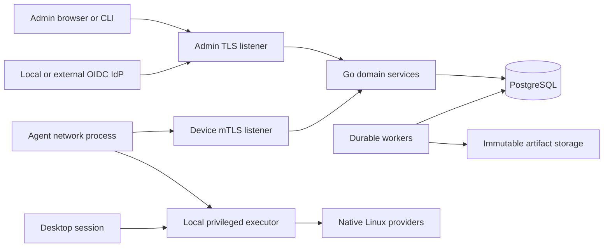

# Architecture and protocol contract

Status: design, not implemented. Requirements originate in the
[product specification](product-specification.md). Tradeoffs and sources are in
[research](research.md). Security/operations requirements are normative alongside
this document.

## 1. Selected architecture

Use a modular Go monolith, not microservices. The same server executable runs API,
worker, or combined roles. PostgreSQL is the authoritative database and durable work
queue; do not introduce Redis, Kafka, Kubernetes, or a workflow engine as baseline
installation prerequisites. Object/file storage holds immutable artifacts, not job
truth. The frontend is a TypeScript web application embedded in the server release.

| Component              | Responsibility                                                                                                 | Boundary                                                                                              |
| ---------------------- | -------------------------------------------------------------------------------------------------------------- | ----------------------------------------------------------------------------------------------------- |
| `lindmd`               | Admin and device RPC, SSO/session handling, reconciliation, durable workers, embedded console                  | Unprivileged process; one organization/database/trust domain per deployment                           |
| `lindm-agent`          | Outbound device transport, observation spool and reconciliation scheduling                                     | Separate executable from server; no inbound device TCP listener; cannot modify executor state         |
| Agent executor process | Typed privileged operations, authoritative execution journal/trust, plan verification and sensitive local keys | Same agent executable in executor mode, root-owned Unix socket with peer credentials and narrow RPC   |
| Agent session process  | Desktop notices, consent, self-service, recovery interaction                                                   | Same executable in session mode, unprivileged per-user context; never accepts raw privileged commands |
| `lindmctl`             | Automation, diagnostics and operator workflows over the same API                                               | No alternate authorization path or direct production database mutation                                |
| PostgreSQL             | Identity, desired state, jobs, audit/outbox, inventory and leases                                              | pgx with sqlc-generated queries, SQL migrations; no ORM                                               |
| Artifact store         | Packages, signed updates, exports and support attachments                                                      | Local filesystem on single host; S3-compatible storage for replicated topology                        |

Logical listeners may share port 443 on different names using L4 passthrough. Device
client certificates are verified at the application TLS boundary. Never trust a
client-supplied `X-Client-Cert` header. A supported TLS-terminating enterprise gateway
requires a separately authenticated, explicitly configured identity-forwarding
contract and tests; it is not the default topology. HTTP CONNECT passthrough proxies
are supported without weakening device authentication. Public bootstrap RPC is
separate from the mTLS-required device service.

## 2. API and compatibility

Choose Protocol Buffers with Connect-Go over `net/http`: generated Go clients for
agents/CLI and generated TypeScript clients for the console. Admin unary RPC may use
Connect JSON; device RPC uses binary protobuf over TLS/mTLS. gRPC compatibility is
useful, but clients do not require permanent bidirectional streams or a gRPC proxy.
SSO callbacks, SCIM, health/metrics and artifact transfer remain appropriate HTTP
interfaces; do not force external standards into proprietary RPC envelopes.

- Packages: `lindm.admin.v1`, `lindm.device.v1`, and `lindm.enrollment.v1`.
  Local executor RPC is a separate, non-network API.
- Never reuse protobuf field numbers or change field meanings. Reserve removed tags
  and names; run Buf lint and breaking-change checks against the released baseline.
- Separate API major, policy schema version, provider capability version, local state
  schema, and agent release. An additive API is not evidence of executable capability.
- Every mutation has an idempotency key scoped to principal and method. Persist its
  request digest and non-secret result with the domain transaction. Reuse with a
  different request returns conflict. Retention covers the maximum retry window.
  Secret issuance is deliberately different: grants/service tokens are returned only
  on their original creation response, stored only as hashes, and excluded from
  response caches/audit/outbox. A retry returns the credential ID and
  `secret_delivery_unknown`, never a new or recoverable bearer value. The authorized
  caller revokes that ID and issues a replacement with a new idempotency key after a
  lost response. Recovery reveals also bypass response caching and are independently
  authorized/audited on every attempt. No retry store may retain plaintext secrets.
- Updates carry expected resource versions; lost-update conflicts are explicit.
  List RPCs use bounded page sizes, stable keyset cursors and allowlisted filters.
- Use canonical RPC errors plus machine-readable reason/retry classification.
  Include request/operation IDs, never secrets or unbounded command output.
- All endpoints have request/decompression/body/output limits, deadlines, cancellation,
  concurrency bounds, admission/rate limits and auditable authorization decisions.
- Initial limits: 1 MiB ordinary control messages, 500 entries per inventory batch,
  200 list rows per page; large content uses bounded streamed artifact endpoints.
  Limits are validated against real inventory, not changed silently by clients.
- Support current and previous two released minor agent series for at least 90 days.
  Deprecated compatibility has an announced end date. Unsupported agents may obtain
  a verified update but cannot receive plans they cannot safely execute.

### Service responsibilities

| Service family       | Operations                                                                                                                           |
| -------------------- | ------------------------------------------------------------------------------------------------------------------------------------ |
| Enrollment           | Issue/revoke grants, submit CSR/proof, approve pending enrollment, finish/resume issuance                                            |
| Device identity      | Renew credentials, report key posture, revoke/recover identity                                                                       |
| Device sync          | Heartbeat/capabilities, publish sequenced observations, long-poll desired revision/work, acknowledge receipt, report progress/result |
| Fleet administration | Devices/groups/ownership, profiles/revisions/assignments, software/repositories, campaigns and exceptions                            |
| Privileged workflows | Approvals, recovery reveal, quarantine/lock/sanitization, enrollment recovery and retirement                                         |
| Integrations         | Scoped service accounts, import/export, audit/reporting, webhooks and directory provisioning                                         |

## 3. Identity and enrollment

Enrollment grants contain no long-lived shared fleet secret. They are high-entropy,
short-lived, one-use, hashed at rest, revocable, and limited to a deployment and
explicit enrollment profile. An authorized provisioning service can mint per-device
grants with bounded scope; a reusable secret embedded in a golden image is forbidden.
Grant consumption and device identity reservation are atomic.

1. The installer verifies a signed package and a deployment bootstrap bundle acquired
   through a trusted channel. It pins deployment identity, server trust, initial
   execution-trust root/quorum and version, and the separate release-update root.
   The root executor imports these into its own protected store. Never trust a key
   fetched from the same unauthenticated endpoint or chosen by the network process.
2. The agent generates its private device key locally, preferably non-exportable in a
   qualified TPM. Software-key devices remain explicitly distinguishable.
3. Bootstrap validates grant, server name/trust, CSR proof of possession, requested
   identity and approval policy. Hardware serial/MAC/machine-id are inventory hints,
   not authenticators or sufficient uniqueness constraints.
4. A reserved device ID and enrollment generation bind the certificate to the new key.
   A consumed grant cannot enroll a second key. Issuance can resume using a short-lived
   enrollment transaction handle plus proof by the same key after a lost response.
5. First authenticated acknowledgment activates the enrollment. A pending issuance
   times out visibly and can be administratively revoked.
6. Renew with current identity and fresh key proof; atomically publish the new cert
   before retiring the old credential. Short overlap is bounded and audited.

Initial device certificate lifetime: 30 days; renew after 10 days with jitter. Local
site CAs permit renewal inside air gaps. An expired device fails closed and uses an
approved, identity-bound recovery workflow; never silently reuses its old grant.
Offline devices cannot be assumed revoked locally, but the server denies revoked
identities on every request, including existing TLS connections. Do not cache
revocation longer than the documented 60-second enforcement bound.

Device credentials authorize only that device's resources and observations. They
cannot enumerate the fleet, call admin RPC, approve their own plan, or fetch another
device's secrets. Reinstallation creates a new enrollment generation. Golden images
must exclude device keys, grants and the agent journal; clone collision detection
quarantines ambiguous identities rather than merging by hostname.

## 4. Admin identity and authorization

OIDC Authorization Code with PKCE, state, nonce, issuer/audience/signature/expiry
validation and exact redirect URI matching. Use a maintained implementation. Browser
sessions are opaque, random, hashed in PostgreSQL, with Secure/HttpOnly/SameSite
cookies, CSRF and origin protection on mutations, 30-minute idle and 12-hour absolute
expiry. Tokens never go in browser local storage. CLI uses system-browser login with
PKCE and a loopback redirect; service accounts use separately scoped expiring tokens.

Bind principals to issuer plus subject, not email. Group claims map only through
explicit administrator policy; default deny. No first-login ownership auto-claim.
An install-time local bootstrap workflow binds the initial owner once. Admin MFA
and step-up requirements validate configured IdP authentication context and freshness;
if the IdP cannot supply the required assurance, privileged actions are unavailable.

SAML-only organizations federate through the supported Keycloak OIDC broker path;
this is not native SAML support. Launch certification also includes Microsoft Entra
ID, Okta and Google Workspace, each with actual provider-specific directory lifecycle
integration. SCIM users/groups are a separate provisioning endpoint with dedicated
authorization, filtering, PATCH/ETag behavior, bounded membership and explicit optional
capabilities. Keycloak and Google are not assumed to supply a native SCIM sender.

Provisioned identities correlate by a configured immutable provider subject/object ID
to the OIDC issuer/subject, with uniqueness enforced. SCIM `externalId` alone is not
proof: only the authorized connector's configured immutable correlation may bind it.
Never join by email, display name, username or an unverified client assertion. Ambiguous
or unbound principals have no grants. Rename/recycled-email tests must preserve this.
Deactivation/tombstones override login claims until authorized source reactivation;
stale OIDC claims cannot resurrect a SCIM-disabled account. Select exactly one
authoritative membership source per mapping; additive unions of conflicting sources
are forbidden. Device ownership and employee identity are separate records.

OIDC authentication alone does not notify us that an account/group was disabled.
Every certified deployment therefore includes an authoritative lifecycle adapter:
Keycloak Admin API locally, Microsoft Graph for Entra, Okta management APIs, or Google
Admin SDK Directory; SCIM/events accelerate updates but are not freshness proof.
Bind the least-privileged connector and immutable IDs during setup. Obtain a fresh
authorization snapshot at login and refresh active principals at most every 30 seconds.
No admin request uses an authorization snapshot older than 60 seconds; stale/failed
refresh denies protected access, including already-open sessions. Check current
deactivation and membership again for privileged approvals/dispatch. Provider-specific
rate limits, upstream propagation and assurance are certification inputs; an adapter
that cannot meet the declared bound is not certified by weakening it silently.
The 60-second enforcement bound starts when the change is visible in the configured
authoritative directory; separately measure and expose upstream propagation delay.
Accepted local/SCIM deactivation immediately invalidates sessions, principal-owned
credentials and pending authority. Directory deletion never erases audit or machines.
G1 includes the real Keycloak lifecycle adapter, not just the login flow. An outage
uses audited local-console break-glass, not indefinitely cached admin privileges.

For brokered identities, persist the complete immutable lineage: trusted broker
issuer/subject, configured upstream IdP, signed persistent upstream subject/object ID,
and authoritative directory connector. A successful read of Keycloak's imported
user/group copy is **not** upstream freshness; mapper synchronization during login
cannot refresh an already-active application session. Poll the original directory
through its approved connector and intersect its active/entitlement state with any
broker-local restrictions. Neither source may widen the other's authority. Missing,
ambiguous or stale lineage denies access under the same 60-second bound; freshness
timestamps derive from the upstream observation, never from reading a cached import.
The offline reference uses a local authoritative Keycloak realm as SAML upstream and
a separate broker realm, with the upstream realm's Admin API as lifecycle source.
Entra/Okta/Google broker paths use their original authoritative connectors. A generic
SAML-only source without a qualified lifecycle connector is not a certified
bounded-revocation integration; it cannot bypass this gate through a broker.
L02 must remove an upstream group and disable the upstream account while the existing
brokered application session continues making requests, without another SAML login.
Also test stale upstream state with a healthy broker, immutable subject remapping and
upstream outage. This source-lineage schema is defined at G1; actual brokered flows
are certified at G5.

### Employee and local-account entitlements

Launch supports both device assignments and person assignments, as confirmed by the
owner. Device baselines apply independently of a login. Device-wide self-service items
must explicitly allow local users and never convey person-specific secrets. Person
assignments require an active organizational principal and a verified binding to
device generation plus a local account incarnation, not merely a reusable numeric UID.
Directory accounts bind using the configured immutable directory object. A local-only
account can bind through system-browser OIDC plus a one-time challenge held by the
authenticated local session helper; the server binds subject/device/session evidence,
not a supplied email. A local-only unbound account sees only explicitly device-wide
items. Account deletion/recreation, ownership transfer, re-enrollment or directory
deactivation invalidates old bindings and person capabilities.

The executor resolves peer UID/session and a root-owned account incarnation, and
verifies signed entitlement tokens bound to that incarnation, principal, device,
specific request and expiry. Online checks are required for new person-specific
secrets/installs; existing offline login and last valid baseline behavior are separate
policies. Shared devices have multiple isolated bindings and no implicit inheritance
from the primary owner. Consent, app requests, user certificates and offboarding use
the same binding. Removal cleans up only resources owned by that binding. UID reuse,
conflicting directory mappings, user switching and transferred ownership are mandatory
L06/L09/L10 tests.

Authorization is evaluated in domain services for every request and again when
privileged work is dispatched. Roles and group scopes apply equally to UI, CLI,
exports, search/counts and workers. Actor authorization changes invalidate pending
privileged approvals. Two distinct authorized humans must approve a destructive plan;
service accounts cannot constitute the second person.

Break-glass is a documented local-console recovery procedure using separately held
recovery material. It is disabled during normal operation, time-bounded, unmistakably
audited, revokes affected sessions and requires a post-incident review. No universal
password or unauthenticated environment flag.

## 5. Desired state and execution semantics

A profile is an immutable revision of typed resources. A resource has stable identity,
kind/schema, desired values, sensitivity, applicability, dependencies, ownership and
verification requirements. Assignments have explicit priority and exclusion rules.
Two applicable resources claiming incompatible values at the same priority produce
`conflict`; do not select a winner by database order. Preview exposes overrides and
conflicts. Dependencies must be acyclic and available before activation.

Device/provider applicability uses detected OS, version, architecture, services,
package tooling, session, encryption topology and hardware—not just `ID_LIKE` from
`os-release`. Capabilities are versioned and carry reasons. A newer unknown policy
kind is rejected, never partially interpreted. Capability reports are untrusted
claims until observation and qualification support the operation.

Providers implement `Observe -> Plan -> Apply -> Verify`. Their operations are typed,
bounded, cancellation-aware and restart-recoverable. They use native D-Bus/APIs where
stable; otherwise explicit argv to documented tools with controlled environment,
locale and working directory. No shell interpolation, arbitrary path writes, or
server-supplied executable names in a typed policy. Protect config writes against
symlink/path races and validate syntax before atomic replacement/reload.

### Work contract

- Each operation binds device ID, enrollment generation, deployment recovery epoch,
  action UUID, immutable plan digest, desired revision, capability prerequisites,
  expiration, authorization/approvals and artifact digests.
- Sign privileged execution envelopes using a maintained standard envelope library
  (DSSE); publish and rotate the execution-verification trust separately from TLS
  and release-update trust. Executor verifies the envelope, not merely its caller.
- Delivery is **at least once**. Exactly-once remote effects are not promised.
  PostgreSQL leases coordinate workers; the local durable journal deduplicates effects.
- Initial cadence: heartbeat every 60 seconds with jitter, a bounded 30-second
  long-poll for work, exponential reconnect backoff with jitter, and server-provided
  pacing. Suspend/resume and offline periods do not create a catch-up storm.
- The root executor exclusively owns `/var/lib/lindm/executor` (0700) and its SQLite
  execution journal/trust files (0600), including acceptance, checkpoints, completions,
  trust versions, recovery epochs and replay fences. Persist before effects. Neither
  the network nor session process can edit/remove this state. Missing/corrupt state
  on an enrolled device enters recovery hold, never an empty success-ready journal.
  Reinstall/purge cannot silently reset replay state; reset requires revoked old
  enrollment and an approved new generation. Keep the unprivileged observation/
  transport spool separate. Observation batches use sequence/boot IDs; server
  acknowledgments follow durable writes and tolerate duplicate delivery.
- Serialize conflicting local resources, especially package transactions. Workers
  never hold a database transaction open while awaiting a device or remote storage.
- Results include before/after evidence, timestamps, boot ID, revision, retryability
  and verification freshness. Provider exit code zero is not sufficient compliance.
- Cancellation can prevent a not-yet-started action. A started package transaction
  is reconciled safely, not killed at an arbitrary point. `cancel_requested` does
  not claim that side effects stopped or rolled back.
- Desired-state retries re-observe actual state. Imperative reboot, lock, key rotation
  and erase recover according to their own durable state machine; they are not
  automatically replayed because a worker lease expired.
- Outcome unknown is persistent and operator-visible. Before retrying an irreversible
  effect, obtain new evidence or require a new explicitly approved operation.
- Expired or superseded actions cannot start. A revision change between dispatch and
  execution requires precondition revalidation. Destructive start authority is a
  separate signed response to a root-executor-generated random challenge, bound to
  device/generation, action UUID, exact plan digest, current recovery epoch and
  authorization version. Its validity is at most 30 seconds, not the 15-minute plan
  approval window. The executor verifies its trusted authorization signer and
  challenge, measures a monotonic local timeout and durably consumes the challenge
  before starting. The network process can relay bytes, never assert authorization
  success. Restart requires a new challenge and reconciliation; a grant cannot cross
  a reboot. If authority is revoked just after issuance, the explicit maximum
  residual start window is 30 seconds. Restore recovery cannot override previously
  issued authority instantaneously; keep dispatch fenced and drain that window before
  reopening. Once an irreversible action starts, cancellation is not guaranteed.
  Destructive operations never start from an offline queue.
- Last valid non-destructive desired state can continue reconciling offline within
  its documented validity period. No new recovery reveal, wipe or privilege grant
  occurs on stale authority. Local expiry never locks out an otherwise usable device.

The executor authenticates Unix-socket peers, binds session calls to their real UID,
checks authorization independently, caps input/output, and only accepts allowed
resource schemas. A compromised desktop helper must not become a root shell. The
network-facing process is unprivileged; executor has the minimum practical systemd,
SELinux/AppArmor and filesystem permissions per provider. Privilege separation
reduces exposure; it cannot withstand an already compromised kernel/root executor.

### Execution trust lifecycle

DSSE authenticates exact envelope payload bytes and a recognized versioned payload
type; it does not define who to trust. The executor rejects unknown schema/authority
roles. Bootstrap pins an execution-trust root distinct from transport and release
roots. A root-signed trust document delegates limited online plan/start signers with
deployment ID, roles, key IDs, monotonically increasing trust version, validity and
minimum recovery epoch. Root replacement requires both the currently trusted quorum
and the new quorum; apply a complete verified chain in order, durably before use.
The executor owns rollback counters and cached trust; TLS credentials, network-process
RPC and ordinary signed plans cannot change verification keys or extend expiration.
Missed rotations are delivered as a verified chain. If trust is expired or the chain
cannot be established, high-risk execution stays blocked until authenticated
out-of-band reprovisioning by the deployment owner. Suspected signer compromise
revokes its delegation and fences dispatch; a disconnected host may retain stale
non-destructive policy only within its original validity. No software mechanism
can immediately revoke authority on a disconnected compromised machine.

## 6. Persistence and transaction boundaries

Use normalized tables for identities, devices/enrollments/certificates, groups and
memberships, profile revisions/assignments, software/artifacts, campaigns, approvals,
actions/attempts/leases, observations, compliance/findings/exceptions, recovery key
metadata, sessions/service accounts, audit/outbox and integration deliveries. JSONB
is reserved for schema-versioned provider evidence, not unconstrained domain records.

Required uniqueness: issuer/subject; device/enrollment generation; grant consumption;
action UUID/device generation; idempotency scope/key; observation device/sequence;
artifact digest; immutable profile ID/revision. Foreign keys, constraints and indexes
encode invariants. sqlc generates pgx queries; reviewed SQL and real PostgreSQL tests
prove locking, pagination and transaction behavior.

A mutating transaction writes domain state, its audit event and outbox intent together.
Workers claim bounded batches with `FOR UPDATE SKIP LOCKED`, lease deadlines and
fencing tokens. Stale workers cannot commit completion after a new lease. External
delivery is retried from the outbox with receiver-visible idempotency IDs. LISTEN/NOTIFY
may reduce latency but is never a durable queue. A dead-lettered delivery remains
visible and replayable under authorization.

Local and remote artifact storage implement the same content-addressed contract:
stream upload into a staging object, enforce size/hash and scan/approval policy,
atomically publish the immutable digest, then reference it transactionally. Never
publish a partial object. Garbage collection has a grace period and cannot remove
referenced release, recovery, legal-hold or restore objects. Do not store multi-GB
packages in PostgreSQL or read them into a whole-memory byte slice.

## 7. Deliberate tradeoffs

- Connect avoids separate browser API and transport gateway; protobuf is a product
  protocol, not a claim of standardized Linux MDM interoperability.
- PostgreSQL queue/outbox avoids infrastructure sprawl; capacity gates determine
  whether partitioning or a later broker is warranted, not speculation.
- Native adapters avoid replacing package managers and network stacks. Narrow shared
  interfaces do not erase distro-specific behavior or license requirements.
- Inventory uses typed native collectors first. osquery may be an optional pinned,
  separately signed advanced-query provider, not a mandatory second daemon or a
  privileged arbitrary-SQL remediation channel.
- Root execution is unavoidable for many controls. Keep the privileged protocol
  narrow instead of describing an all-powerful root daemon as sandboxed.
- All single-tenant resources share a deployment trust domain. Group RBAC is not
  hostile-tenant isolation. Separate organizations require separate installations.

## 8. Mutable, rolling and declarative platform contracts

The owner included legacy, SUSE enterprise, rolling and immutable/declarative Linux
in the launch scope. Do not model these as DEB/RPM aliases:

| Platform                  | Native provider contract                                                                                                                                                                            |
| ------------------------- | --------------------------------------------------------------------------------------------------------------------------------------------------------------------------------------------------- |
| Debian/Ubuntu             | apt-get/dpkg, native signature/dependency policy and explicit package locks; preserve native configuration ownership                                                                                |
| Fedora/RHEL/Rocky/Alma    | DNF4 or DNF5 as detected, RPM truth, SELinux enforcing; EL8 runtime differences remain separate                                                                                                     |
| Leap/SLES/SLED            | zypper/libzypp transactions and supported installer/version-specific service/network interfaces                                                                                                     |
| Arch                      | pacman/libalpm, signed repository snapshot and whole-system compatible upgrade plan; no unsupported partial-upgrade promise                                                                         |
| Tumbleweed                | Tested distribution snapshot and native zypper distribution-upgrade semantics; snapshot pinning/rollback evidence, not Leap patch rules                                                             |
| Fedora Silverblue/Kinoite | rpm-ostree staged deployment and booted checksum, explicit layering, reboot/rollback and preserved mutable state; no apt/dnf mutation of the immutable OS                                           |
| NixOS                     | Explicit composition with the owner's declarative configuration, pinned inputs and signed closure/cache; build/test/boot/activate a system generation, never edit generated `/etc` files behind Nix |

Core typed policy vocabulary stays shared, but each provider declares what it can
enforce and how. On NixOS, activation requires a previewed configuration/closure
digest and ownership agreement; arbitrary Nix expressions from a low-privilege
request are not a policy API. Offline bundles include closure dependencies and binary
cache trust. Agent and baseline changes participate in the platform transaction;
they cannot be overwritten independently by a second package updater. Flatpak apps,
user data and database migrations are not reverted merely by rolling back the OS.
Rolling systems are certified at recorded repository/installation snapshots, with a
published supported update window and continuously tested candidate snapshots.
Failure to qualify the next snapshot pauses rollout and is visible; it does not
silently make all rolling releases supported.

## 9. Built-in graphical remote assistance

The owner selected a built-in operator and employee experience, not a link to a
third-party support product. Reuse the XDG RemoteDesktop/ScreenCast portals and
PipeWire for session capture, supported EIS/libei or portal input methods for control,
and standard WebRTC with a maintained implementation for media/data transport.
Capability-test portal/backends on each supported GNOME/KDE session; no silent X11
capture fallback that bypasses user consent. The implementation feasibility gate
must prove older supported desktop versions before claiming matrix parity.

The console requests a single-use, device/session/person-bound support invitation
with reason and operator identity. The active local user explicitly accepts screen
sharing; keyboard/pointer control is a separately visible permission. The local
portal grant and product authorization are both required. No unattended access,
login-screen capture, automatic unlock, cross-session access, file transfer or
clipboard transfer is implied. These are separately authorized future scope decisions.
Visible indicator and local stop control persist throughout the session; lock,
logout, UID/session change, consent withdrawal or authorization expiry terminates it.

Signaling uses authorized server RPC with bounded messages. Bind SDP/DTLS fingerprints,
session identities, capability and expiry to the authenticated invitation exchange;
an unrelated enrolled device/operator cannot join by guessing a room ID. Use
DTLS-SRTP media and authenticated data channels, fresh per-session credentials and
short-lived TURN allocations. Reauthorize control at least every 30 seconds; loss of
authority ends access rather than indefinitely maintaining a peer-to-peer channel.
Default maximum session duration is 30 minutes with fresh local consent to extend.

Ship/configure a local TURN service such as coturn for relay-required networks and
air-gapped sites. It is optional to the MDM core but required for the supported
relayed assistance topology; no public STUN/TURN dependency. Document UDP/TCP/TLS
ports, trusted relay destinations and bandwidth/admission budgets. For restrictive
deployments, require the local relay rather than leaking peer network addresses.
Graphical assistance is not a headless-server control mechanism; servers retain
typed diagnostics and authorized maintenance operations.

Default audit records consent, operator/employee/session IDs, capabilities, reason,
start/stop and termination cause, not captured screen contents. Session recording is
off by default and not a launch guarantee; adding it requires explicit recording
consent, encryption, retention/legal rules and product approval. L09/L12/L16 must
prove the actual UI, input effects, identity isolation, local termination, relay-only
operation and network interruption on real graphical sessions.
