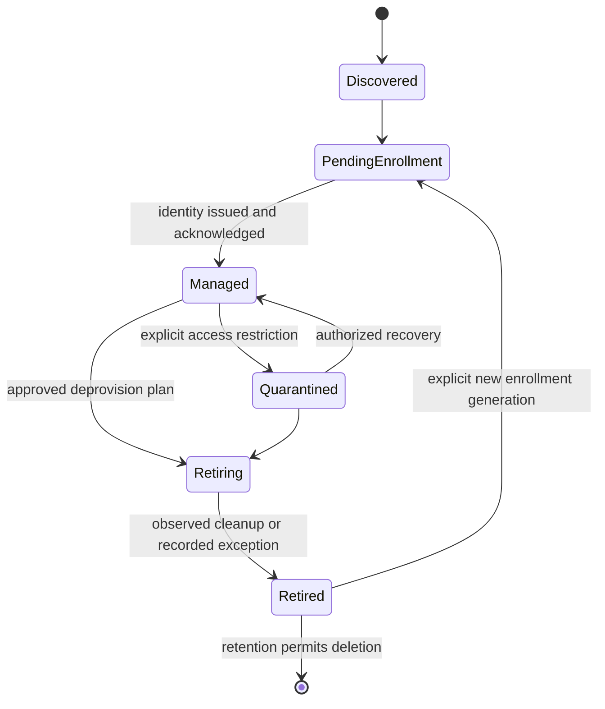

# Linux MDM product specification

Status: release-scoped implementation contract. Enrollment, inventory, profile catalog
and signed local service execution have exercised implementations; production
dispatch and the revised authentication modes are not yet qualified. No release is
certified. See the [evidence ledger](implementation-plan.md#2-evidence-ledger).
Research baseline: 2026-10-08. Working name: `lindm`.

## 1. Product outcome

A self-hosted, single-tenant Linux device-management product with the usability of
SimpleMDM: enroll a device, assign understandable policies and software, see whether
those policies actually took effect, and safely manage the device through retirement.
Desktop experience is the priority. Company-owned servers are also in the commercial
launch scope and share the management core, not the desktop assumptions.

The commercial launch contract is the **entire** requirement set below (P01–P21) on
every Tier 1 and Tier 2 distribution in [supported OS tiers](#supported-os-tiers),
plus the other branches allocated in [verification](verification.md).
Nothing in this specification is optional roadmap. Implementation milestones (G0–G8)
only order the work; they are not permission to ship a reduced product as
production-ready. No resource, derivative, architecture or desktop workflow inherits
support from a neighboring cell.

The build order started with one systemd service resource proven end to end
(console intent → server work → installed agent → native effect → device-signed
result → console), so that every later resource kind and imperative action reuses a
proven authority, dispatch and evidence spine. The highest-priority capabilities after
that spine are: agents qualified on the major releases (Ubuntu, Fedora, RHEL), disk
encryption management (inventory, recovery-key escrow and rotation, TPM2 binding and
cold-boot recovery), and remote lock, quarantine and wipe with two-person approval.

QEMU/KVM emulation (UEFI Secure Boot, swtpm TPM 2.0, NVMe/SATA/virtio disks,
aarch64, desktop sessions, network faults) is used to build and verify behavior as far
as emulation allows. Evidence records whether each property was emulated or physical.
Destructive and hardware-attestation capabilities still require their recorded
physical-hardware gate before they are advertised; a missing machine never leaves the
behavior unbuilt.

### Confirmed product decisions

- Greenfield implementation; Fleet is a research reference, not the base product.
- Go backend, PostgreSQL with sqlc, versioned protobuf RPC, and a separate Go agent.
- One organization per installation; single-host deployment must be first-class.
- Desktop-first, with company-owned servers included. No graphical dependencies in
  the server agent. Desktop integrations are an unprivileged presentation layer.
- Connected and genuinely air-gapped installations are both launch requirements.
- Remote lock, quarantine and wipe are launch requirements. They are
  capability-gated, audited and two-person approved; advertised destructive
  capabilities also require physical-hardware validation.
- Production security, scaling, repeatable lifecycle testing, maintainable automation,
  code review, linting, and Git hooks are requirements from the start.
- Launch distributions follow the [supported OS tiers](#supported-os-tiers). Each
  native management model gets its own qualification. Rolling systems use pinned
  snapshots and whole-system upgrades. NixOS and Fedora Atomic need a separately
  specified declarative/image-based model, not DEB/RPM aliases.
- Employee entitlements support both device and person assignments, with explicit
  organizational-identity/local-account bindings and no cross-user secret inheritance.
- Built-in local admin accounts use Postgres, Argon2id and mandatory WebAuthn.
  Keycloak (including offline and SAML brokerage), Entra ID, Okta and Google Workspace
  are certified directory integrations with actual lifecycle sync, plus SCIM. Keycloak
  is optional, not mandatory.
- Lindm authenticates its own administrators only. It does not become an IdP or
  issue identity tokens for other applications.
- Graphical remote assistance is built into the product with explicit user consent;
  it is not outsourced to a third-party support product or an unattended root shell.

### Supported OS tiers

The owner set these tiers on 2026-10-11. **Tier 1** is desktop-first with full parity
with Ubuntu 24.04. **Tier 2** meets the same contract through a rolling model.
**Future** rows (NixOS, Fedora Atomic Silverblue/Kinoite) are a design-only management
model: their declarative and image-based models stay unadvertised and unbuilt beyond
design until a separate model is specified. The table is generated from the platform
registry (`internal/platform`, `make generate`); the live per-capability matrix is in
[verification](verification.md#platform-support-tiers).

<!-- BEGIN GENERATED platform-tiers -->

| Tier   | Distribution        | Releases                        | Desktop edition                | Architectures   | Platform page                             |
| ------ | ------------------- | ------------------------------- | ------------------------------ | --------------- | ----------------------------------------- |
| 1      | Ubuntu              | 22.04 LTS, 24.04 LTS, 26.04 LTS | GNOME                          | x86_64, aarch64 | [ubuntu](platforms/ubuntu.md)             |
| 1      | Debian              | 12, 13                          | GNOME/KDE                      | x86_64, aarch64 | [debian](platforms/debian.md)             |
| 1      | Fedora              | 43, 44                          | Workstation GNOME; KDE edition | x86_64, aarch64 | [fedora](platforms/fedora.md)             |
| 1      | RHEL                | 9, 10                           | GNOME                          | x86_64, aarch64 | [rhel](platforms/rhel.md)                 |
| 1      | Rocky Linux         | 9, 10                           | GNOME                          | x86_64, aarch64 | [alma-rocky](platforms/alma-rocky.md)     |
| 1      | AlmaLinux           | 9, 10                           | GNOME                          | x86_64, aarch64 | [alma-rocky](platforms/alma-rocky.md)     |
| 1      | Linux Mint          | 22.3                            | Cinnamon                       | x86_64          | [mint](platforms/mint.md)                 |
| 1      | Pop!\_OS            | 24.04 LTS                       | COSMIC                         | x86_64          | [popos](platforms/popos.md)               |
| 2      | Arch Linux          | rolling                         | owner-chosen per record        | x86_64          | [arch](platforms/arch.md)                 |
| 2      | Omarchy             | 4.0.4                           | Hyprland                       | x86_64          | [omarchy](platforms/omarchy.md)           |
| 2      | openSUSE Tumbleweed | pinned snapshot                 | KDE Plasma/GNOME               | x86_64, aarch64 | [opensuse](platforms/opensuse.md)         |
| Future | Fedora Atomic       | Silverblue/Kinoite              | —                              | —               | [atomic-nixos](platforms/atomic-nixos.md) |
| Future | NixOS               | any                             | —                              | —               | [atomic-nixos](platforms/atomic-nixos.md) |

<!-- END GENERATED platform-tiers -->

Full parity means the agent lifecycle works: signed install, enrollment, upgrade,
reboot, purge/reinstall and revocation. It also needs connected dispatch, strict
inventory health and all eight configuration kinds. Encryption covers inventory,
escrow, reveal, rotation, TPM2 binding and cold-boot recovery. Wipe covers live-root
crypto-erase, report-loss and recovery sanitize. It also needs lock, release and
quarantine, agent self-update, OS patch policy and remote assistance. Each
distribution, version, architecture and desktop edition qualifies on its own; a
derivative never inherits its base's evidence.

### Definitions

- **Managed** means an enrolled agent has a valid identity and an assigned lifecycle.
  It does not mean its last report is current or every policy is enforced.
- **Compliant** means all required controls have fresh, applicable, successful evidence.
  Unknown, unsupported, stale, conflicting, and not applicable are distinct states.
- **Supported** means a published distro/version/architecture/capability combination
  passed its release gates. A package that installs is not sufficient evidence.
- **Air-gapped** means installation and operation without public DNS, Internet egress,
  public identity providers, public registries, or license/telemetry phone-home.
- **Lock** means the named, tested lock mechanism. It never implicitly means Apple
  Activation Lock, boot prevention, or resistance to a hostile root user.
- **Wipe** means a named sanitization workflow and its evidence, not "device stopped
  checking in." A lost acknowledgment is an unknown outcome.

## 2. Users and critical journeys

| User              | Required journey                                                                         | Observable success                                                                              |
| ----------------- | ---------------------------------------------------------------------------------------- | ----------------------------------------------------------------------------------------------- |
| IT administrator  | Configure identity, enroll machines, assign baseline/apps                                | Devices become ready with independently observed policy and software state                      |
| Employee          | See management disclosure, install approved apps, defer a restart, request help          | No administrator password or arbitrary root execution; accessible UI and clear reasons          |
| Server operator   | Schedule patches and reboot coordinated hosts                                            | Explicit headless policy, bounded concurrency, availability prerequisites and no desktop prompt |
| Security operator | Investigate stale/vulnerable devices, rotate recovery access, isolate or retire a device | Scope-limited, fresh evidence and attributable approved actions                                 |
| Auditor           | Export configuration history, access, approvals, and execution evidence                  | Complete time-bounded records with actor, reason, revision, outcome, and redaction              |
| Platform operator | Install offline, upgrade, restore, rotate keys, scale workers                            | Documented reproducible operations without bypassing integrity or authentication                |

### Lifecycle

Connectivity is orthogonal: online, delayed, offline, or stale must not overwrite
lifecycle. Deleting a record is not unenrollment. Revoking an identity does not erase
local data. Uninstall and retirement are separately tracked operations.

## 3. Commercial launch requirements

All rows are launch requirements for their certified capability combinations. A
capability limitation must have a visible reason and remediation, not a green check.
The test references are scenario families in [verification](verification.md).

| ID  | Capability and required behavior                                                                                                                                                                                                                                                                     | Acceptance evidence                                                                                                                                                                                       |
| --- | ---------------------------------------------------------------------------------------------------------------------------------------------------------------------------------------------------------------------------------------------------------------------------------------------------- | --------------------------------------------------------------------------------------------------------------------------------------------------------------------------------------------------------- |
| P01 | Install and bootstrap a single host using signed artifacts, external hostname/TLS, PostgreSQL, durable artifact storage, and first-owner setup                                                                                                                                                       | Fresh connected and offline installs; restart survives; bootstrap cannot be claimed a second time (L01, L14)                                                                                              |
| P02 | Built-in local admin accounts (Argon2id, mandatory WebAuthn), CLI loopback PKCE sessions; certified Keycloak (incl. SAML broker), Entra, Okta and Google Workspace directory lifecycles; SCIM provisioning; opaque sessions, roles, CSRF, authorization fencing, MFA/step-up and audited break-glass | Actual local/external login, immediate local disable, bounded external revocation/outage denial, WebAuthn enrollment and replay rejection, restricted break-glass, broker flow and SCIM correlation (L02) |
| P03 | Owner/admin/operator/helpdesk/auditor roles and group-scoped custom roles; separate recovery-key, remote-execution, destructive-action, approval, and infrastructure permissions                                                                                                                     | Every RPC denies unauthorized and out-of-scope identities; no self-approval; no scope leakage in counts/exports (L02, L13)                                                                                |
| P04 | Interactive and unattended enrollment, short-lived one-use grants, approval flows, offline-site enrollment, reinstall and identity recovery                                                                                                                                                          | Token races, expiration, cloned image, interrupted enrollment, identity renewal/revocation, and re-enrollment (L03)                                                                                       |
| P05 | Hardware/OS/software inventory, ownership, labels, custom typed attributes, last-seen and data freshness, searchable pagination and export                                                                                                                                                           | Real machines and packages; architecture, package epochs, serial absence, changed boot IDs and stale records handled (L04)                                                                                |
| P06 | Static/dynamic groups, assignments, exclusions, immutable profile revisions, previews, staged rollout, drift detection and remediation                                                                                                                                                               | Target preview matches execution snapshot; conflicting resources rejected; obsolete revisions do not execute (L05)                                                                                        |
| P07 | Native security/configuration controls: local accounts/groups and sudo, SSH, session/password settings, service state, firewall, time, trust stores, Wi-Fi/Ethernet/VPN and DNS/proxy                                                                                                                | Per-backend enforcement plus fresh observation, reboot persistence, drift repair, safe network rollback and uninstall ownership (L05, L10)                                                                |
| P08 | Repository/software management across DEB/RPM/Arch packages and atomic/Nix deployments, Flatpak/Snap capability providers, device/person self-service assignments                                                                                                                                    | Native dependencies/signatures/transaction ownership, source failure, offline mirrors and per-person authorization; no unsafe partial upgrades (L06)                                                      |
| P09 | OS/security update policies, advisory reporting, rings/canaries, maintenance windows, restart deadlines/deferrals, exclusions and server availability budgets                                                                                                                                        | Real kernel/package updates and reboot; interrupted transactions; DST/timezone changes; rollout automatically pauses on threshold (L07)                                                                   |
| P10 | Encryption inventory, supported LUKS recovery escrow and rotation, TPM/Secure Boot posture, controlled recovery access                                                                                                                                                                               | Recovery unlock after cold boot, key rotation and escrow failure recovery on qualified configurations; never generic live encryption (L10, L15)                                                           |
| P11 | Certificates and identity: trust roots, device/user certificate enrollment and rotation, revocation, enterprise EAP-TLS/VPN credentials, SSSD/realmd directory configuration where certified                                                                                                         | Certificate renewal, removal, wrong EKU/name rejection, network authentication, directory outage and offline-login policy (L10)                                                                           |
| P12 | Compliance rules, exceptions with expiry, vulnerability findings using distro advisories, remediation workflows and evidence exports                                                                                                                                                                 | Backported fixes and package epochs correctly classified; stale feeds/observations are unknown; expired exception resurfaces (L11)                                                                        |
| P13 | Desktop status/disclosure, approved self-service apps, reboot notices/deferrals, recovery interaction and support requests; GNOME and KDE paths                                                                                                                                                      | Actual visible Wayland and applicable X11 sessions, accessibility and multi-user isolation; no dependency on a tray extension (L09)                                                                       |
| P14 | Audited diagnostics, reboot/shutdown, support bundles, built-in consent-controlled graphical assistance and restricted script escape hatch                                                                                                                                                           | Actual console/employee screen-share/control UX, local/remote termination, session isolation and local TURN under air-gap; scripts remain distinct (L09, L12, L16)                                        |
| P15 | Capability-gated session lock, access restriction/quarantine and sanitization plans with two-person approval, target preview and physical validation                                                                                                                                                 | Unsupported plans refused; approvals bind exact targets/action/revision/expiry; ambiguous result stays unknown; qualified physical evidence (L13, L15)                                                    |
| P16 | Safe offboarding: remove owned profiles/apps/credentials by policy, revoke device/user access, transfer ownership, retain audit and re-enroll deliberately                                                                                                                                           | No unrelated configuration/data removal; cancellation/partial cleanup visible; server reboots not implied by retirement (L08)                                                                             |
| P17 | Full admin API/CLI parity, versioned RPC, stable cursors, idempotent mutations, signed webhooks, scheduled reports, SIEM/CMDB export and Git-managed policy import                                                                                                                                   | Retry/deduplication, ordering and delivery failure visible; secrets excluded; preview/change authorization same as UI (L12)                                                                               |
| P18 | Tamper-evident audit export, configurable retention/legal holds, privacy controls, event alerts, backup/restore, key rotation, upgrade/rollback operations and metrics                                                                                                                               | Restore drills, audit continuity, retention boundary tests, external archive verification and failure alerts (L14)                                                                                        |
| P19 | Offline install/update/software/advisory distribution, local IdP and PKI, site mirrors, signed import/export bundles and explicit freshness                                                                                                                                                          | Full isolated lifecycle with egress denied, expired/replayed/corrupt bundles refused; local management continues (L16)                                                                                    |
| P20 | Native package/image/generation delivery, unattended agent updates, compatibility, reproducible releases, SBOM/provenance/signatures and distro certification                                                                                                                                        | Full matrix install/update/recovery and two clean builds with matching unsigned payload digests; old-agent/new-server and rejection attacks (L08, L17)                                                    |
| P21 | Horizontal control-plane/worker operation with durable jobs, isolation/backpressure, predictable capacity and no mandatory message broker                                                                                                                                                            | Sustained load and failover gates in operations; no duplicate destructive effects or lost accepted work (L18)                                                                                             |

### Original-device sanitize capability

Original-device SATA/NVMe sanitize requires the approved signed recovery image to
fit the existing EFI system partition, including allocation-unit rounding. A
fresh authenticated inventory observation reports the image, needed and available
bytes before approval. Insufficient capacity is **unsupported: ESP capacity**, not
an approval warning or a sanitization failure after erasure begins. The console
shows those bytes and the external-recovery alternative. Execution rechecks space;
inventory readiness is neither authority nor a reservation.

Do not resize the ESP, remove or compact ordinary boot images, replace the
distribution kernel with an unqualified kernel, or weaken image trust to turn a
gated cell green. The pinned Fedora 44 stock fixture is such a gated cell: its
unchanged ESP has 14,888,960 bytes available, while its vendor-signed kernel alone
is 18,479,464 bytes before the recovery stub and initramfs. Component digests and
native records are retained in [verification](verification.md).

An on-site operator may instead use separately qualified external recovery media
with the same exact target validation, fresh two-person authorization and
protected off-target state described in
[dangerous-action operations](security-and-operations.md#3-dangerous-actions).
That mode is not remote wipe of a lost or stolen device and does not certify
original-device sanitize for the capacity-gated configuration.

### Management, not a script runner

Policies describe desired resources with schemas, applicability, dependencies,
conflict rules, observation, planning, application, and verification. Routine package,
account, firewall, certificate, and configuration operations use typed providers.
A provider may invoke a documented system utility with explicit arguments when it
is the correct interface. That is not equivalent to distributing arbitrary shell.

The shared resource vocabulary is closed and versioned: twenty kinds cover the
P07/P08/P09/P11 configuration scope. Profiles are heterogeneous and canonical
resource identities are derived from typed fields. Static/dynamic targeting,
exclusions, priority, pinned previews and staged rings do not weaken native
ownership or fresh execution authority. A declared kind without a qualified
executor remains visibly unsupported and is still a launch blocker. Unassignment
requests ownership-safe release, never invents a previous value and never treats
missing ownership evidence as successful cleanup.

A script is a separately authorized, immutable, hashed artifact with an explicit
interpreter, target identity, deadline, runtime/output bounds, audit, and results.
It is disabled by default, cannot be a hidden fallback for an unsupported provider,
and cannot silently upgrade a device's compliance state. Package maintainer scripts
are also privileged code; publisher approval and source integrity are required.

### Software and OS distinctions

- Package updates and release upgrades are different operations. Release upgrades
  need their own supported source/target pair, preflight, backup, recovery and gate.
- Generic package downgrade is not promised to undo schema/data migrations.
  Rollback eligibility is per application/provider, displayed before approval.
- Repositories carry distro/architecture, signing identity, provenance, entitlement
  and snapshot/freshness metadata. Do not mix incompatible distribution packages.
- Flatpak and Snap are app distribution capabilities, not assumptions about every
  server. Offline support requires a tested approved mirror/import workflow and
  permitted redistribution; missing content blocks the plan rather than fetching
  from the Internet. User-scoped installs run as the intended local user.

### Remote assistance capabilities

This is the delivery contract for P13/P14 and L09/L12/L16, not a claim that the
capabilities below have shipped. Existing consent-controlled view/control evidence
does not qualify clipboard, file transfer, recording or unattended access. The
[assistance evidence ledger](verification.md#built-in-graphical-remote-assistance-l09-l12)
records each platform/capability separately.

Every capability has an independent administrator policy: **off** denies it,
**limited** applies the restrictions stated below, and **on** permits it within
the session's consent, role, scope, expiry and platform gates. On never overrides
portal consent, lock, logout or another user's session. The server intersects
deployment policy, operator permission, device capability and local grants; the
helper enforces that intersection again. Policy revocation takes effect during
the session. Disabled and unsupported controls show a reason, not a successful
empty result.

The built-in owner/admin roles may configure policy and use authorized capabilities;
operator/helpdesk roles receive none implicitly and require explicit scoped grants.
Auditors receive metadata through `audit.read`, not live-screen or content access.
Recording retrieval requires a separate explicit scoped grant, including for an
auditor. Live capability permissions below add to `remote_assistance.run`; recording
retrieval/deletion instead use their own permissions and device scope without
granting live assistance. Policy administration uses `remote_assistance.policy.manage`.
No role, including owner, bypasses local consent. Policy changes, denied operations,
consent changes and capability withdrawal are audited with actor, device, session,
effective policy, result and reason. Clipboard/message bodies, keystrokes, file
paths, credentials and recording plaintext never enter the ordinary audit log.

#### Tier 1: interactive support

| Capability and user story                                                                                                                            | Consent and off/limited/on policy                                                                                                                                                                                                                                                                                                           | Per-role permission and audit                                                                                                                                                                                                                           | Wayland mechanism, platform support and lab qualification                                                                                                                                                                                                                                                                                                                                                                                          |
| ---------------------------------------------------------------------------------------------------------------------------------------------------- | ------------------------------------------------------------------------------------------------------------------------------------------------------------------------------------------------------------------------------------------------------------------------------------------------------------------------------------------- | ------------------------------------------------------------------------------------------------------------------------------------------------------------------------------------------------------------------------------------------------------- | -------------------------------------------------------------------------------------------------------------------------------------------------------------------------------------------------------------------------------------------------------------------------------------------------------------------------------------------------------------------------------------------------------------------------------------------------- |
| Clipboard both ways: the operator and employee explicitly copy a troubleshooting snippet without retyping it.                                        | Off by default. Limited permits operator-to-user text only; on additionally permits user-to-operator text. The invitation names directions and the user grants them. Transfers require an explicit Copy/Send action, not continuous clipboard scraping; revocation clears queued data. UTF-8 text only, bounded size, no HTML/images/files. | `remote_assistance.clipboard` for owner/admin or explicitly scoped operator/helpdesk; auditor denied. Audit `assistance.clipboard` with direction, byte count, outcome, never content or content hashes of low-entropy text.                            | Use `org.freedesktop.portal.Clipboard` on the **existing RemoteDesktop session**, never a second capture session, X11 utility or root clipboard. Probe the frontend and backend; GNOME 46/Ubuntu 24.04 and GNOME 50/Fedora 44 have independent source and runtime gates. Lab writes a fresh nonce in each peer's real clipboard and verifies the opposite clipboard, plus denied direction, oversized text, withdrawal and end-of-session refusal. |
| Special keys and layout fidelity: the operator sends shortcuts intercepted by the browser and types text correctly with a different keyboard layout. | Off disables remote keyboard input; limited permits printable text; on permits an explicit bounded special-key menu. All require the portal's keyboard grant and Take control. Secure-attention/login/unlock bypasses are never offered.                                                                                                    | `remote_assistance.keyboard` for owner/admin or explicit operator/helpdesk; auditor denied. Audit `assistance.special_keys` with named chord and result; never log ordinary typing.                                                                     | Portal `NotifyKeyboardKeysym` represents semantic text; `NotifyKeyboardKeycode` represents physical shortcuts. Track and release pressed keys on blur, disconnect and stop. Menu labels describe the guest action. GNOME Wayland qualification proves observable guest shortcut effects, US/non-US mismatched layouts, modifiers, repeats and no stuck keys.                                                                                       |
| Full screen, scaling and monitor selection: the operator reads a chosen display and controls the matching coordinates.                               | Off prohibits display switching/full-screen controls; limited allows fit/actual-size/full screen of the initially consented display; on allows selecting among displays explicitly granted by the portal. Selecting an ungranted monitor requires fresh local portal consent. Browser full screen never changes capture authority.          | `remote_assistance.display` for owner/admin or explicit operator/helpdesk; auditor denied. Audit `assistance.display` for selected stream and outcome; local zoom/full-screen changes need no server audit because they disclose no additional content. | ScreenCast stream IDs and dimensions bind media and absolute-pointer routing. No compositor-wide capture fallback. Ubuntu 24.04 and Fedora 44 GNOME Wayland each require a two-head virtio-gpu guest, distinct visible markers on both heads, selection and pointer-coordinate checks at fit/actual size and browser full screen. Hot-unplug fails visibly and cannot select another display silently.                                             |
| Operator messages: the operator can tell the employee what to do next without a separate chat application.                                           | Off by default; limited permits one outstanding message in an accepted session; on permits bounded sequential messages in an accepted session. No pre-consent free-text message channel. Local notification identity clearly says who sent it; messages cannot masquerade as authentication prompts.                                        | `remote_assistance.message` for owner/admin or explicit operator/helpdesk; auditor denied. Audit `assistance.message` with byte count and delivered/rejected/unknown outcome, not body.                                                                 | Per-user desktop notification through the existing notification helper, on the bound local session only. Plain text, bounded length/rate; no markup, links/actions that execute commands or secrets. GNOME 46/50 lab captures an actual notification containing a nonce in a guest screenshot and verifies another UID/session cannot receive it. Notification service acceptance alone is not proof of visibility.                                |

#### Tier 2: managed support workflows

| Capability and user story                                                                                   | Consent and off/limited/on policy                                                                                                                                                                                                                                                                                                                                                                                                                                                                                                                             | Per-role permission and audit                                                                                                                                                                                                                                                                                                                                                                                        | Wayland mechanism, platform support and lab qualification                                                                                                                                                                                                                                                                                                                                                                                                                                                                                                                                                                                                                                                                                                  |
| ----------------------------------------------------------------------------------------------------------- | ------------------------------------------------------------------------------------------------------------------------------------------------------------------------------------------------------------------------------------------------------------------------------------------------------------------------------------------------------------------------------------------------------------------------------------------------------------------------------------------------------------------------------------------------------------- | -------------------------------------------------------------------------------------------------------------------------------------------------------------------------------------------------------------------------------------------------------------------------------------------------------------------------------------------------------------------------------------------------------------------- | ---------------------------------------------------------------------------------------------------------------------------------------------------------------------------------------------------------------------------------------------------------------------------------------------------------------------------------------------------------------------------------------------------------------------------------------------------------------------------------------------------------------------------------------------------------------------------------------------------------------------------------------------------------------------------------------------------------------------------------------------------------- |
| File transfer: the operator delivers a support file to Downloads, or the employee selects a file to return. | Off by default, separately from clipboard/control. Limited permits admin-to-user only; on permits both directions. Each file needs visible local acceptance while **all remote input and clipboard injection are paused**, with pending inputs released/discarded before showing approval or FileChooser. Only local completion resumes control. User-to-admin is selected **only** in the portal FileChooser, never a remote path request. Policy bounds per-file/session bytes, permitted MIME/types and extensions; blocked types remain blocked under on. | `remote_assistance.files` for owner/admin or explicit operator/helpdesk; auditor denied. Audit `assistance.file.request`, `.complete`, `.deny`, `.cancel` with direction, size, SHA-256, policy decision and result; no source path or content.                                                                                                                                                                      | Write as the session user beneath `~/Downloads`, with exclusive no-follow creation, sanitized basename, no overwrite, executable permission or automatic launch; show completion notification. Read only a regular file explicitly selected by `org.freedesktop.portal.FileChooser`; descriptor/identity checks defend symlink and selection races. Authenticated bounded streaming, digest verification, quotas and cancellation must span browser/server/helper. Ubuntu/Fedora lab proves both directions and hashes, portal cancel, remote inability to approve/select, traversal/symlink/overwrite refusal, size/type limits, interrupted transfer cleanup and visible notification. An independent security-reviewer pass is required before landing. |
| Reconnect: the operator resumes a support workflow after the employee reboots or logs out.                  | Off by default. Limited offers a new invitation with fresh local and portal consent after reconnect. On may remember an approved workflow for a bounded interval under explicit policy, but each new login/portal session still requires consent. Only a connection independently satisfying an in-force unattended approval and native persistent grant may use that separate consent model; policy on or possession of a permission is insufficient. No stored portal token is itself authority.                                                            | `remote_assistance.reconnect` for owner/admin or explicit operator/helpdesk; auditor denied. Audit `assistance.reconnect.request`, `.consent`, `.expire`, `.end`, linking old/new sessions without reusing grants or media credentials.                                                                                                                                                                              | Lock/logout/reboot ends old capture. Persist only bounded workflow metadata; rebind fresh device epoch, UID/logind session, permissions, portal grant, TURN and DTLS identity. Ubuntu/Fedora lab performs real reboot and logout, fresh consent/cancel, changed user, expired workflow and revoked operator/policy; no screen/input exists before fresh authorization.                                                                                                                                                                                                                                                                                                                                                                                     |
| Recording: the organization retains an explicitly disclosed support recording for review.                   | Off by default. Limited allows user-approved per-session recording; on requires recording for selected support sessions and refuses the session if notification/consent or secure storage fails. The employee is notified before capture and continuously while recording, including the organization's later archive access; refusal ends the request, never starts hidden recording.                                                                                                                                                                        | `remote_assistance.record` starts recording for owner/admin or explicit operator/helpdesk; separate `remote_assistance.recordings.read` governs retrieval, and `remote_assistance.recordings.delete` deletion. Auditor receives metadata only unless separately granted retrieval. Audit `assistance.recording.start`, `.stop`, `.read`, `.delete`, `.retention` with object identity, digest, duration and outcome. | The session helper records only consented media before WebRTC encryption and encrypts the recording stream before any temporary storage or upload; the relay remains ciphertext-only. The server may decrypt a finalized archive only for separately authorized retrieval, streaming over TLS without plaintext disk storage. Use standard authenticated encryption with deployment-managed keys, retention/quota bounds and expiring retrieval; fail closed when required recording is unavailable. Ubuntu/Fedora lab proves visible notification, playable known screen changes, no plaintext at rest, denied retrieval, retention deletion, disk-full/disconnect handling and no frames after termination.                                              |

#### Tier 3: explicitly gated designs

These designs do not authorize implementation of unattended access or KDE
qualification until the parent confirms. No Tier 3 status inherits Tier 1 evidence.

| Capability and user story                                                                                                                                                                                                            | Consent and off/limited/on policy                                                                                                                                                                                                                                                                                                                                                                                                   | Per-role permission and audit                                                                                                                                                                                                                                                                 | Wayland mechanism, platform support and lab qualification                                                                                                                                                                                                                                                                                                                                              |
| ------------------------------------------------------------------------------------------------------------------------------------------------------------------------------------------------------------------------------------ | ----------------------------------------------------------------------------------------------------------------------------------------------------------------------------------------------------------------------------------------------------------------------------------------------------------------------------------------------------------------------------------------------------------------------------------- | --------------------------------------------------------------------------------------------------------------------------------------------------------------------------------------------------------------------------------------------------------------------------------------------- | ------------------------------------------------------------------------------------------------------------------------------------------------------------------------------------------------------------------------------------------------------------------------------------------------------------------------------------------------------------------------------------------------------ |
| Unattended access: an independently approved operator supports an explicitly opted-in, already-unlocked user session without requiring the employee to attend each connection. An absent-and-locked workstation remains unavailable. | Off by default. Limited requires a time-bounded per-device independent approval and prior local enrollment consent; on permits a bounded approved schedule, never fleet-wide implicit access. Persistent on-device banner identifies the operator and provides Stop. No banner, locked/login screen, changed UID, missing compositor grant or expired approval means denial.                                                        | `remote_assistance.unattended` and independent `remote_assistance.unattended.approve`; requester cannot approve. Owner/admin require the same approval; operator/helpdesk only explicit scoped grants; auditor denied. Audit `.unattended.request`, `.approve`, `.start`, `.stop`, `.revoke`. | Use only a separately qualified compositor-supported persistent RemoteDesktop grant. Do not assume restore tokens enable unattended operation or replace authentication. GNOME 46/50 and KDE are unsupported until native capability evidence exists. Lab must prove banner/stop, expiry, two-person approval, reboot/session isolation, revocation and denied lock/login capture.                     |
| Elevation-prompt UX: the operator explains an action while the employee enters credentials locally.                                                                                                                                  | Off hides elevation guidance; limited/on show guidance and pause **all** remote injection, including pointer/buttons/scroll, keysyms/keycodes, special-key commands and clipboard, while the employee handles a privileged prompt. Release/discard pending inputs before the pause; only local resume restores input. Only the employee types credentials; no remote password API, stored credential, polkit rule or prompt bypass. | `remote_assistance.elevation_guidance` for owner/admin or explicit operator/helpdesk; auditor denied. Audit `.elevation.pause`/`.resume`, never credentials or input content.                                                                                                                 | Compositor-protected prompts may be blacked out or unavailable; report that limitation honestly. If the compositor cannot reliably identify protected entry, require explicit local pause before invoking elevation and local resume afterward, rather than claim automatic detection. GNOME/KDE lab exercises a real polkit dialog, local typing and refusal of every remote input type while paused. |
| Pointer and annotation: the operator points out a control without clicking it.                                                                                                                                                       | Off by default; limited allows ephemeral pointer; on allows bounded annotations, all disclosed in the session grant with local hide/clear. No input grant follows from annotation.                                                                                                                                                                                                                                                  | `remote_assistance.annotate` for owner/admin or explicit operator/helpdesk; auditor denied. Audit `.annotation.enable`/`.disable`, not drawing content.                                                                                                                                       | A per-user non-interactive overlay must bind the consented stream geometry and never intercept local input. Wayland has no assumed universal overlay portal; gate each compositor implementation explicitly. GNOME/KDE lab proves visibility, scaling/monitor mapping, no input interception, clear/stop and no leakage onto unshared displays.                                                        |
| Audio: the employee optionally shares support-relevant sound.                                                                                                                                                                        | Off by default. Limited permits explicitly selected output audio; on additionally permits separately consented microphone audio. Mute and source selection remain local and visible. No implicit microphone from screen consent.                                                                                                                                                                                                    | `remote_assistance.audio` for owner/admin or explicit operator/helpdesk; auditor denied. Audit `.audio.consent`, `.mute`, `.source`, `.stop`, never samples.                                                                                                                                  | PipeWire capture requires a separately qualified source permission mechanism; ScreenCast/RemoteDesktop availability does not imply an audio grant. GNOME/KDE lab uses known tones, verifies selected source, local mute, permission denial and termination; recording policy must name whether audio is included.                                                                                      |
| KDE Plasma qualification: an employee on Plasma receives the same visible, consent-controlled support experience.                                                                                                                    | Off when unqualified; limited admits only individually qualified portal capabilities; on remains their intersection, never GNOME parity by assumption. Consent/stop/lock must be visible and reliable under Plasma.                                                                                                                                                                                                                 | Existing capability permissions apply unchanged to every role. Audit backend/version and explicit unsupported outcomes, not a new role bypass.                                                                                                                                                | Qualify xdg-desktop-portal-kde, KWin/PipeWire, notifications and logind lock/logout on pinned distribution/version/architecture. Run every applicable Tier 1/2 lane independently with screenshots, portal versions and hashes; unimplemented interfaces remain capability-gated. Implementation/qualification waits for parent confirmation.                                                          |
| X11: an employee on an explicitly qualified X11 desktop can request assistance without losing the consent boundary.                                                                                                                  | Off by default; limited allows qualified view only; on additionally allows individually qualified control/capabilities. A portal-backed session and persistent local stop are mandatory, even when X11 offers unrestricted capture APIs.                                                                                                                                                                                            | Existing capability permissions apply unchanged; auditor never gains capture. Audit session type, grants and termination, with the same content exclusions.                                                                                                                                   | No silent Xlib/XTest/xclip fallback. Pin the portal/backend and independently prove UID/seat isolation, lock/logout, local termination and each enabled capability. Ubuntu/Fedora X11 remain not qualified; absent portal support is an explicit unsupported gate, not an invitation to bypass it.                                                                                                     |

Qualification evidence records exact OS/desktop/portal/mutter versions, architecture,
commit, scenario, screenshots and immutable artifact SHA-256. Source support is
necessary but insufficient: GNOME 46 and GNOME 50 each need real Wayland VM results.
Physical screens, other architectures, KDE, X11 and derivatives remain separate rows.

## 4. UI and operator semantics

Required console areas: overview, devices/device detail, groups, profiles, software,
patch campaigns, compliance/vulnerabilities, jobs/approvals, people/access, audit,
reports/integrations, and infrastructure health. Device detail includes inventory,
capabilities, policy diff, execution timeline, user, recovery access, and retirement.

Every operation shows intent, target count, exclusions, applicability, risk,
maintenance impact, revision, author, approval state, and progress. Bulk actions
require a concrete preview; destructive actions freeze the target set. Dynamic-group
membership changing later cannot silently add wipe targets.

Do not collapse accepted, delivered, running, reboot-required, verified, failed,
cancel-requested, cancelled-before-start, expired, superseded, unsupported, conflict,
and outcome-unknown into success/failure. Cancellation is not undo. Recovery UI must
explain whether a retry is safe. See architecture for execution invariants.

Target WCAG 2.2 AA for console and self-service. Keyboard use, screen readers,
contrast, reduced motion and non-color-only status need real surface tests. GNOME
and KDE integration must not assume a particular panel/tray implementation.

## 5. Safety and ownership boundaries

- An administrator/root attacker on a device can stop or falsify a software-only
  agent. Report tamper signals; do not advertise tamper-proof control.
- A powered-off or disconnected machine cannot receive immediate actions. Show last
  contact and expiry. Never queue indefinite destructive actions for a future owner.
- SSO for console access, workstation directory login, and enrollment authentication
  are distinct integrations and must be tested independently.
- No silent employee surveillance: no browsing history, keystrokes, screen capture,
  personal files or continuous location collection in baseline inventory. Remote
  assistance requires explicit visible session consent and recording disclosure.
- Multiple managers may coexist only with explicit resource ownership. Conflicts
  block enforcement rather than alternating values. Removal restores only values
  still owned by this product; administrator changes are not blindly overwritten.
- Unencrypted machines are not encrypted in place by a generic policy. Provisioning
  or a qualified migration procedure must establish encryption with recovery proof.
- Server patches/restarts require operator-controlled availability prerequisites.
  Desktop deferrals never substitute for server drain or quorum checks.

## 6. Boundaries and release contract

This product is not an EDR/antivirus engine, a general provisioning/IaC platform, a
backup product, or a replacement identity provider. It integrates with those systems.
No universal Linux zero-touch hardware enrollment, Activation Lock, non-removable
agent, secure wipe on arbitrary hardware, or universal live disk encryption is
claimed. Automated enrollment is achievable through trusted installer/image and
provisioning integrations, not a nonexistent cross-vendor hardware registry.

Commercial launch requires every P requirement and applicable lifecycle gate, a
published feature-level support matrix, security review, support/incident runbooks,
measured capacity and an independently reviewable evidence bundle. Unqualified cells
cannot be labeled "supported". See the [implementation sequence](implementation-plan.md)
for build order and [research](research.md) for evidence versus design decisions.
